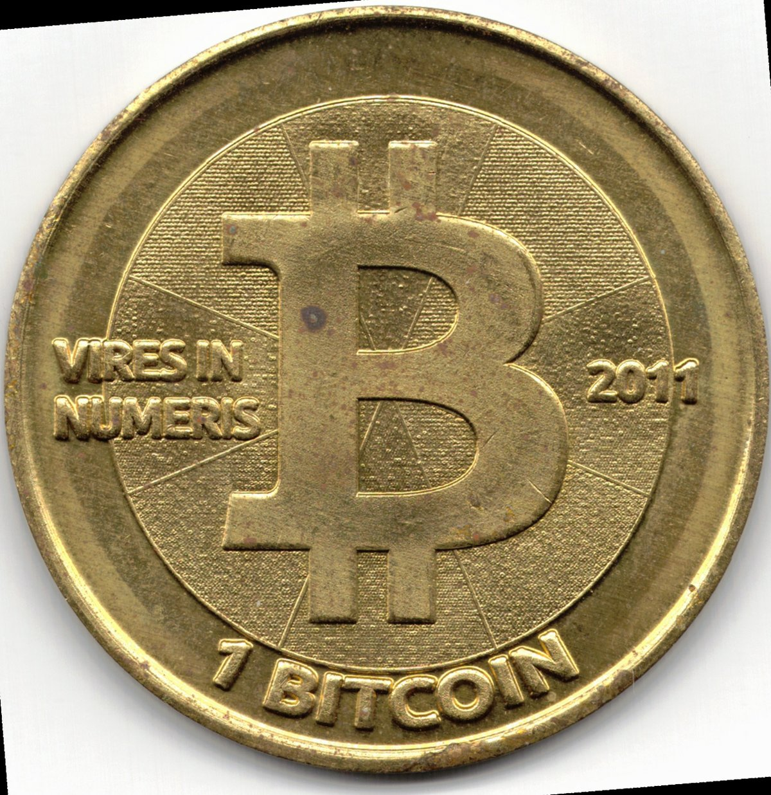
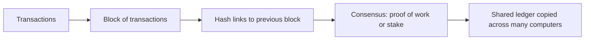

# Cryptoassets

**Prerequisites:** [Money and value](../../01-foundations/01-money-and-value.md), [What a security is](../../02-firms-and-capital/07-what-is-a-security.md).

*A 2011 Casascius physical token for bitcoin: the coin is only a holder for a digital key. Credit: Tiberiandusk. License: [CC BY-SA 4.0](https://creativecommons.org/licenses/by-sa/4.0). Source: [File:Physical Bitcoin 2011 Casascius 1 Bitcoin Coin Token.png](https://commons.wikimedia.org/wiki/File:Physical_Bitcoin_2011_Casascius_1_Bitcoin_Coin_Token.png).*

**Cryptoassets** are digital assets recorded on a **blockchain**, a shared ledger maintained by many computers using cryptography rather than by one trusted institution. The best known is Bitcoin. This lesson explains what they are, how to think about their value, and why regulators treat them with caution. It is education, not a recommendation to buy or avoid anything.

## What a blockchain is

A blockchain is a list of **blocks** of transactions, each linked to the previous one by a cryptographic hash, so that altering history would require redoing all subsequent work and be noticed. The network agrees on the order of transactions through a **consensus mechanism**:

- **Proof of work** (Bitcoin): participants ("miners") compete to solve a computational puzzle, spending energy; the winner adds the next block and is rewarded in new coins and fees.
- **Proof of stake** (Ethereum since 2022): validators lock up coins as collateral and are chosen to validate blocks; misbehaviour can be penalised.

The aim is to solve the **double-spending problem** of digital money without a central party.

## Bitcoin and others

An author or group using the name Satoshi Nakamoto published the Bitcoin white paper on 31 October 2008, in the middle of the financial crisis, and the network began on 3 January 2009. Its supply is capped by design at 21 million coins. Ethereum, launched in 2015, added programmable **smart contracts**, enabling applications such as decentralised finance (DeFi) and tokens. Thousands of other coins and tokens exist.

Types of cryptoassets:

- **Currencies / stores of value:** Bitcoin and similar.
- **Smart-contract platforms:** Ethereum and others.
- **Stablecoins:** tokens designed to hold a fixed value (such as one US dollar), supposedly backed by reserves; their safety depends on the quality of those reserves, and some have collapsed (for instance TerraUSD in 2022).
- **Utility and governance tokens, NFTs, and "meme coins".**

## Is it money, an asset or something else?

Bitcoin does not currently do the three jobs of money well (see [money and value](../../01-foundations/01-money-and-value.md)): prices are too volatile to be a stable unit of account, few merchants price goods in it, and it is mostly held as an investment. As an asset it has no cash flows (no dividends or interest), so it cannot be valued by [discounting](../../01-foundations/05-present-value-and-discounting.md); proponents compare it to "digital gold" or point to its fixed supply and network growth; sceptics call its price a pure belief-driven speculation. Value depends on what the next buyer will pay, which makes it prone to booms and busts (see [herding, bubbles and manias](../../07-behavioural-finance/04-herding-bubbles-and-manias.md)).

## Volatility and losses

Large declines are normal. Arithmetic matters: after a 50% fall you need a 100% gain to return to where you started. Bitcoin has experienced multiple drawdowns of more than 70% since 2011, along with large gains. Correlation with stocks has been variable and higher during stress, so as a "diversifier" its record is mixed. Position size, and the ability to bear a total loss, are central.

## Custody, fraud and failures

If you hold coins on an exchange, you rely on the exchange: there is generally no deposit insurance. If you hold your own coins, you must protect the **private key**; lose it and the coins are gone. Failures include:

- **Mt. Gox** (Tokyo), which collapsed in 2014 after losing a very large number of bitcoins.
- **QuadrigaCX** (Vancouver), which failed in 2019 when its founder died, leaving customers unable to access funds; hundreds of millions of Canadian dollars were owed to customers.
- **FTX**, once one of the largest exchanges, which filed for bankruptcy in November 2022; its founder was later convicted of fraud.

Scams are common: fake exchanges, "pig-butchering" romance investment frauds, rug pulls and impersonation. See [scams and common mistakes](../../09-personal-investing-canada/09-scams-and-common-mistakes.md). Many are unrecoverable because transactions on a blockchain cannot be reversed.

## Regulation

Rules are evolving. In Canada, the securities regulators require crypto trading platforms serving Canadians to register and meet conditions such as holding customers' assets in custody and restrictions on certain products. Canada approved the world's first spot Bitcoin ETFs in early 2021 (Purpose Bitcoin ETF, February 2021); US regulators approved spot Bitcoin ETFs in January 2024. Some tokens may count as **securities** under legal tests like the [Howey test](../../02-firms-and-capital/07-what-is-a-security.md). In Canada, the CRA treats cryptocurrency as a commodity for income tax purposes: gains and losses on disposal are generally taxed like other capital property, and trades between coins are taxable disposals; confirm current rules with the CRA. Also see [the SEC and US securities law](../../05-regulation/02-the-sec-and-us-securities-law.md) and [securities regulation in Canada](../../05-regulation/03-securities-regulation-in-canada.md).

## A framework for thinking

Ask of any investment: What produces its return? Who is on the other side? What would make it worth more or less? Can I lose everything? Can I get my money out? Who protects me if something goes wrong? For cryptoassets, the honest answers are often "the price depends on future demand," "unclear," "yes" and "not necessarily." That does not mean the technology is useless, but it means the burden of proof is high and position sizes should reflect that.

## Key ideas

- Cryptoassets are digital assets on blockchains secured by cryptography and consensus, rather than by a central institution.
- Most have no cash flows, so their value depends on future demand; volatility and deep drawdowns are normal.
- Custody, exchange failure and fraud are major risks; deposit insurance does not generally apply.
- Regulation is evolving; treat as high-risk and size positions so a total loss is survivable.

## Where this leads

- Next: [markets](../../04-markets/01-what-an-exchange-does.md) and how trading works, starting with what an exchange does.
- Related: [the SEC and US securities law](../../05-regulation/02-the-sec-and-us-securities-law.md), [herding, bubbles and manias](../../07-behavioural-finance/04-herding-bubbles-and-manias.md).
- Glossary: [[g:blockchain|blockchain]], [[g:bitcoin|Bitcoin]], [[g:stablecoin|stablecoin]], [[g:proof-of-work|proof of work]], [[g:proof-of-stake|proof of stake]], [[g:smart-contract|smart contract]], [[g:private-key|private key]], [[g:crypto-custody|custody]].
