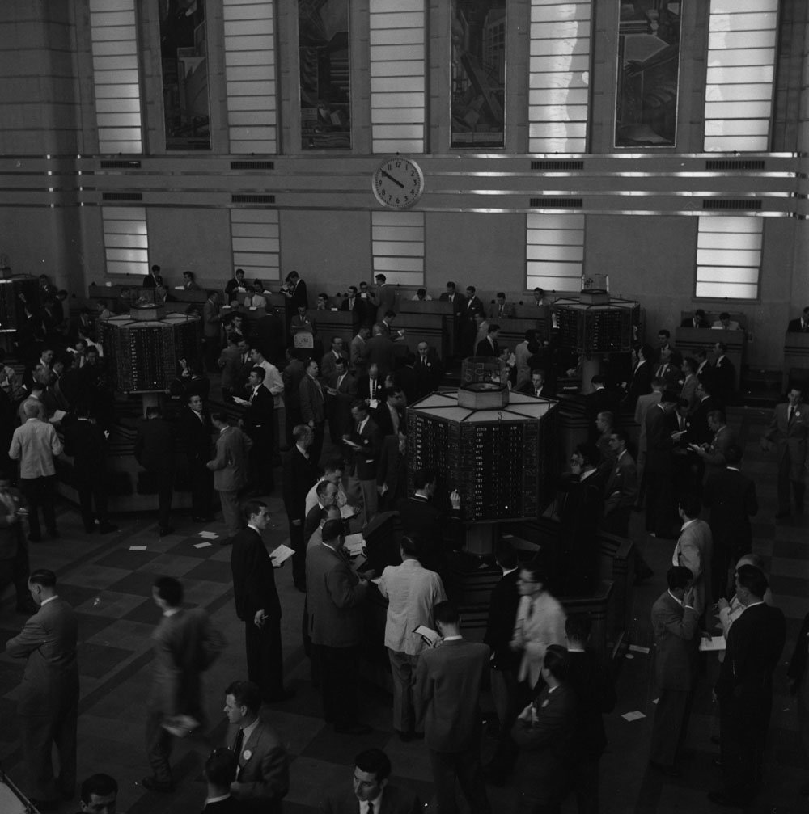
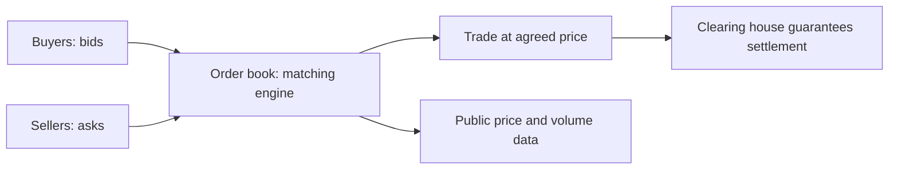

# What an exchange does

**Prerequisites:** [What a security is](../02-firms-and-capital/07-what-is-a-security.md), [Stocks](../03-securities/01-stocks/README.md).

*The floor of the Toronto Stock Exchange in 1956. Credit: Chris Lund. License: Public domain. Source: [File:Floor of Toronto Stock Exchange 1956.jpg](https://commons.wikimedia.org/wiki/File:Floor_of_Toronto_Stock_Exchange_1956.jpg).*

A **stock exchange** is an organised marketplace where buyers and sellers of securities meet under shared rules. It is not where companies are "kept"; it is a venue for trading claims that already exist, and, through the IPO, for creating new ones.

## What exchanges are for

1. **Liquidity:** a place where a security can be turned into cash quickly at a price close to the last one. See [liquidity](../01-foundations/01-money-and-value.md) in the foundations.
2. **Price discovery:** the continual interaction of buy and sell orders produces a visible price reflecting available information and opinions.
3. **Transparency:** published prices, volumes and quotes, allowing everyone to see what a security trades at.
4. **Trust and standards:** listing requirements (financial disclosure, governance, minimum size), trading rules and surveillance for manipulation.
5. **Capital raising:** companies can sell new shares to the public through the **primary market**, discussed in [IPOs](02-ipos-and-the-primary-market.md); subsequent trading is the **secondary market**.

## A brief history

The idea began with merchants trading shares of the Dutch East India Company in Amsterdam in the early 1600s; see [the Dutch East India Company and the first stock exchange](../08-history/02-the-dutch-east-india-company-and-the-first-stock-exchange.md). The New York Stock Exchange traces its origin to the Buttonwood Agreement of 1792. In Canada, the Toronto Stock Exchange was founded in 1861, and the Montreal Stock Exchange in 1874. Over time, exchanges were member-owned clubs (**mutuals**); since the 1990s and 2000s most have **demutualised** and become for-profit companies, some listed themselves. The NYSE went public in 2006 after merging with Archipelago, and TMX Group, parent of the Toronto Stock Exchange and the Montreal Exchange, began trading as a public company in 2008.

The 1971 launch of NASDAQ, a computerised quotation system, began the shift from trading floors to screens. Today most trading is electronic, matched by computers in data centres.

## How an exchange matches orders

Most modern exchanges run an **electronic limit order book**: a list of all outstanding buy orders (**bids**) and sell orders (**asks** or offers), sorted by price and, within a price, by the time received (**price-time priority**). A trade occurs when a buy price meets or exceeds a sell price. Participants are not contracting with each other directly: they trade via members (brokers), and a **clearing house** guarantees settlement; see [clearing and settlement](07-clearing-and-settlement.md).

Market sessions are usually open from 9:30 a.m. to 4 p.m. Eastern Time for the TSX and NYSE, preceded by pre-open and followed by extended-hours trading on some venues. An **opening and closing auction** collects orders and sets a single price to concentrate liquidity.

## Many venues

Trading is not limited to the main exchange. In both the US and Canada, securities can trade on several competing exchanges and on **alternative trading systems** (ATSs). **Dark pools** are venues that do not display orders before execution, used by institutions to avoid moving the price when trading large blocks. Rules require brokers to seek the best available price across venues: in the US, **Regulation NMS** (adopted 2005); in Canada, an **order protection rule** introduced in 2011. Competition has narrowed trading costs but fragmented the market.

## Listing

To list on an exchange, a company must meet the exchange's requirements and file a prospectus with the securities regulators. Canada has two main equity boards: the **Toronto Stock Exchange (TSX)** for established companies and the **TSX Venture Exchange (TSXV)** for smaller, earlier-stage ones, with lighter requirements and higher risk. There is also Cboe Canada, which took over the NEO Exchange, and others. Companies that fail to meet continuing requirements can be **delisted**, and delisting usually pushes the shares to less liquid over-the-counter trading.

## Beyond equities

Exchanges also list derivatives (the Montreal Exchange), ETFs, and in some jurisdictions bonds, though most bond trading takes place over the counter through dealers rather than on exchanges. The **over-the-counter (OTC)** market is a network of dealers trading directly; it handles bonds, currencies and many derivatives. See [brokers and dealers](03-brokers-and-dealers.md).

## Key ideas

- Exchanges provide liquidity, price discovery, transparency and standards.
- The primary market issues new securities; the secondary market trades existing ones.
- Most exchanges match orders electronically in a limit order book with price-time priority.
- Trading is spread across exchanges, alternative systems and dark pools, linked by best-price rules.

## Where this leads

- Next: [IPOs and the primary market](02-ipos-and-the-primary-market.md).
- Related: [bid, ask and market makers](05-bid-ask-and-market-makers.md), [securities regulation in Canada](../05-regulation/03-securities-regulation-in-canada.md).
- Glossary: [[g:stock-exchange|stock exchange]], [[g:limit-order-book|limit order book]], [[g:dark-pool|dark pool]], [[g:demutualization|demutualization]], [[g:over-the-counter|over-the-counter]], [[g:listing|listing]], [[g:price-discovery|price discovery]], [[g:tsx|TSX]].
