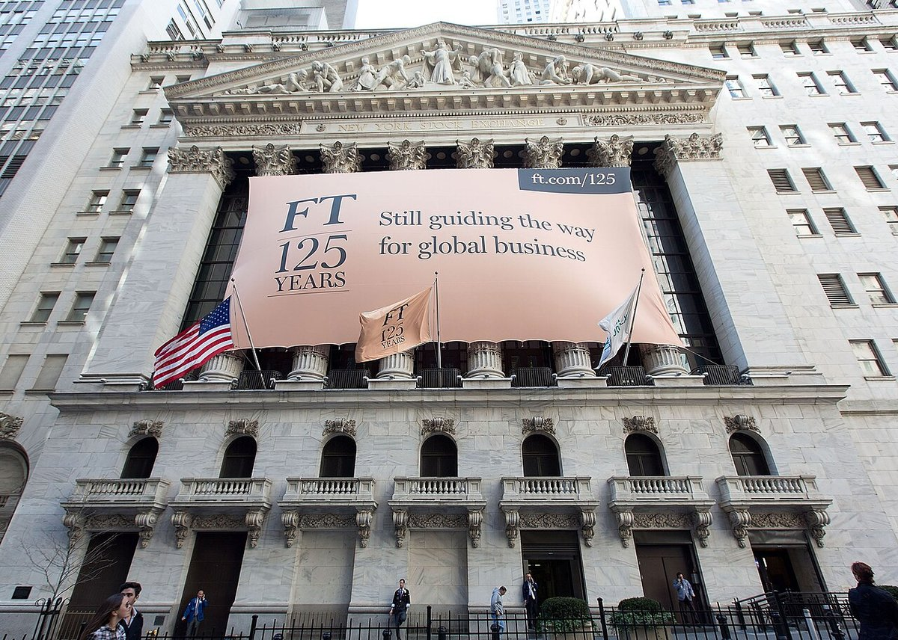
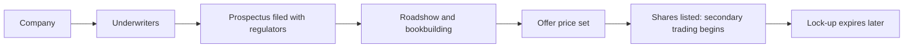

# IPOs and the primary market

**Prerequisites:** [What an exchange does](01-what-an-exchange-does.md), [Equity and debt](../02-firms-and-capital/03-equity-and-debt.md).

*Ringing the closing bell at the New York Stock Exchange. Credit: Financial Times. License: [CC BY 2.0](https://creativecommons.org/licenses/by/2.0). Source: [File:FT ringing the Closing Bell at the NYSE (8741695960).jpg](https://commons.wikimedia.org/wiki/File:FT_ringing_the_Closing_Bell_at_the_NYSE_(8741695960).jpg).*

An **initial public offering** (IPO) is the first time a company sells its shares to the general public. It is the best-known event in the **primary market**, where securities are created and the money goes to the *issuer* (the company), as opposed to the **secondary market**, where investors trade among themselves.

## Why go public

- **Raise capital** for growth, acquisitions or to repay debt.
- **Liquidity for early owners:** founders, employees and venture investors can sell shares.
- **Currency for acquisitions:** listed shares can be used to buy other companies.
- **Visibility and credibility.**

The costs: underwriting fees, legal and audit work, ongoing disclosure obligations, quarterly reporting pressure, loss of some control and the exposure of every number to competitors.

## How an IPO works

1. **Choose underwriters,** investment banks that guide the process, set the price, market the shares and often guarantee the sale (a "firm commitment").
2. **Prospectus:** a legal document describing the business, risks, finances, management and use of proceeds. In Canada, a preliminary prospectus is filed with provincial securities regulators through SEDAR+; in the US the filing is a registration statement with the SEC. It is liability-bearing: material misstatements lead to legal exposure.
3. **Roadshow and bookbuilding:** management pitches institutional investors, who indicate demand at various prices. The underwriters build a "book" of orders.
4. **Pricing:** the offer price is set the night before listing.
5. **Allocation:** shares are distributed, mostly to institutions. Retail investors often get small or no allocations.
6. **Listing and trading:** shares begin trading, and the opening price reveals demand.
7. **Stabilisation and lock-up:** underwriters may support the price for a time; insiders are typically **locked up**, barred from selling for about 180 days. Expiry of a lock-up often puts pressure on the price.

Example: Maple Bakery Ltd. has 20 million shares owned by the founders. It sells 5 million new shares at 20, raising 100 million before fees. The underwriters' spread is 7%, or 7 million, so net proceeds are 93 million. After the IPO there are 25 million shares: founders own 80% instead of 100%. This is **dilution** of ownership, offset by the larger firm value.

## Underpricing

On average, IPOs close their first day well above the offer price: studies of the US market find average first-day gains of about 15% to 20% over several decades, with much variation. If Maple Bakery's shares open at 24, the company has sold at 20 shares worth 24 on day one. The gap is **underpricing**, and the "money left on the table" is 5 million × 4 = 20 million. Explanations include compensation for institutional investors who reveal demand, the winner's curse (uninformed investors get the bad IPOs), legal protections for the underwriters and the benefits of strong aftermarket trading. Retail investors who buy at the first-day price, not the offer price, typically do worse: academic research on long-run performance (such as Jay Ritter's work) finds that IPO shares have tended to underperform comparable firms over several years.

## Alternatives to the traditional IPO

- **Dutch auction:** investors bid and all winning bidders pay the same clearing price. Google used a form of auction for its 2004 IPO.
- **Direct listing:** the company lists existing shares without raising new money, as Spotify did in 2018.
- **SPAC (special purpose acquisition company):** a "blank cheque" shell lists first with cash, then merges with a private company. SPACs boomed in 2020 and 2021 and many later performed poorly.
- **Private placements:** shares sold to a limited group of qualified investors without a public offering. In Canada, the *prospectus exemption* for **accredited investors** is common.

## Other primary-market events

- **Secondary (follow-on) offering:** a listed company issues more shares, which dilutes existing holders.
- **Rights offering:** existing holders are offered the right to buy new shares at a discount, pro rata.
- **Bond issues:** governments and companies sell debt in the primary market through dealers and auctions; see [government bonds](../03-securities/02-bonds/07-government-bonds.md).
- **Bought deal:** common in Canada, an underwriter commits to buy the whole issue immediately and then resells.

## Notable examples

Shopify listed on the TSX and NYSE in 2015. Facebook's May 2012 IPO priced at 38 a share and faced technical glitches on the Nasdaq and a fall below the offer price within days. Canada's IPO market is dominated by resource, financial and technology firms, with a long tradition of junior mining and energy listings on the TSX Venture Exchange.

## What should an investor think about IPOs?

IPOs are typically hyped, and the best-informed investors get the best allocations. For individuals, evidence suggests that buying IPOs after their first day adds no return advantage and often subtracts. A broad index fund, which owns newly listed firms once they are large enough to enter the index, gets exposure to successful IPOs without trying to pick them.

## Key ideas

- An IPO sells a company's shares to the public for the first time; proceeds go to the company in the primary market.
- Underwriters price the offering, build a book of demand, and take a fee (about 7% in the example).
- IPOs are on average underpriced, but the gains mostly go to those who receive allocations; later returns have tended to lag.
- Alternatives include auctions, direct listings, SPACs and private placements.

## Where this leads

- Next: [brokers and dealers](03-brokers-and-dealers.md).
- Related: [regulation and disclosure](../05-regulation/05-insider-trading-disclosure-and-fraud.md), [dot-com bubble](../08-history/10-the-dot-com-bubble.md).
- Glossary: [IPO](../glossary/markets/ipo.md), [underwriter](../glossary/markets/underwriter.md), [prospectus](../glossary/markets/prospectus.md), [dilution](../glossary/markets/dilution.md), [underpricing](../glossary/markets/underpricing.md), [lock-up](../glossary/markets/lock-up.md), [SPAC](../glossary/markets/spac.md), [bought deal](../glossary/markets/bought-deal.md).
