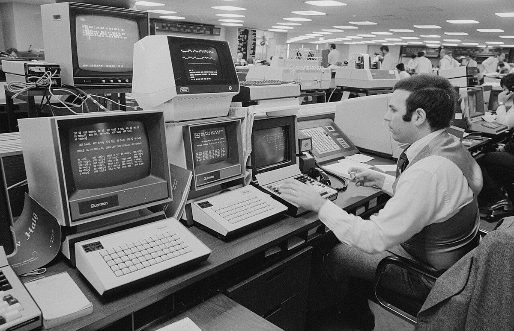
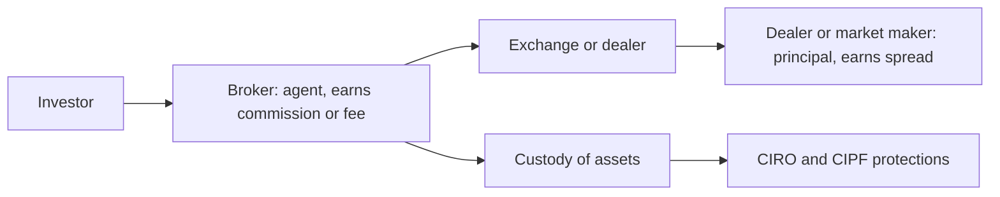

# Brokers and dealers

**Prerequisites:** [What an exchange does](01-what-an-exchange-does.md).

*A man working at a computer terminal of the Cincinnati National Market System at Merrill Lynch's main New York office, 1979. Credit: Thomas J. O'Halloran. License: Public domain. Source: [File:Merrill Lynch Quotron.jpg](https://commons.wikimedia.org/wiki/File:Merrill_Lynch_Quotron.jpg).*

Ordinary investors cannot send orders straight to an exchange: they need an intermediary that is a member. Two roles are often confused. A **broker** acts as an *agent* for a client, arranging a trade for a commission. A **dealer** acts as a *principal*, trading from its own inventory and earning the spread. Many firms do both and are called **broker-dealers**.

## Brokers

A broker takes your instruction ("buy 100 shares of X"), routes it to a venue, and confirms the trade. Brokers also hold your assets in **custody** in your account, keep records, issue statements and tax slips, and often provide research and advice. Types:

- **Full-service brokers:** an adviser provides advice, planning and research; fees are higher, usually commissions or a percentage of assets.
- **Discount or online brokers:** self-directed accounts with low or no commission; no advice. In Canada, investing without advice is called **order-execution-only** (OEO). Examples include the bank-owned platforms and independent firms such as Questrade and Wealthsimple.
- **Robo-advisors:** automated portfolio management, typically with ETFs and an annual fee.
- **Investment advisers / wealth managers:** manage portfolios on a discretionary basis.

## Dealers and market makers

A **dealer** quotes a price at which it will buy (the **bid**) and sell (the **ask**) and is paid by the difference; see [bid, ask and market makers](05-bid-ask-and-market-makers.md). Dealers dominate bond trading and foreign exchange. A **market maker** is a dealer who commits to continuously quoting two-sided prices in a security. An **investment bank** also underwrites new issues, advises on mergers and runs trading desks; see [IPOs](02-ipos-and-the-primary-market.md).

## How things changed

Until 1 May 1975 in the US, brokerage commissions were fixed by the exchanges' rules. "May Day" abolished fixed commissions, giving rise to discount brokers. In Canada, a series of deregulatory steps in the 1980s culminating in the Ontario "Big Bang" of 1987 allowed banks to buy brokerage firms, and bank-owned dealers became dominant. In the late 1990s online brokerages cut costs again. In the 2010s and especially from 2019, US brokers moved to zero commissions for stock trades, and Canadian firms followed with zero-commission offerings on at least some trades. The money has to come from somewhere, though.

## How "free" brokers earn money

- **Spreads and order routing:** in the US, many zero-commission brokers receive **payment for order flow** (PFOF) from market makers who execute retail trades. This practice is not generally permitted in Canada, where rules require brokers to focus on best execution.
- **Interest on cash balances** and **securities lending**, where the broker lends your shares to short sellers.
- **Currency conversion:** often a significant cost to Canadians buying US stocks.
- **Fund fees and subscriptions,** margin interest and premium services.

Always ask: how does this firm make money from me?

## Account types and services

- **Cash account:** you pay in full for purchases.
- **Margin account:** you can borrow against your holdings; see [short selling and margin](08-short-selling-and-margin.md).
- **Registered accounts:** TFSA, RRSP, FHSA and others are tax wrappers held at a broker; see [registered and non-registered accounts](../09-personal-investing-canada/02-registered-and-non-registered-accounts.md).

## Protections

A broker holds your securities in your name or "street name" (registered in its name on your behalf) and, in Canada, must segregate client assets and be a member of **CIRO**, the Canadian self-regulatory organisation, and of the **Canadian Investor Protection Fund** (CIPF), which covers losses if a member firm becomes insolvent; see [CIRO and investor protection](../05-regulation/04-ciro-and-investor-protection.md). In the US, the equivalent is SIPC. Neither covers losses from falling prices.

## Duties and conflicts

Different standards of conduct apply. In Canada, a **client-focused reforms** package, phased in by 2021, strengthened rules requiring registrants to put the client's interest first, address conflicts of interest and ensure suitability. Advisers paid by commission have a conflict: they may favour higher-fee products. Questions to ask any adviser: How are you paid? What are the total costs? Are you a fiduciary? Can I see it in writing?

## Key ideas

- Brokers act as agents for clients; dealers trade as principals from inventory; many firms are both.
- Choices include full-service, order-execution-only discount brokers, robo-advisors and discretionary managers.
- "Free" trading is paid for by spreads, currency conversion, interest and lending; in Canada payment for order flow is not generally permitted.
- CIRO regulates Canadian brokers and CIPF protects assets in a failure, not against market losses.

## Where this leads

- Next: [order types](04-order-types.md).
- Related: [costs, brokers and choosing a platform](../09-personal-investing-canada/08-costs-brokers-and-choosing-a-platform.md), [fees](../03-securities/03-funds/04-fees-and-the-cost-of-investing.md).
- Glossary: [broker](../glossary/markets/broker.md), [dealer](../glossary/markets/dealer.md), [market maker](../glossary/markets/market-maker.md), [investment bank](../glossary/markets/investment-bank.md), [order-execution-only](../glossary/markets/order-execution-only.md), [payment for order flow](../glossary/markets/payment-for-order-flow.md), [CIPF](../glossary/regulation/cipf.md), [CIRO](../glossary/regulation/ciro.md).
