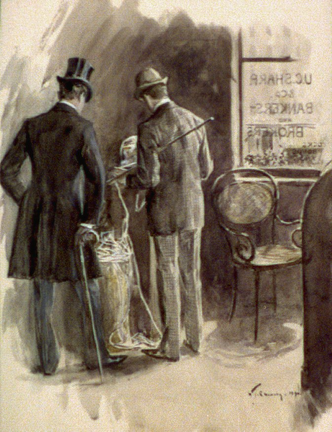
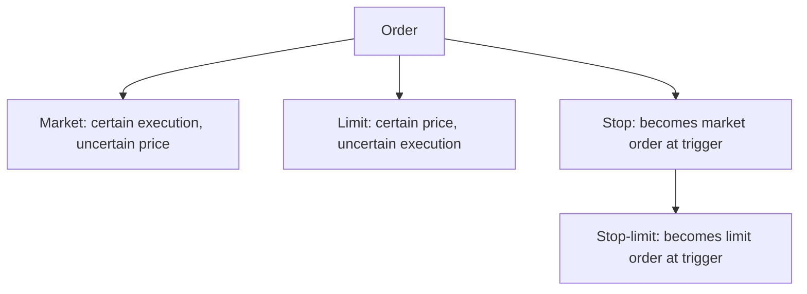

# Order types

**Prerequisites:** [What an exchange does](01-what-an-exchange-does.md), [Brokers and dealers](03-brokers-and-dealers.md).

*A broker reading ticker tape in 1894. Credit: William Thomas Smedley. License: Public domain. Source: [File:Ticker Tape Broker 1894.jpg](https://commons.wikimedia.org/wiki/File:Ticker_Tape_Broker_1894.jpg).*

When you trade, you do not just pick a security and a quantity: you also choose an **order type**, which controls how and at what price your order executes. The choice affects what you pay. The main trade-off is between **certainty of execution** and **certainty of price**: you cannot have both.

## Market orders

A **market order** says "buy or sell now at the best available price." It nearly always executes immediately, but the price is not guaranteed. In a liquid stock, the price will be close to the quote. In a thin one, it can be far.

Suppose the order book for a stock shows asks: 200 shares at 50.02, 200 at 50.03 and 300 at 50.05. You place a market buy for 500 shares. You fill 200 at 50.02, 200 at 50.03 and 100 at 50.05: an average of **50.03** instead of the quoted 50.02. The difference is **slippage**, here small, but larger for big orders in illiquid names, or during fast markets. In very fast markets the price you see may be stale by the time your order arrives.

## Limit orders

A **limit order** sets a price limit: a buy limit at 50.00 will fill at 50.00 or lower; a sell limit at 50.10 fills at 50.10 or higher. It guarantees the price but not the execution: if the market never reaches your limit, nothing happens. A limit order that is not immediately executable joins the order book and provides liquidity to others; a **marketable limit order** crosses the spread and executes at once, up to your limit. Using limit orders protects you from bad fills, especially in ETFs and small stocks, and in the first minutes after the open, when spreads are wide.

## Stop orders

A **stop order** (stop-loss) becomes a market order when the price touches a trigger. A sell stop at 45 on a stock bought at 50 will convert to a market sell if the stock trades at 45, aiming to limit losses. Drawbacks: in a gap down or crash the execution may be far below the stop (you sell at the next available prices), and in a brief sharp dip the stop can trigger and sell you out before a rebound. A **stop-limit order** triggers a limit order instead of a market order, which protects the price but may leave the order unfilled just when you most want out. A **trailing stop** moves its trigger up as the price rises, by a fixed amount or percent.

## Time in force

- **Day order:** expires at the end of the trading day.
- **Good-till-cancelled (GTC):** stays active until filled or cancelled, sometimes with a maximum duration.
- **Immediate-or-cancel (IOC):** fill what you can now, cancel the rest.
- **Fill-or-kill (FOK):** fill the entire order immediately or cancel.
- **On-open / on-close orders:** participate in the opening or closing auction.
- **All-or-none (AON):** fill the full quantity or nothing.

## Additional features

- **Iceberg or reserve orders** display only part of the full size, to avoid revealing a large order.
- **Algorithmic orders** split a large order into slices over time, like VWAP (volume-weighted average price) or TWAP (time-weighted); see [algorithmic and high-frequency trading](09-algorithmic-and-high-frequency-trading.md).
- **Bracket orders** attach a profit target and a stop to an entry order.

## Reading the quote

A quote shows the **bid** (highest buy price), the **ask** (lowest sell price), the sizes available at each, and the last trade price. A buyer pays the ask; a seller receives the bid. The last trade price is not necessarily what you will get.

## Choosing an order type

| Situation | Typical choice |
|---|---|
| Highly liquid large-cap stock, want to trade now | Market or marketable limit |
| ETF or small-cap stock | Limit order |
| Want a specific price and can wait | Limit, perhaps GTC |
| Want a trigger to exit | Stop or stop-limit (know the gap risk) |
| Large institutional order | Algorithm, iceberg, or negotiated block |

## Cautions

- **Bad data at the open or close:** quotes at the open can be erratic.
- **After-hours trading:** thin liquidity and wide spreads.
- **Fat-finger errors:** double check quantity and price; an extra zero is costly.
- **A stop is not insurance:** it is a conditional market order.

## Key ideas

- Market orders trade immediately at the best available price, which may include slippage.
- Limit orders fix the price but may not fill; they are the sensible default for ETFs and thinly traded stocks.
- Stop orders trigger market orders and can execute well below the stop in a gap.
- Time-in-force and special instructions control how long and in what form an order lives.

## Where this leads

- Next: [bid, ask and market makers](05-bid-ask-and-market-makers.md).
- Related: [exchange-traded funds](../03-securities/03-funds/02-exchange-traded-funds.md), [short selling and margin](08-short-selling-and-margin.md).
- Glossary: [market order](../glossary/markets/market-order.md), [limit order](../glossary/markets/limit-order.md), [stop order](../glossary/markets/stop-order.md), [slippage](../glossary/markets/slippage.md), [good-till-cancelled](../glossary/markets/good-till-cancelled.md), [VWAP](../glossary/markets/vwap.md).
