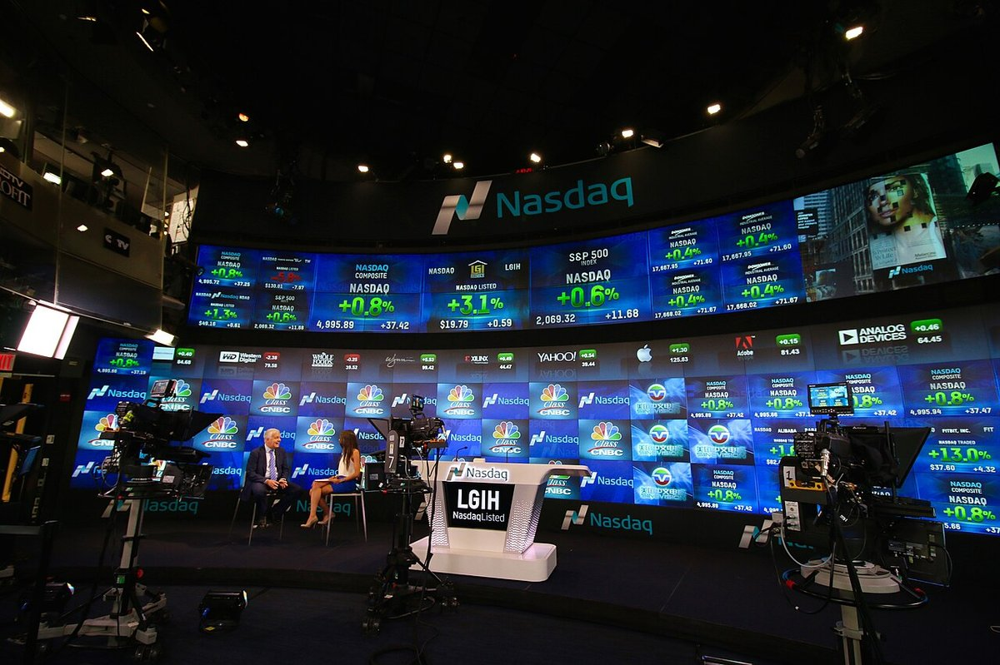
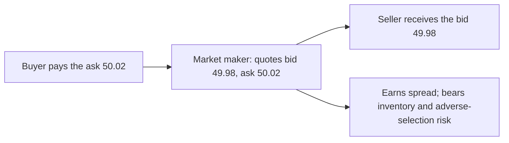

# Bid, ask and market makers

**Prerequisites:** [Order types](04-order-types.md).

*The Nasdaq MarketSite in Times Square, New York; Nasdaq was founded as a dealer market with competing market makers. Credit: Luca Marfè at Italia all'ONU. License: [CC BY 2.0](https://creativecommons.org/licenses/by/2.0). Source: [File:NASDAQ Market Site 201506.jpg](https://commons.wikimedia.org/wiki/File:NASDAQ_Market_Site_201506.jpg).*

Every security has two prices at any moment: the **bid**, the highest price someone will pay, and the **ask**, the lowest price someone will accept. The gap between them is the **bid-ask spread**, a cost every trader pays for immediacy. Behind it stand market makers, who stand ready to trade with anyone.

## The spread as a cost

Suppose a stock is quoted 49.98 bid, 50.02 ask: a spread of 0.04, or about 0.08% of the price (4 cents ÷ 50). If you buy at 50.02 and immediately sell at 49.98, you lose 4 cents per share: on 100 shares, 4.00 dollars. Small for one trade, but a trading strategy that turns over a portfolio frequently pays this repeatedly. For thinly traded stocks, small caps, some bonds and some ETFs, spreads can be 1% or more.

The **mid-price** is the average of bid and ask. The **effective spread** measures what you actually paid relative to the mid, including slippage. Transaction costs also include commissions, and the **market impact** of large orders.

## What market makers do

A **market maker** continuously quotes both a bid and an ask, buying from sellers and selling to buyers, and earns the spread. They provide **liquidity**: you can trade when you want, without waiting for a natural counterparty. On the NYSE this role was historically performed by **specialists** on the floor; now "designated market makers" and electronic firms do it. Dealer networks do the same in bonds and currencies.

The spread compensates them for three things:

1. **Order-processing costs:** the cost of technology, capital and regulatory compliance.
2. **Inventory risk:** after buying, they hold shares whose price might fall before they can sell.
3. **Adverse selection:** some counterparties know more than the market maker. If an informed trader buys, the price is likely to rise; the market maker loses to them. The spread must be wide enough that profits from uninformed traders offset those losses. The Glosten–Milgrom model (1985) formalised this idea.

Example: a market maker quotes 50.00 / 50.10. Over a day it buys 10,000 shares at 50.00 and sells 10,000 at 50.10, earning 0.10 × 10,000 = 1,000 dollars before costs. But if news arrives and the price drops to 49 while it holds inventory, it loses far more than a day's spread income. Market makers therefore adjust quotes in response to news, volatility and inventory, and widen spreads in uncertain times, which is why spreads balloon in crises such as March 2020.

## Tick size and competition

The **tick size** is the minimum price increment. The US moved from fractions to decimal pricing in 2001, and spreads shrank sharply; the minimum increment for most stocks is one cent. In Canada, decimal trading arrived in 1996. A tick that is large relative to a stock's price keeps the spread wide; a tiny tick narrows it but can make quotes flicker and reduce displayed depth. Competition among electronic market makers has driven spreads for liquid stocks to a single tick or less than a penny for the busiest.

## Liquidity is not constant

Liquidity has dimensions: **tightness** (a narrow spread), **depth** (size available at the quote) and **resilience** (how quickly prices recover after a large trade). It can vanish when needed most. During the "flash crash" of 6 May 2010, many electronic market makers withdrew, and some stocks briefly traded at absurd prices; see [algorithmic and high-frequency trading](09-algorithmic-and-high-frequency-trading.md). Liquidity risk is a real risk of bonds and illiquid funds.

## Practical consequences

- Prefer liquid securities; check the spread before you trade.
- Use [limit orders](04-order-types.md) so you do not pay more than you intend.
- Trade away from the open and close on volatile days.
- For ETFs, the spread is a cost to the extent of holding period: a long-term holder pays it twice (buying and selling) over decades, so it matters much less than the MER; an active trader pays it far more often. See [fees](../03-securities/03-funds/04-fees-and-the-cost-of-investing.md).

## Key ideas

- The bid is what buyers will pay; the ask is what sellers want; the spread is the cost of immediacy.
- Market makers quote both sides and earn the spread, compensating for processing costs, inventory risk and adverse selection.
- Tick size and competition determine how narrow spreads can be.
- Liquidity can disappear in stress, and spreads widen when uncertainty rises.

## Where this leads

- Next: [market indices](06-market-indices.md).
- Related: [exchange-traded funds](../03-securities/03-funds/02-exchange-traded-funds.md), [market crashes](../08-history/09-1987-ltcm-and-the-1990s-crises.md).
- Glossary: [bid-ask spread](../glossary/markets/bid-ask-spread.md), [bid](../glossary/markets/bid.md), [ask](../glossary/markets/ask.md), [market maker](../glossary/markets/market-maker.md), [adverse selection](../glossary/markets/adverse-selection.md), [tick size](../glossary/markets/tick-size.md), [market liquidity](../glossary/markets/market-liquidity.md).
