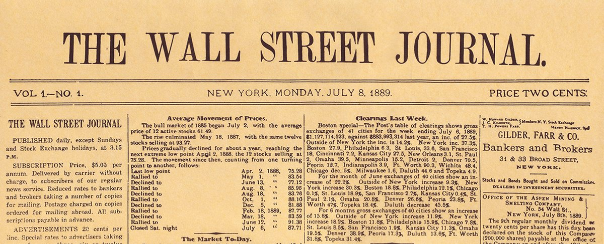
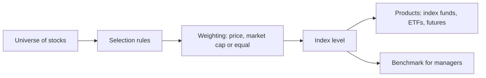

# Market indices

**Prerequisites:** [What an exchange does](01-what-an-exchange-does.md), [Stocks](../03-securities/01-stocks/README.md).

*Front page of The Wall Street Journal, 8 July 1889, the paper first published by Dow Jones & Company. Credit: WSJ. License: Public domain. Source: [File:WSJ July 8 1889 front.jpg](https://commons.wikimedia.org/wiki/File:WSJ_July_8_1889_front.jpg).*

A **market index** is a number that summarises the price movement of a group of securities, a thermometer for the market. When a newsreader says "the market fell 2% today", they mean an index. Indexes also serve as benchmarks for managers and as the basis of [index funds](../03-securities/03-funds/03-index-funds.md), ETFs and derivatives.

## Famous indices

- **Dow Jones Industrial Average (DJIA):** created by Charles Dow in 1896 with 12 stocks, now 30 large US companies. It is **price-weighted**.
- **S&P 500:** about 500 large US companies, in its modern form since 1957, **market-capitalisation weighted**, and selected by a committee with eligibility rules, so it is not simply "the 500 largest".
- **Nasdaq Composite:** all stocks on the Nasdaq exchange, heavy in technology.
- **S&P/TSX Composite:** Canada's main benchmark, covering most of the TSX by market value; the earlier TSE 300 was renamed in 2002. It has heavy weights in financials, energy and materials, and a growing technology weight. The **S&P/TSX 60** covers 60 large Canadian firms.
- **MSCI World, MSCI EAFE, MSCI Emerging Markets, FTSE Global All Cap:** global benchmarks.
- **Bond indices:** such as the FTSE Canada Universe Bond Index and the Bloomberg Global Aggregate.

## How an index is built

Three choices define an index: **which securities** (the universe and selection rules), **how to weight them**, and **when to rebalance** (reconstitute).

### Weighting methods compared

Take three stocks. Prices and shares outstanding on day 1:

| Stock | Price | Shares | Market cap |
|---|---|---|---|
| A | 100 | 10 | 1,000 |
| B | 50 | 100 | 5,000 |
| C | 20 | 500 | 10,000 |

On day 2, A rises 10% to 110, B falls 5% to 47.50, and C rises 2% to 20.40.

- **Price-weighted** (like the Dow): sum of prices ÷ divisor. Prices sum from 170 to 177.9: **+4.65%**. Stock A, with the highest price, dominates though it is the smallest company; a stock split changes its weight, which is why the Dow uses an adjusted divisor.
- **Market-cap weighted** (like the S&P 500): total market value goes from 16,000 to 1,100 + 4,750 + 10,200 = 16,050: **+0.31%**. Big companies matter most; the index reflects what a buy-and-hold owner of the whole market earns.
- **Equal-weighted:** simple average of returns (10% − 5% + 2%) ÷ 3 = **+2.33%**. Gives small companies the same say as large ones, and requires frequent rebalancing.

The same three stocks produce three index moves because the weighting is different. Capitalisation weighting is dominant because it is passive: it needs no trading when prices move, and it matches the aggregate investor's holdings. Many indices use **free-float** adjustment, counting only shares available to public investors, not those held by insiders or governments.

## Price index versus total return

A **price index** tracks only price changes. A **total return index** assumes dividends are reinvested. Over decades the difference is large: dividends have contributed a substantial portion of historical stock returns. When you compare a fund's performance with an index, use the total return version. See [compound interest](../01-foundations/03-simple-and-compound-interest.md).

## Reading index levels

An index level, such as 5,000, has no meaning by itself; only changes matter. Percent changes are comparable; points are not. A 500 point move means little unless you know the starting level. Long-run charts should use a **log scale** so equal percentage moves look equal, and **real** (inflation-adjusted) levels, which show that nominal highs may mask years of lost purchasing power; see [inflation and real returns](../01-foundations/07-inflation-and-real-returns.md).

## Uses and limits

- **Benchmarks:** to judge a manager, compare with the index in the same asset class.
- **Basis for products:** index funds, ETFs, futures and options.
- **Economic signal:** indices are leading indicators of sentiment, not the economy: stock markets can rise during recessions and fall in growth.
- **Limits:** survivorship bias (failed companies leave the index, so historical index returns reflect the "winners"), concentration (a few firms can dominate cap-weighted indices), and the inclusion effect: stocks added to the S&P 500 have historically often risen as index funds buy.

## Key ideas

- An index summarises the performance of a basket of securities; construction (selection, weighting, rebalancing) drives results.
- Price weighting, capitalisation weighting and equal weighting give very different results from the same stocks.
- Compare funds with total return indices; read index changes in percent, ideally in real terms.
- Cap-weighted indices can become concentrated and suffer survivorship bias in the historical record.

## Where this leads

- Next: [clearing and settlement](07-clearing-and-settlement.md).
- Related: [index funds](../03-securities/03-funds/03-index-funds.md), [active versus passive investing](../06-portfolio-theory/05-active-versus-passive-investing.md).
- Glossary: [[g:market-index|market index]], [[g:price-weighted|price-weighted]], [[g:cap-weighted|cap-weighted]], [[g:free-float|free float]], [[g:total-return|total return]], [[g:benchmark|benchmark]], [[g:survivorship-bias|survivorship bias]].
