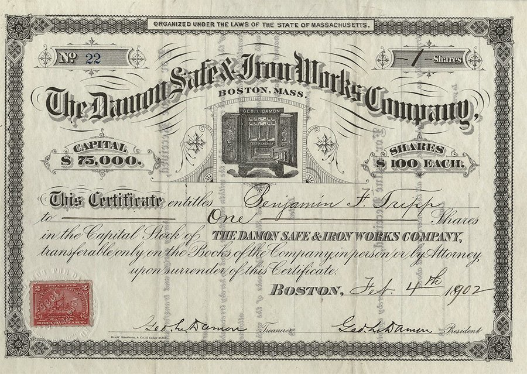
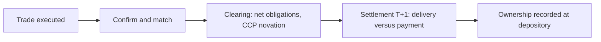

# Clearing and settlement

**Prerequisites:** [What an exchange does](01-what-an-exchange-does.md), [Brokers and dealers](03-brokers-and-dealers.md).

*A paper stock certificate; physical delivery of such certificates once made settlement slow and error-prone. Credit: The Damon Safe &amp; Iron Works Company. License: Public domain. Source: [File:The Damon Safe & Iron Works Company Stock Certificate.jpg](https://commons.wikimedia.org/wiki/File:The_Damon_Safe_&_Iron_Works_Company_Stock_Certificate.jpg).*

A trade on screen is only a promise. The cash must reach the seller and the shares the buyer. The steps that make that happen, mostly invisible to investors, are **clearing** and **settlement**. They matter because failure here is what turns one firm's trouble into the market's.

## The steps

1. **Execution:** the trade is agreed on an exchange or with a dealer.
2. **Confirmation and affirmation:** the details (security, quantity, price, parties) are matched.
3. **Clearing:** the trade is netted and the obligations calculated. Participants' many trades in one security are netted into one amount owed or due.
4. **Settlement:** the securities are delivered and cash paid, and ownership is recorded.

**Delivery versus payment (DvP)** ensures that securities move only if cash moves, so no one hands over one leg without receiving the other.

## The settlement cycle

The time between trade date (T) and settlement is "T+n". A standard cycle used to be five business days (T+5), then three (T+3 from 1995 in the US), then two (T+2 in the US from 2017). In **May 2024**, Canada and the US moved to **T+1**: a stock trade on Monday settles on Tuesday. Shorter settlement cuts the time risk is outstanding and the collateral needed, but compresses operations and funding for foreign investors, such as those converting currencies. Some markets have begun to trial faster cycles, and fully instant settlement using blockchain-style technology is also being explored.

Example: you buy 100 shares at 50 on Monday. Your broker shows the shares in your account right away, but legally the trade settles on Tuesday: 5,000 leaves your account and 100 shares are recorded as yours. If you sell on Tuesday, you can generally do so before the cash is fully "settled" at many brokers, which is why a **cash account** has rules on "good faith violations".

## Who does the work

- **Central securities depositories (CSDs)** hold securities in electronic form and record ownership changes. In Canada this is **CDS Clearing and Depository Services**, part of TMX Group. In the US, the **Depository Trust Company (DTC)**, part of **DTCC**.
- **Central counterparties (CCPs)** step between buyer and seller through **novation**: the original contract is replaced by two contracts, one with each side and the CCP. The CCP guarantees performance even if one side defaults. In Canada, **CDCC** (Canadian Derivatives Clearing Corporation) clears Montreal Exchange derivatives; CDS clears equity trades. In the US the **NSCC** nets equity trades.
- **Custodians and brokers** keep records for investors.

Most shares are held in **street name**: the registered owner is your broker (or its depository nominee), not you, and the broker holds an entry for you. This **book-entry** system replaced paper certificates, and made modern volumes possible.

## Why the plumbing matters: the paperwork crisis

In 1967 to 1970, rising US trading volume overwhelmed brokers' manual back offices. Unmatched trades and lost certificates piled up; the NYSE shortened trading hours and closed on Wednesdays from mid-1968 to catch up, and many firms failed. The crisis led to the Securities Investor Protection Act of 1970 (SIPC) and to the creation of central depositories.

## Risks managed by clearing

- **Counterparty (credit) risk:** one party fails to deliver. A CCP mitigates it by requiring **margin** and a **default fund** contributed by members.
- **Settlement risk:** one side delivers but does not receive. DvP removes that.
- **Operational risk:** errors, outages, cyber attacks.
- **Liquidity risk:** needing cash on short notice to meet margin calls.

Margin requirements can jump when volatility spikes; in January 2021 clearing margin demands on brokers forced some to restrict trading in heavily shorted "meme" stocks such as GameStop. Clearing houses are themselves "too important to fail", which is why regulators supervise them closely. After 2008, many derivative trades were required to be cleared through CCPs; see [swaps and credit derivatives](../03-securities/04-derivatives/06-swaps-and-credit-derivatives.md).

## What it means for you

As an investor you rarely deal with clearing, but it explains: why a sale's proceeds are available after a day or so; why your broker may hold shares in street name; why a settlement date, not just a trade date, matters for **dividends** (the **ex-dividend date** is the first day on which a buyer no longer receives the declared dividend, because the trade will not settle in time for the buyer to be on the shareholder register at the record date); and why CIPF and SIPC exist: see [CIRO and investor protection](../05-regulation/04-ciro-and-investor-protection.md).

## Key ideas

- Clearing nets and guarantees obligations; settlement exchanges securities for cash, usually at T+1 in Canada and the US since May 2024.
- Central counterparties and depositories reduce counterparty and settlement risk.
- Most investors hold shares in street name through book-entry records.
- Poor plumbing can threaten markets, as in the 1960s paperwork crisis.

## Where this leads

- Next: [short selling and margin](08-short-selling-and-margin.md).
- Related: [the ex-dividend date](../03-securities/01-stocks/03-dividends.md), [regulation](../05-regulation/01-why-markets-are-regulated.md).
- Glossary: [clearing](../glossary/markets/clearing.md), [settlement](../glossary/markets/settlement.md), [central counterparty](../glossary/markets/central-counterparty.md), [novation](../glossary/markets/novation.md), [delivery versus payment](../glossary/markets/delivery-versus-payment.md), [street name](../glossary/markets/street-name.md), [CDS Clearing](../glossary/markets/cds-clearing.md), [depository](../glossary/markets/depository.md).
