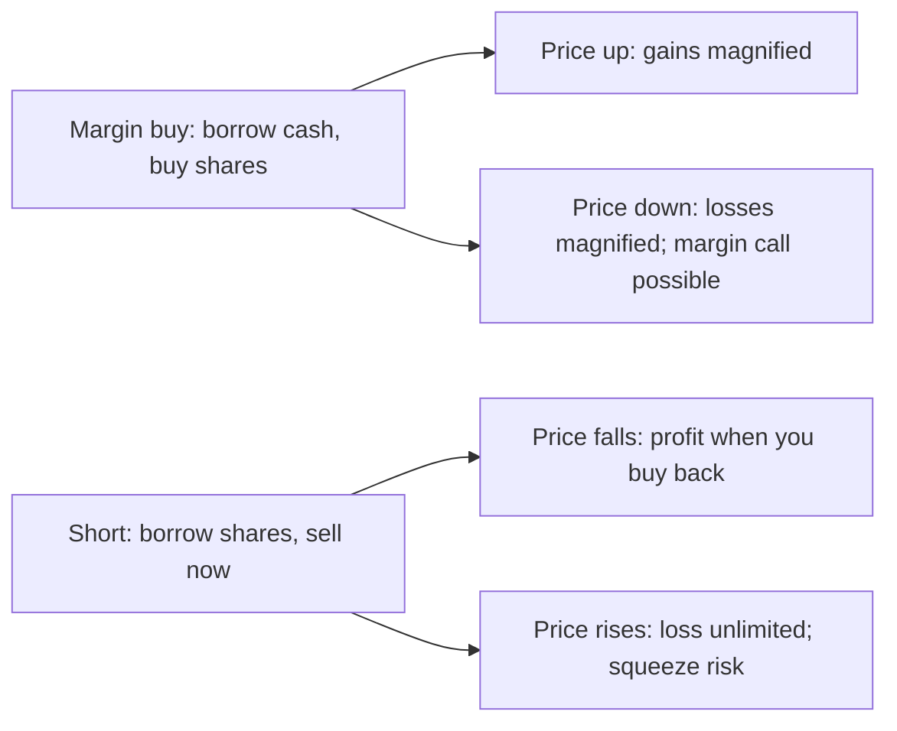

# Short selling and margin

**Prerequisites:** [Order types](04-order-types.md), [Clearing and settlement](07-clearing-and-settlement.md), [Risk and return](../01-foundations/10-risk-and-return.md).

*Jesse Livermore, the speculator famous for short selling around the 1907 and 1929 market falls. Credit: Unknown authorUnknown author. License: Public domain. Source: [File:Jesse Livermore (c. 1923).jpg](https://commons.wikimedia.org/wiki/File:Jesse_Livermore_(c._1923).jpg).*

Two practices let investors take positions larger than their cash, or bet against a price: **margin** (borrowing money to buy) and **short selling** (borrowing shares to sell). Both are forms of leverage and both can produce losses larger than the original investment.

## Buying on margin

A **margin account** lets you borrow from your broker against the securities in the account, which serve as collateral. You pay **margin interest** on the loan.

Example: you have 25,000 and want to buy 1,000 shares at 50 (50,000). You borrow 25,000. In the US, Regulation T sets an initial margin of 50%; Canadian brokers apply rules set by CIRO, which vary by security.

| Share price | Position value | Loan | Your equity | Equity % | Return on your 25,000 |
|---|---|---|---|---|---|
| 50 | 50,000 | 25,000 | 25,000 | 50% | 0% |
| 60 | 60,000 | 25,000 | 35,000 | 58% | +40% |
| 40 | 40,000 | 25,000 | 15,000 | 37.5% | −40% |
| 35 | 35,000 | 25,000 | 10,000 | 28.6% | −60% |

A 20% price move produces a 40% change in your equity. Interest on the loan is extra cost, which means the stock must rise by more than the interest rate just to break even.

A **margin call** happens if your equity falls below the **maintenance margin**, for instance 25% of the position's value. Here, equity ÷ value = (P × 1,000 − 25,000) ÷ (P × 1,000) falls to 25% when the price is 33.33. Below that you must add cash or securities, or the broker will sell your holdings, often at the worst moment and without asking, since the loan agreement allows it. Forced selling in a falling market can lock in losses and drive prices lower: a feedback loop seen in 1929 and 2008.

## Short selling

To **short** a stock, you borrow shares from a broker (who sources them from other clients' accounts or institutions), sell them now at the market price, and later buy them back (**cover**) and return them. If the price fell in the meantime, you keep the difference.

Example: short 100 shares at 50 (receive 5,000 in proceeds, which stay as collateral).

- If the price falls to 40, you buy back for 4,000: profit **1,000**.
- If the price rises to 70, you buy back for 7,000: loss **2,000**.

A long position can lose at most 100% of the investment (the price goes to zero), but a short loses without limit as the price climbs. You also pay a **borrowing fee** (small for easy-to-borrow shares, very high for scarce ones) and must make payments equal to any dividends. If the lender recalls the shares, you may be forced to close.

A **short squeeze** occurs when rising prices force short sellers to cover, which means buying, which pushes prices higher still. In January 2021, GameStop shares rose many times over in days as retail traders and short covering fed each other; some hedge funds took large losses.

## Why short selling exists

- **Price discovery:** short sellers bring negative information into prices and may help expose overvaluation and fraud, as with Enron in 2001.
- **Liquidity:** short sellers make markets more liquid.
- **Hedging:** a fund can offset market exposure (as in A. W. Jones's original hedge fund: see [hedge funds](../03-securities/03-funds/05-hedge-funds-private-equity-and-closed-end-funds.md)).
- **Arbitrage** between related securities.

Critics argue shorting can drive down prices through rumours and "bear raids". Regulators have sometimes restricted it: in September 2008, the SEC banned short selling of many financial stocks temporarily, and in 2020 several European countries imposed short bans. Evidence on whether such bans help is mixed, with research finding they reduce liquidity without clearly preventing declines. Rules aim to curb **naked shorting** (selling without borrowing) and require reporting of large short positions.

## Short ETFs and inverse products

For people who do not wish to short directly, inverse ETFs aim for the opposite of an index's daily return; see [exchange-traded funds](../03-securities/03-funds/02-exchange-traded-funds.md) for the compounding caveat. Options (a purchased put) offer a capped loss alternative; see [option payoffs](../03-securities/04-derivatives/04-option-payoffs-and-strategies.md).

## Should individuals use leverage?

Leverage turns a modest investment into a risk of ruin. Even when a position is right in the long run, it may be liquidated during a temporary drop. Most advisers suggest that investors with long horizons and limited experience avoid margin and shorting; the point of this lesson is to understand the mechanics and risks, including why they magnify [volatility](../01-foundations/09-variance-and-standard-deviation.md).

## Key ideas

- Margin means borrowing against your portfolio; gains and losses are magnified, and a margin call forces you to add money or sell.
- Short selling profits from falling prices but has unlimited loss potential, borrowing costs and squeeze risk.
- Shorting supports price discovery and liquidity; regulators monitor and sometimes restrict it.
- Leverage can produce losses larger than invested capital and needs strict risk limits.

## Where this leads

- Next: [algorithmic and high-frequency trading](09-algorithmic-and-high-frequency-trading.md).
- Related: [behavioural finance and overconfidence](../07-behavioural-finance/03-overconfidence-and-other-biases.md), [the crash of 1929](../08-history/07-the-crash-of-1929-and-the-great-depression.md).
- Glossary: [margin account](../glossary/markets/margin-account.md), [margin call](../glossary/markets/margin-call.md), [maintenance margin](../glossary/markets/maintenance-margin.md), [short selling](../glossary/markets/short-selling.md), [short squeeze](../glossary/markets/short-squeeze.md), [leverage](../glossary/firms-and-accounting/leverage.md), [naked shorting](../glossary/markets/naked-shorting.md).
