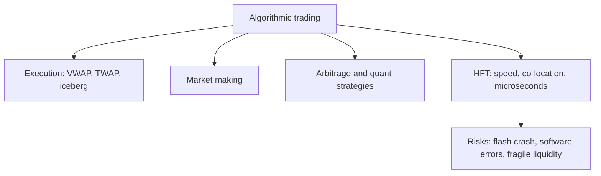

# Algorithmic and high-frequency trading

**Prerequisites:** [Order types](04-order-types.md), [Bid, ask and market makers](05-bid-ask-and-market-makers.md).

*Optical fibre cable: high-frequency traders compete on the speed of data links. Credit: Syced. License: [CC0](http://creativecommons.org/publicdomain/zero/1.0/deed.en). Source: [File:Fujikura optic fiber at Science Museum.jpg](https://commons.wikimedia.org/wiki/File:Fujikura_optic_fiber_at_Science_Museum.jpg).*

Most of today's trading is carried out not by people shouting in pits, but by computer programs. **Algorithmic trading** uses rules coded in software to decide when, how and how much to trade. **High-frequency trading (HFT)** is a subset in which speed, measured in microseconds, is central.

## From floors to servers

Until the 1990s, trading was done by people on floors and over the phone. Electronic exchanges and decimal pricing made automated strategies viable, and regulations promoting competition among venues (Regulation NMS in the US, 2005) multiplied the number of places to trade. By the 2010s algorithms accounted for the majority of US equity volume. Today's exchanges place their matching engines in data centres, and firms rent rack space next to them (**co-location**) to cut milliseconds. In 2010, a company built a straight fibre cable between Chicago and New Jersey to shave a few milliseconds off the route, and microwave networks soon beat that.

## What algorithms do

1. **Execution algorithms:** institutions (pension funds, mutual funds) split large orders into small pieces to reduce market impact: **VWAP** (follow the day's volume pattern), **TWAP** (spread evenly in time), **implementation shortfall** (minimise cost relative to the decision price), and **iceberg** orders.
2. **Market making:** electronic firms quote bids and asks at thousands of securities and adjust within microseconds, earning the spread; see [bid, ask and market makers](05-bid-ask-and-market-makers.md).
3. **Arbitrage:** exploiting small price gaps between related securities, such as an ETF and its holdings, or the same stock on different venues.
4. **Statistical and quantitative strategies:** models seeking patterns in prices or data, at various speeds.
5. **Momentum ignition, spoofing and layering:** manipulative practices which are illegal: placing orders with intent to cancel to mislead others. Regulators have prosecuted such cases.

## Benefits

- **Narrower spreads and lower costs:** research has generally found that bid-ask spreads fell as electronic trading and competition grew, benefiting retail and institutional investors.
- **Faster price adjustment** and more consistent pricing across venues.
- **Lower commissions** from automation.

## Concerns

- **Fragile liquidity:** liquidity providers can withdraw at once under stress.
- **Fairness and the speed race:** Michael Lewis's 2014 book *Flash Boys* popularised the claim that fast traders exploit slower ones by seeing orders first; economists debate its size, and many studies find the net effect on ordinary investors modest or positive for small orders.
- **Systemic risk:** many algorithms reacting to the same signals can amplify moves.
- **Operational risk:** a software error can lose a fortune in minutes.

## Two episodes

**The Flash Crash, 6 May 2010.** In the afternoon, a very large automated sell order in E-mini S&P 500 futures, executed by an algorithm tied to trading volume, coincided with falling liquidity. The Dow fell about 1,000 points (around 9%) within minutes and recovered much of it within about 36 minutes. Some stocks briefly traded at one cent or 100,000 dollars a share. The SEC and CFTC investigated, and market structure reforms followed: **limit up-limit down** price bands for individual stocks (2012) and updated **market-wide circuit breakers** that halt trading after declines of 7%, 13% and 20% in the S&P 500.

**Knight Capital, 1 August 2012.** A software deployment error caused the firm's systems to send unintended orders in about 150 stocks for roughly 45 minutes, losing around 440 million dollars, more than the firm's capital; it needed a rescue and was acquired within months.

## Canada

Canadian markets have the same structure: multiple venues, co-location and algorithmic trading, with regulators (CIRO and the provincial commissions) rules on order handling and market integrity. In Canada, alternative venues have experimented with "speed bumps" intended to reduce latency advantages. Retail investors seldom see HFT directly; what they see is the spread.

## What it means for investors

For a long-term buy-and-hold investor, HFT is mostly a background factor: ensure you use limit orders, avoid placing market orders at the open and in turbulent moments, and do not mistake short-term noise for information. The risk is not that algorithms "beat" you every time, but that liquidity can be thin and prices briefly irrational when markets are stressed.

## Key ideas

- Algorithms now execute most trades: some to split large orders, some to make markets, some to arbitrage.
- Benefits include narrower spreads and lower costs; concerns are fragile liquidity, fairness and systemic and operational risk.
- The 2010 flash crash and the 2012 Knight Capital loss led to circuit breakers and other safeguards.
- Long-term investors should use limit orders and avoid trading at the open and during stress.

## Where this leads

- Next: [regulation](../05-regulation/01-why-markets-are-regulated.md).
- Related: [market crashes of the past](../08-history/09-1987-ltcm-and-the-1990s-crises.md), [market microstructure and regulation in Canada](../05-regulation/03-securities-regulation-in-canada.md).
- Glossary: [algorithmic trading](../glossary/markets/algorithmic-trading.md), [high-frequency trading](../glossary/markets/high-frequency-trading.md), [co-location](../glossary/markets/co-location.md), [flash crash](../glossary/markets/flash-crash.md), [circuit breaker](../glossary/markets/circuit-breaker.md), [spoofing](../glossary/markets/spoofing.md), [market impact](../glossary/markets/market-impact.md).
