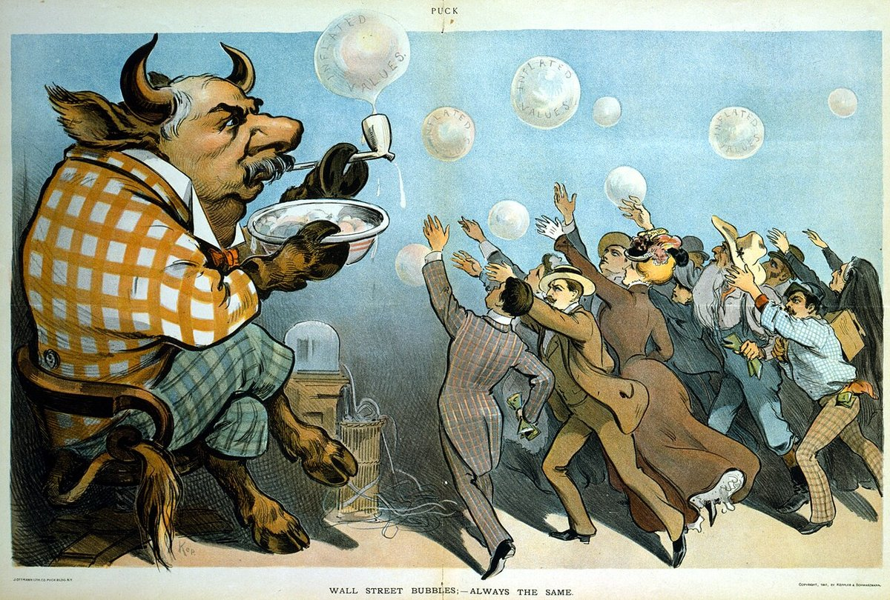
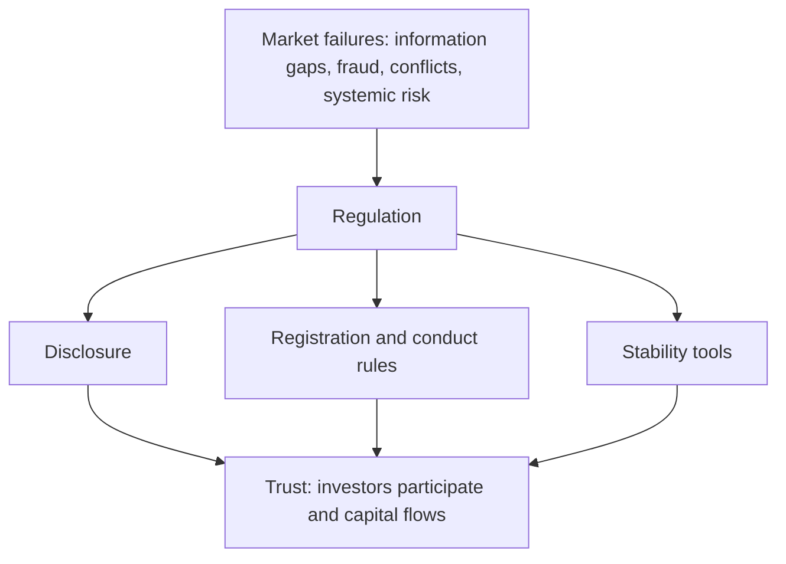

# Why markets are regulated

**Prerequisites:** [What an exchange does](../04-markets/01-what-an-exchange-does.md), [What a security is](../02-firms-and-capital/07-what-is-a-security.md).

*'Wall Street bubbles – Always the same', a 1901 cartoon by Udo Keppler showing J. P. Morgan as a bull blowing bubbles labelled 'inflated values'. Credit: Udo Keppler. License: Public domain. Source: [File:Wall Street bubbles - Always the same - Keppler 1901.jpg](https://commons.wikimedia.org/wiki/File:Wall_Street_bubbles_-_Always_the_same_-_Keppler_1901.jpg).*

A market for used cars, shares or loans works only if buyers believe they will not be cheated. Left alone, markets can fail in particular predictable ways, and securities markets, where the buyer usually cannot inspect the product, are especially exposed. Regulation is society's answer, and its design is a trade-off: protection against fraud, versus the cost of rules and the risk of stifling useful activity.

## The case for regulation

1. **Information asymmetry.** Company managers know more about the firm than outside investors. George Akerlof's 1970 paper "The Market for 'Lemons'" showed how this can destroy a market: if buyers cannot tell good products from bad, they will pay only an average price. Example: half of the used cars are good (worth 10,000) and half are lemons (worth 4,000). Buyers, unable to tell which is which, offer the average of 7,000. Owners of good cars will not sell at that price, so good ones leave the market, and the average quality and price fall further. Mandatory **disclosure** and audited accounts address this problem for securities.
2. **Fraud and manipulation.** Where money changes hands on promises, some will lie: Ponzi schemes, which pay earlier investors from later investors' money, are named after Charles Ponzi's 1920 scheme in Boston; "pump-and-dump" schemes inflate a cheap stock with false hype and sell out. Example: someone buys 1 million shares at 10 cents (100,000), promotes the stock until it reaches 1.00 and sells for 1,000,000, leaving buyers holding the loss.
3. **Conflicts of interest.** Advisers, underwriters and analysts may have incentives that differ from the clients'.
4. **Externalities and systemic risk.** The failure of one big bank or broker can cascade, harming people who were not parties to its dealings; the 2008 crisis is the example. See [the 2008 financial crisis](../08-history/11-the-2008-financial-crisis.md).
5. **Unequal sophistication.** Households are poorly placed to evaluate complex products, so rules require suitability and plain-language disclosure.
6. **Public goods:** reliable accounting standards, clear property rights and market integrity benefit everyone.

## What regulation does

| Objective | Tools |
|---|---|
| Investor protection | Disclosure, registration of advisers and brokers, suitability and best-interest rules, complaint handling |
| Fair, orderly markets | Rules against insider trading and manipulation, trading venue rules, surveillance |
| Financial stability | Capital and liquidity requirements for banks, clearing of derivatives, central bank liquidity support |
| Confidence and efficiency | Standardised accounting, audit, corporate governance |

The classic approach in securities law is **disclosure-based**: regulators do not decide whether an investment is good, only that investors receive the material facts. As Louis Brandeis put it in 1914, "sunlight is said to be the best of disinfectants". Merit-based regulation, which approves investments, is rare.

## Regulation after crises

Regulation has often followed disaster. Early Anglo-American examples include the Bubble Act of 1720 after the South Sea bubble; see [the Mississippi and South Sea bubbles](../08-history/04-the-mississippi-and-south-sea-bubbles.md). In the US, state "blue sky" laws (Kansas, 1911) began protecting investors from worthless schemes; after the 1929 crash, the Securities Act of 1933 and the Securities Exchange Act of 1934 followed; see [the SEC and US securities law](02-the-sec-and-us-securities-law.md). After the Enron and WorldCom collapses, the Sarbanes–Oxley Act of 2002 tightened audit and governance. After 2008, the Dodd–Frank Act of 2010 and global reforms (Basel III) targeted bank capital and derivatives. In Canada, the 1997 Bre-X fraud and later scandals prompted stronger disclosure and enforcement; see [insider trading, disclosure and fraud](05-insider-trading-disclosure-and-fraud.md).

## Costs and criticism

Regulation is costly: compliance expenses, slower innovation, and the chance of **regulatory capture**, where the regulated shape the rules. Excessive restriction can push activity offshore or to less transparent channels. Rules may create **moral hazard**, if people take more risk because they expect to be bailed out or protected. Economists argue about where to draw lines: whether disclosure is read by investors at all, whether the rules favour incumbents, and how much risk-taking is healthy. The honest conclusion is that some regulation is necessary, and the details matter.

## Who regulates

- **Governments and legislatures** write securities laws.
- **Regulators** (SEC in the US; provincial commissions in Canada) enforce them.
- **Self-regulatory organisations** (SROs) such as CIRO oversee dealers; see [CIRO and investor protection](04-ciro-and-investor-protection.md).
- **Exchanges** run their own listing and trading rules.
- **Central banks and banking supervisors** oversee systemic stability; see [central banks](06-central-banks-and-monetary-policy.md).
- **International bodies** coordinate standards: IOSCO for securities, the Basel Committee for banks.

## Key ideas

- Securities markets are prone to information asymmetry, fraud, conflicts and systemic risk.
- Disclosure is the core tool, supplemented by registration, conduct rules and stability measures.
- Major laws and institutions have mostly been created after crises and scandals.
- Regulation has costs and trade-offs; it cannot eliminate risk, and investors must still check what they buy.

## Where this leads

- Next: [the SEC and US securities law](02-the-sec-and-us-securities-law.md), then [Canada](03-securities-regulation-in-canada.md).
- Related: [philosophy: ethics](../../../philosophy/concepts/ethics/README.md), for the underlying questions of honesty, fairness and what a good agent owes others (only a loose connection; the regulatory debate is mostly practical).
- Glossary: [information asymmetry](../glossary/regulation/information-asymmetry.md), [disclosure](../glossary/regulation/disclosure.md), [moral hazard](../glossary/regulation/moral-hazard.md), [systemic risk](../glossary/regulation/systemic-risk.md), [Ponzi scheme](../glossary/regulation/ponzi-scheme.md), [pump and dump](../glossary/regulation/pump-and-dump.md), [regulatory capture](../glossary/regulation/regulatory-capture.md).
