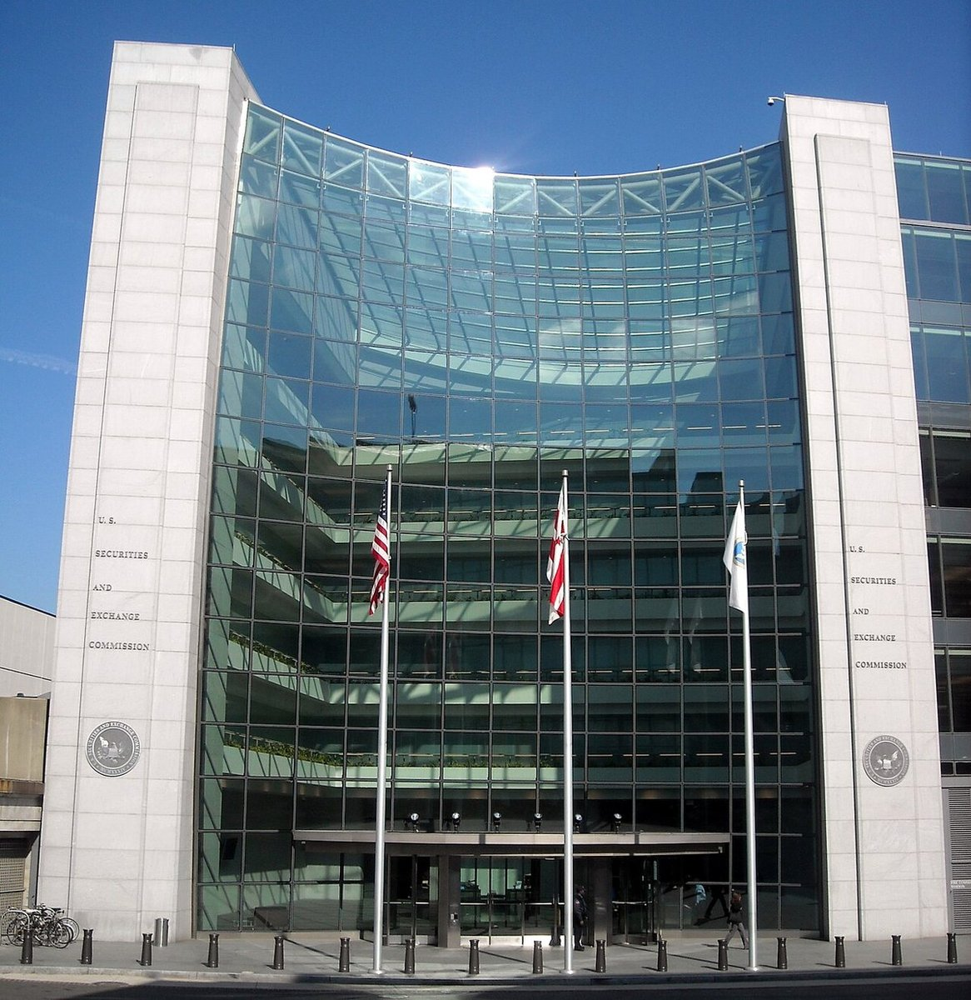
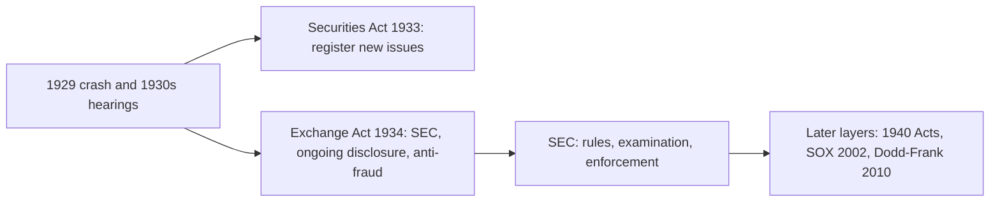

# The SEC and US securities law

**Prerequisites:** [Why markets are regulated](01-why-markets-are-regulated.md).

*The headquarters of the US Securities and Exchange Commission in Washington, D.C.. Credit: AgnosticPreachersKid. License: [CC BY-SA 3.0](https://creativecommons.org/licenses/by-sa/3.0). Source: [File:U.S. Securities and Exchange Commission headquarters.JPG](https://commons.wikimedia.org/wiki/File:U.S._Securities_and_Exchange_Commission_headquarters.JPG).*

The United States has the largest securities markets in the world and the most influential securities law. Its core was written in the early 1930s, in the wake of the 1929 crash and the Great Depression, and many other countries' rules borrow from it.

## The background

In the 1920s, millions of Americans bought stock, often on margin, and new issues were sold with little information. States had "blue sky" laws, but they were patchy; promoters could cross state lines. The Senate Banking Committee's investigation of 1932 to 1934, led in its later stage by counsel Ferdinand Pecora, exposed practices such as insider pools, preferential stock offerings to favoured insiders and conflicts between banks' lending and securities businesses. See [the crash of 1929](../08-history/07-the-crash-of-1929-and-the-great-depression.md). This created political momentum for federal regulation.

## The main statutes

- **Securities Act of 1933:** regulates the **primary market**. Anyone offering securities to the public must **register** the offering with the government and give investors a **prospectus** with material information, unless an exemption applies. It makes issuers, directors and underwriters liable for false statements.
- **Securities Exchange Act of 1934:** regulates the **secondary market**. It created the **Securities and Exchange Commission (SEC)**, with Joseph P. Kennedy as its first chairman; requires public companies to file ongoing reports; regulates exchanges, brokers and dealers; and prohibits fraud, manipulation and insider trading (Section 10(b) and Rule 10b-5).
- **Glass–Steagall Act (Banking Act of 1933):** separated commercial from investment banking; its main provisions were repealed by the Gramm–Leach–Bliley Act of 1999.
- **Investment Company Act of 1940** and **Investment Advisers Act of 1940:** regulate mutual funds and advisers; see [pooled investing and mutual funds](../03-securities/03-funds/01-pooled-investing-and-mutual-funds.md).
- **Securities Investor Protection Act of 1970:** created SIPC, the broker-failure insurer.
- **Sarbanes–Oxley Act of 2002:** after Enron and WorldCom, requires CEOs and CFOs to certify financial reports, strengthens audit committee independence, and created the **PCAOB** to oversee auditors.
- **Dodd–Frank Act of 2010:** a broad response to the 2008 crisis, covering derivatives clearing, bank capital, consumer protection and more.
- **JOBS Act of 2012**, crowdfunding and easier small-company offerings.

## What the SEC does

The SEC is an independent federal agency governed by commissioners appointed by the President (no more than three from one party). It:

1. Reviews **disclosure documents** and sets accounting-related rules (through the US accounting standard setter, FASB).
2. Supervises exchanges, brokers, advisers, clearing agencies and credit rating agencies.
3. **Enforces** the law, bringing civil actions for fraud and insider trading; criminal prosecution is by the Department of Justice.
4. Provides **EDGAR**, a free public database of filings.

The key periodic filings are the annual report **Form 10-K**, quarterly **10-Q**, and current report **8-K** for significant events. **Regulation FD** (2000) forbids companies from selectively disclosing material information to analysts and big investors before the public.

## The Howey test

What counts as a security? The Supreme Court's 1946 decision in *SEC v. W. J. Howey Co.* held that an "investment contract" exists where there is an investment of money in a common enterprise with an expectation of profits from the efforts of others. The Howey test is a flexible tool: it captured orange-grove sale-and-leaseback contracts and has been argued over crypto tokens; see [what a security is](../02-firms-and-capital/07-what-is-a-security.md) and [cryptoassets](../03-securities/05-alternatives/04-cryptoassets.md).

## Principles of the system

- **Disclosure, not merit review:** the SEC does not say a security is a good investment.
- **Liability:** misstatements bring civil and criminal liability.
- **Exemptions:** private placements to **accredited investors**, small offerings and others do not need full registration, with the idea that sophisticated investors need less protection.
- **Dual regime:** state "blue sky" law still exists alongside federal law, though for many larger offerings federal law pre-empts it.
- **Private enforcement:** investors can sue, including through class actions.

## Limits

Regulation did not prevent every fraud. Bernard Madoff's Ponzi scheme, which ran for decades and was exposed in December 2008, had been reviewed by SEC examiners, who missed it; the SEC's own inspector general criticised the agency's failure. Reforms followed. The case shows that disclosure and examination can fail where a fraudster controls all information, and that "registered" does not mean "safe".

Related regulators in the US include the **CFTC** (futures and swaps), the **Federal Reserve**, **FDIC** and **OCC** (banks), **FINRA** (self-regulatory organisation for broker-dealers) and the **Consumer Financial Protection Bureau**.

## Key ideas

- US securities law rests on the Securities Act of 1933 (primary market) and the Exchange Act of 1934 (secondary market, creating the SEC).
- The philosophy is mandatory disclosure and anti-fraud rules, not government approval of investments.
- The SEC enforces civil law, runs EDGAR and supervises markets; later laws added funds, audit and derivatives regulation.
- The Howey test defines an investment contract; registration and examination do not eliminate fraud.

## Where this leads

- Next: [securities regulation in Canada](03-securities-regulation-in-canada.md).
- Related: [insider trading, disclosure and fraud](05-insider-trading-disclosure-and-fraud.md), [the Great Depression](../08-history/07-the-crash-of-1929-and-the-great-depression.md).
- Glossary: [SEC](../glossary/regulation/sec.md), [Securities Act of 1933](../glossary/regulation/securities-act-of-1933.md), [Securities Exchange Act of 1934](../glossary/regulation/securities-exchange-act-of-1934.md), [Howey test](../glossary/regulation/howey-test.md), [EDGAR](../glossary/regulation/edgar.md), [Sarbanes–Oxley](../glossary/regulation/sarbanes-oxley.md), [Dodd–Frank](../glossary/regulation/dodd-frank.md), [FINRA](../glossary/regulation/finra.md).
