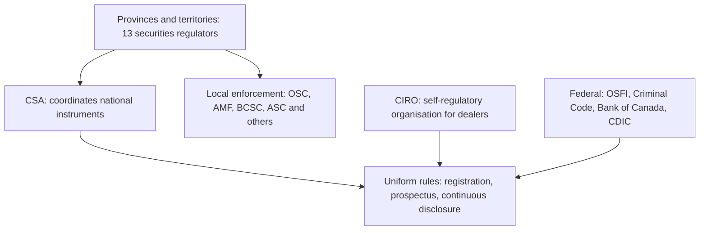

# Securities regulation in Canada

**Prerequisites:** [Why markets are regulated](01-why-markets-are-regulated.md), [The SEC and US securities law](02-the-sec-and-us-securities-law.md).

*Toronto's financial district, Bay Street, centre of Canadian capital markets. Credit: Arild Vågen. License: [CC BY-SA 4.0](https://creativecommons.org/licenses/by-sa/4.0). Source: [File:Toronto Financial District August 2017.jpg](https://commons.wikimedia.org/wiki/File:Toronto_Financial_District_August_2017.jpg).*

Canada's system differs from the American one in an important way: there is no single national securities regulator. Under the Constitution, **property and civil rights** belong to the provinces, and securities regulation has been provincial and territorial since the early 20th century. It is a federation of regulators that cooperate closely.

## Structure

- **Provincial and territorial securities regulators:** thirteen in all, such as the **Ontario Securities Commission (OSC)**, the **Autorité des marchés financiers (AMF)** in Quebec, the **British Columbia Securities Commission** and the **Alberta Securities Commission**. Each administers its province's securities act: it makes rules, reviews prospectuses, registers firms and individuals, and brings enforcement cases before tribunals and courts.
- **Canadian Securities Administrators (CSA):** the umbrella organisation of the provincial and territorial regulators that coordinates rule-making. Most rules are written as **national instruments** (NI) adopted by each jurisdiction, so they apply uniformly. Key examples:
  - **NI 31-103**, registration requirements and conduct;
  - **NI 45-106**, prospectus exemptions, including the accredited-investor definition;
  - **NI 51-102**, continuous disclosure obligations for reporting issuers;
  - **NI 81-102**, rules for mutual funds;
  - **NI 41-101**, the general prospectus requirements.
- **Passport system:** a firm or issuer can deal with its principal regulator and have a decision recognised in the other provinces, which cuts duplication.
- **SEDAR+:** the national electronic filing system for prospectuses and disclosure documents, replacing the older SEDAR; investors can read filings of Canadian public companies for free.
- **Federal role:** the federal government regulates banks (OSFI, the Office of the Superintendent of Financial Institutions), criminal law (fraud, in the Criminal Code) and deposit insurance (CDIC), and the RCMP and other bodies deal with serious fraud. The Bank of Canada sets monetary policy: see [central banks](06-central-banks-and-monetary-policy.md).

## The effort for a national regulator

Proposals for a federal regulator have existed for decades. In its 2011 *Reference re Securities Act* opinion, the Supreme Court of Canada ruled that a draft federal Act covering all securities regulation was beyond federal power, though it recognised a federal role in matters of national systemic risk. Later initiatives aimed for a cooperative system among willing provinces and Ottawa; confirm current progress, because this has been slow and politically contested. The practical effect for an investor is small: national instruments make the rules largely uniform.

## What the rules require

1. **Prospectus requirement:** the public offering of securities requires a prospectus unless an exemption applies, a regime like the one in the US. See [IPOs](../04-markets/02-ipos-and-the-primary-market.md).
2. **Continuous disclosure:** reporting issuers must file annual and quarterly financial statements, **management's discussion and analysis (MD&A)**, an annual information form and **material change reports** promptly when something significant happens. An **insider** must report trades, filed on **SEDI**.
3. **Registration:** firms and individuals who trade or advise in securities as a business must be registered. Categories include dealers, advisers and investment fund managers, and each has proficiency and conduct requirements. Check a firm or adviser at the CSA's **National Registration Search** (aretheyregistered.ca).
4. **Know your client and suitability:** the **client-focused reforms**, fully in force by 2021, strengthened requirements to put the client's interest first when making a suitability determination, to manage conflicts of interest and to give clients clearer information on costs.
5. **Prospectus exemptions:** the **accredited investor** exemption lets issuers sell to people who meet income or asset tests, such as financial assets above a set threshold, without a prospectus; the **offering memorandum** exemption has limits on how much non-accredited investors can invest; and crowdfunding rules allow small raises.
6. **Civil liability:** investors can sue for misrepresentation in disclosure documents, and provincial securities acts provide a statutory right of action for secondary market misrepresentation.

## Enforcement

Provincial regulators can issue cease-trade orders, impose administrative penalties and sanctions, and refer matters for **quasi-criminal** prosecution under their securities acts, with penalties that include fines and imprisonment. Criminal fraud falls under the federal Criminal Code, and cases are prosecuted by provincial Crown attorneys. Enforcement in Canada has historically drawn criticism for being slower or weaker than in the US; the regulators have in recent years sought to strengthen it. The system also includes the **self-regulatory organisation** CIRO, covered next.

## Relationship with the US and others

Many Canadian companies are **interlisted** on US exchanges and are subject to both regimes, mitigated by the **Multijurisdictional Disclosure System** (MJDS), which lets large Canadian issuers use home-country documents in US offerings. Canadian regulators also cooperate with international bodies such as IOSCO.

## What this means for you

- Look up whether a person or firm is **registered** before giving them money.
- Read the **ETF Facts / Fund Facts** and prospectus for what you buy.
- Know that the regulators **do not guarantee** returns or the honesty of issuers.
- Report suspected fraud to your provincial regulator or the **Canadian Anti-Fraud Centre**; see [scams and common mistakes](../09-personal-investing-canada/09-scams-and-common-mistakes.md).

## Key ideas

- Canadian securities regulation is provincial and territorial, coordinated through the CSA and national instruments.
- Core requirements include prospectuses, continuous disclosure, registration of advisers and dealers, and suitability and conflict rules.
- The Supreme Court held in 2011 that a comprehensive federal Act was beyond federal power; efforts at a cooperative regulator have progressed slowly.
- Check registration and read official disclosure before investing.

## Where this leads

- Next: [CIRO and investor protection](04-ciro-and-investor-protection.md).
- Related: [IPOs and the primary market](../04-markets/02-ipos-and-the-primary-market.md), [canadian markets history](../08-history/06-canadian-markets-history.md).
- Glossary: [[g:csa|CSA]], [[g:osc|OSC]], [[g:national-instrument|national instrument]], [[g:sedar-plus|SEDAR+]], [[g:continuous-disclosure|continuous disclosure]], [[g:registration|registration]], [[g:accredited-investor|accredited investor]], [[g:know-your-client|know your client]].
