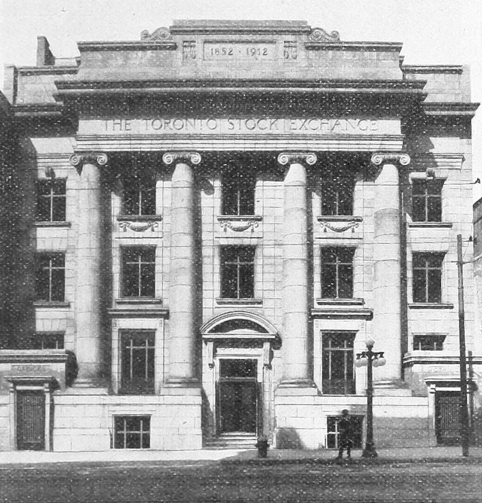
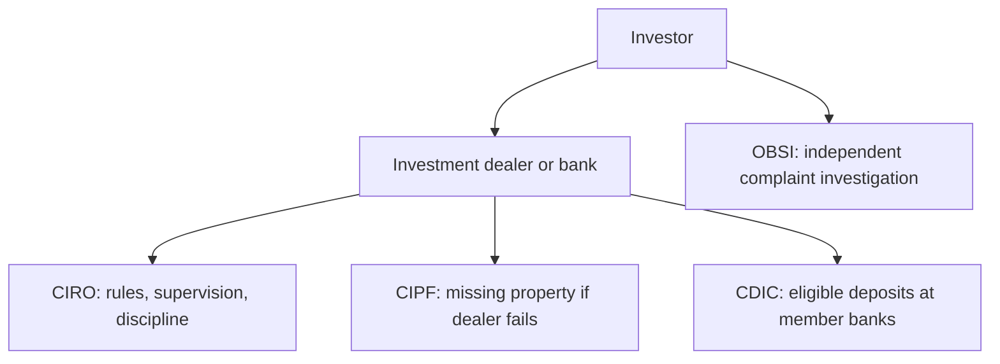

# CIRO and investor protection

**Prerequisites:** [Securities regulation in Canada](03-securities-regulation-in-canada.md), [Brokers and dealers](../04-markets/03-brokers-and-dealers.md).

*The Toronto Stock Exchange in 1912. Credit: Unknown authorUnknown author. License: Public domain. Source: [File:Toronto Stock Exchange, 1912.png](https://commons.wikimedia.org/wiki/File:Toronto_Stock_Exchange,_1912.png).*

Canadian investors are protected by several layers: a self-regulatory organisation that oversees the firms they deal with, insurance-like funds for specific failures, an independent complaint service, and the courts. This lesson separates what each does and, just as importantly, what none of them does.

## CIRO

The **Canadian Investment Regulatory Organization (CIRO)** is the national self-regulatory organisation for investment dealers, mutual fund dealers and trading on Canadian debt and equity marketplaces. It was formed when the Investment Industry Regulatory Organization of Canada (IIROC) and the Mutual Fund Dealers Association of Canada (MFDA) amalgamated on 1 January 2023; the name CIRO was adopted on 1 June 2023. It is recognised and overseen by the provincial securities regulators.

CIRO:

- sets and enforces **rules** on dealer capital, conduct, advertising, supervision and proficiency;
- **registers and examines** member firms and their approved individuals;
- **oversees trading** on exchanges and alternative trading systems, using surveillance to detect manipulation;
- **investigates and disciplines**: it can fine, suspend or bar firms and individuals, with decisions published;
- maintains **public databases**, such as CIRO's *Advisor Report*, which lets you check an adviser's registration and any disciplinary history.

An SRO is funded by the firms it regulates and staffed by industry experts; critics say that this risks gentle enforcement, supporters say it brings expertise. The provincial regulators oversee SROs and can step in. The related **mutual fund** and **exempt market** dealers have their own category rules under the CSA; see [securities regulation in Canada](03-securities-regulation-in-canada.md).

## CIPF: protection if your firm fails

The **Canadian Investor Protection Fund (CIPF)** is a not-for-profit fund, paid for by its members, that protects customers if a **CIRO-member investment dealer becomes insolvent** and the firm cannot return their property. Key points, which you should confirm at cipf.ca:

- CIPF covers **missing property**: the securities and cash that should be in your account, up to limits. It does *not* cover market losses.
- The limits are per customer, per category of account: up to **1 million dollars** for general accounts combined (this includes TFSAs and FHSAs held as general accounts), **1 million dollars** for registered retirement accounts (RRSP, RRIF, LIF) combined, and **1 million dollars** for RESPs.
- It does not cover a loss from bad advice, a dropping market, fraud by an adviser unconnected to insolvency, or products not held with the member. Mutual fund dealers in Canada have a separate investor protection arrangement; check which applies to you.

Example: you hold 600,000 of shares and cash in an investment dealer that fails with a shortfall in client assets, and only 550,000 can be returned. CIPF can cover the missing 50,000, up to the limit. If the same dealer's accounts simply fell in value from 600,000 to 400,000 because the market fell, you are not compensated.

## CDIC: bank deposits

The **Canada Deposit Insurance Corporation (CDIC)** is a federal Crown corporation insuring eligible deposits at member banks and other institutions: up to **100,000 dollars per depositor per insured category** (savings and chequing, term deposits and GICs up to five years, registered plans, and so on). Mutual funds, stocks, bonds, ETFs and crypto, even if bought at a bank, are *not* CDIC-insured. A segregated fund and an insurance policy fall under a separate insurer fund, Assuris. See [credit and banking](../01-foundations/02-credit-and-banking.md) and [GICs](../03-securities/02-bonds/10-inflation-linked-zero-coupon-and-gics.md).

| Protection | Covers | Does not cover |
|---|---|---|
| CDIC | Eligible deposits up to 100,000 per category | Investments, crypto |
| CIPF | Missing client property if a member dealer fails | Market losses, poor advice |
| Assuris | Insurance policies and segregated funds if an insurer fails | Market losses |

## Complaints and recourse

1. **Complain first to the firm,** in writing. Firms must have complaint-handling procedures, and must respond within set time limits, in Canada generally within 90 days.
2. If unsatisfied, escalate to the **Ombudsman for Banking Services and Investments (OBSI)**, a free and independent service that investigates and can recommend compensation, currently up to 350,000 dollars. Its recommendations for investment firms are not legally binding, though CIRO-regulated firms are required to take part and the OBSI can publicly name firms that do not follow its recommendations. Confirm the current limit at obsi.ca.
3. **CIRO or provincial regulators:** report misconduct (they do not typically obtain compensation for you).
4. **Civil court,** small claims court or arbitration, subject to time limits (limitation periods). Class actions are possible.
5. **Report fraud** to local police and to the **Canadian Anti-Fraud Centre**.

## Investor education and tools

The **Ontario Securities Commission's GetSmarterAboutMoney.ca**, the **Financial Consumer Agency of Canada** and CSA tools provide independent information. Use the **National Registration Search** (aretheyregistered.ca) to see if someone may sell or advise you; see [scams and common mistakes](../09-personal-investing-canada/09-scams-and-common-mistakes.md).

## What protection does not mean

- No protection from **investment risk**. A "regulated" firm or a "registered" product can still lose money.
- No guarantee for investments sold by unregistered sellers or off the books.
- No protection against the poor choices that cost more than any fraud: high fees, panic selling and over-concentration; see [fees](../03-securities/03-funds/04-fees-and-the-cost-of-investing.md).
- Protection is limited in amount and has conditions: spread large balances across eligible institutions where appropriate.

## Key ideas

- CIRO is the national SRO for investment and mutual fund dealers; it was formed from IIROC and the MFDA in 2023.
- CIPF protects missing property when a member dealer fails (1 million dollars per category), not market losses; CDIC protects eligible deposits to 100,000 per category.
- Complain to the firm, then OBSI, and report fraud to the authorities.
- Check figures for 2026 on official sites; protections never cover investment losses.

## Where this leads

- Next: [insider trading, disclosure and fraud](05-insider-trading-disclosure-and-fraud.md).
- Related: [costs, brokers and choosing a platform](../09-personal-investing-canada/08-costs-brokers-and-choosing-a-platform.md), [scams and common mistakes](../09-personal-investing-canada/09-scams-and-common-mistakes.md).
- Glossary: [CIRO](../glossary/regulation/ciro.md), [CIPF](../glossary/regulation/cipf.md), [CDIC](../glossary/regulation/cdic.md), [OBSI](../glossary/regulation/obsi.md), [self-regulatory organisation](../glossary/regulation/self-regulatory-organization.md), [IIROC](../glossary/regulation/iiroc.md).
