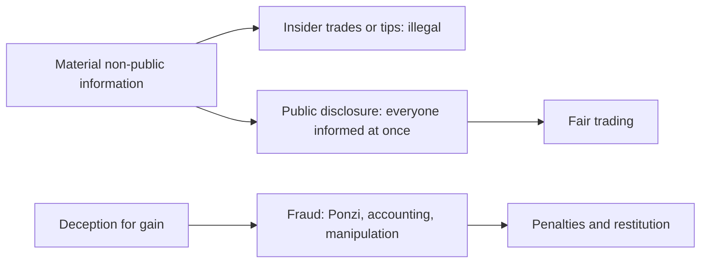

# Insider trading, disclosure and fraud

**Prerequisites:** [Securities regulation in Canada](03-securities-regulation-in-canada.md), [The SEC and US securities law](02-the-sec-and-us-securities-law.md).

*Charles Ponzi's mug shot: his 1920 scheme gave its name to the Ponzi scheme. Credit: US Goverment. License: Public domain. Source: [File:Charles Ponzi mug shot.jpg](https://commons.wikimedia.org/wiki/File:Charles_Ponzi_mug_shot.jpg).*

The rules of securities law come down to a few ideas: tell the truth, tell everyone at the same time, and do not trade on a secret edge. This lesson covers three families of wrongdoing, and the fair dealing principles behind them.

## Disclosure

Public companies must publish material information: **audited financial statements**, annual and quarterly reports, and prompt announcements of significant events. The standard is **materiality**: information is material if a reasonable investor would likely consider it important in deciding to buy or sell, or if it would be expected to affect the share price. Disclosure must be **timely** (a "material change" in Canada requires a news release immediately and a report within ten days), **accurate** (no misleading statements or omissions) and **fair** (everyone gets the information together; "selective disclosure" to favoured analysts is banned, as in the US Regulation FD and Canadian equivalents).

**Forward-looking statements** (forecasts) have safe harbours if cautionary language is provided. Auditors give an independent opinion on the financial statements, and **audit committees** of independent directors oversee them. When this fails, as in the Enron case, the fallout is large.

## Insider trading

**Insider trading** means trading on **material non-public information** (MNPI) in breach of a duty. Not all trading by insiders is illegal: company executives buy and sell their own firm's shares legitimately if they report the trades and do not use secrets.

Example: a director learns on Monday that the company will be acquired at 30% above the current price, to be announced on Friday. If she buys shares on Tuesday, she has a certain edge over people who sell to her; this is illegal. If she tells her friend who buys (**tipping**), both can be liable.

Who counts as an insider: directors, officers, significant shareholders (usually over 10% of voting shares), and anyone in a **special relationship** with the issuer, including employees, advisers, lawyers and bankers working on a deal, and people who got the information from them and who know or should know its status. In the US, the "misappropriation theory" covers outsiders who steal confidential information.

Why ban it? The arguments: it harms confidence in fairness, discourages ordinary investors from participating and raises the cost of capital, and it rewards theft of information. Some economists have argued that insider trading makes prices more accurate faster and might be allowed; but most legal systems treat it as unfair and harmful to market integrity, since insiders profit at others' expense.

Examples. In the US, hedge fund manager **Raj Rajaratnam** was convicted in 2011 of insider trading on the basis of wiretapped calls, and sentenced to 11 years in prison. **Martha Stewart** was convicted in 2004 of obstruction of justice and lying to investigators in a case that grew out of a stock sale; she was not convicted of insider trading itself. In Canada, enforcement has been more modest, with some high-profile cases, and penalties under securities law that include fines and imprisonment.

**Legal insider reporting:** insiders of reporting issuers must file trades within days; in Canada, reports are on **SEDI** (the System for Electronic Disclosure by Insiders); in the US, Form 4 on EDGAR. These are public, and some investors watch them for signals, though the evidence of excess returns is modest.

## Fraud and manipulation

**Fraud** is deliberate deception for gain. Common forms:

- **Ponzi and pyramid schemes:** promise steady high returns, paid from new investors' money until recruitment fails. Example: promising 10% a year, the scheme owes 1,100 on each 1,000 deposited a year later; it can last while new deposits exceed withdrawals. **Bernard Madoff's** scheme, uncovered in December 2008, involved tens of billions of dollars of claimed assets, and he was sentenced to 150 years in prison.
- **Accounting fraud:** inflating revenues or hiding debts. **Enron** (2001), with hidden debts in off-balance-sheet entities, and **WorldCom** (2002), with improperly capitalised expenses, led to the Sarbanes–Oxley reforms.
- **Resource and "salting" frauds:** in 1997 **Bre-X Minerals**, a Calgary-based company, claimed to have discovered an enormous gold deposit at Busang in Indonesia. Its shares soared on the Toronto Stock Exchange, and investors including pension funds lost heavily when independent testing found that the samples had been tampered with and there was almost no gold. It remains Canada's best-known market fraud, and led to tighter mining disclosure standards (NI 43-101).
- **Pump-and-dump** and other **market manipulation**: spreading false information, wash trades, spoofing.
- **Affinity fraud:** targeting communities by shared ethnicity, religion or profession; fraudsters use trust.
- **Boiler-room, romance and crypto scams:** high-pressure sales calls and online impersonators.

Warning signs: guaranteed or unusually high returns, pressure to act now, unregistered sellers, complex strategies you cannot explain, difficulty withdrawing, and secrecy. Bernie Madoff's returns were improbably smooth: low volatility plus high return is a red flag. See [variance and standard deviation](../01-foundations/09-variance-and-standard-deviation.md) and [scams and common mistakes](../09-personal-investing-canada/09-scams-and-common-mistakes.md).

## Remedies and penalties

Regulators can issue cease-trade orders, administrative penalties and disgorgement of profits; they may bar people from the industry; courts can order restitution; and fraud can be prosecuted criminally. Investors can sue. Recovery in a collapsed fraud is usually partial at best.

## Ethical connection

Securities law enforces norms familiar from ethics: honesty, fairness and not exploiting others' ignorance. See [philosophy: ethics](../../../philosophy/concepts/ethics/README.md) for the broader tradition on virtue and fairness; law sets a floor, not a ceiling, for behaviour.

## Key ideas

- Disclosure must be material, timely, accurate and fair; selective disclosure is banned.
- Insider trading is trading on material non-public information in breach of a duty; tipping is covered too.
- Fraud takes many forms; Ponzi schemes, accounting fraud and resource frauds like Bre-X have recurring features.
- Warning signs include guaranteed returns, unregistered sellers and pressure; verify registration.

## Where this leads

- Next: [central banks and monetary policy](06-central-banks-and-monetary-policy.md).
- Related: [dot-com bubble](../08-history/10-the-dot-com-bubble.md), [Canadian markets history](../08-history/06-canadian-markets-history.md).
- Glossary: [insider trading](../glossary/regulation/insider-trading.md), [material information](../glossary/regulation/material-information.md), [tipping](../glossary/regulation/tipping.md), [SEDI](../glossary/regulation/sedi.md), [accounting fraud](../glossary/regulation/accounting-fraud.md), [market manipulation](../glossary/regulation/market-manipulation.md), [Bre-X](../glossary/regulation/bre-x.md), [affinity fraud](../glossary/regulation/affinity-fraud.md).
