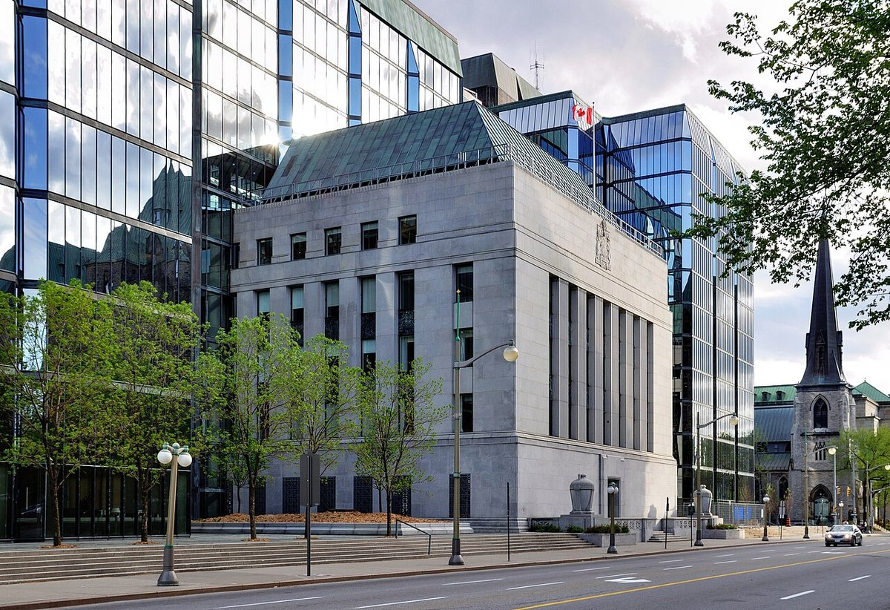
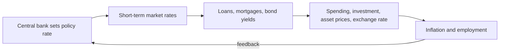

# Central banks and monetary policy

**Prerequisites:** [Credit and banking](../01-foundations/02-credit-and-banking.md), [Inflation and real returns](../01-foundations/07-inflation-and-real-returns.md), [The yield curve](../03-securities/02-bonds/09-the-yield-curve.md).

*The Bank of Canada building in Ottawa. Credit: Wladyslaw. License: [CC BY-SA 3.0](http://creativecommons.org/licenses/by-sa/3.0/). Source: [File:Ottawa - ON - Bank of Canada.jpg](https://commons.wikimedia.org/wiki/File:Ottawa_-_ON_-_Bank_of_Canada.jpg).*

Financial markets respond more to one institution's decisions than almost any other: the central bank. It controls the price of short-term money, and that price influences bond yields, mortgage costs, stock valuations and exchange rates. It is also the lender of last resort when markets seize up.

## What a central bank is

A **central bank** is a public institution that issues the national currency, manages the money supply and interest rates and supports the financial system. Examples: the **Bank of Canada** (established 1934, opened 1935), the **Federal Reserve** (1913), the **Bank of England** (1694), the **European Central Bank** (1998), and the **Bank of Japan**. Its main jobs:

1. **Monetary policy:** keep inflation low and stable and support employment and growth.
2. **Financial stability:** be the **lender of last resort** to solvent banks facing a run. Walter Bagehot's *Lombard Street* (1873) set out the principle: lend freely, at a penalty rate, against good collateral.
3. **Issuing money** and running the payments system.
4. **Acting as banker to the government,** and in some countries supervising banks.

In Canada, the Bank of Canada targets inflation at **2%** (the midpoint of a 1% to 3% control range), under an agreement with the federal government renewed every five years; the target was introduced in 1991.

## How monetary policy works

The main tool is a **policy interest rate**. In Canada, this is the **target for the overnight rate**, the rate at which major financial institutions lend each other one-day funds. The bank sets it, and market rates follow: banks' prime rates, deposit rates and floating mortgage rates move with it, and expectations about future policy shape longer-term yields.

Transmission:

- **Lower rates →** cheaper borrowing → more spending and investment; bond prices up; stocks often rise (lower discount rates and cheaper financing); a weaker currency → more exports → more inflation and growth.
- **Higher rates →** the reverse, which cools demand and inflation.

Mortgage example: a 400,000 mortgage amortised over 25 years has a monthly payment of about **1,897** at 3% and **2,338** at 5% (monthly compounding for simplicity; Canadian fixed mortgages compound semi-annually), a rise of 23%. Higher rates reduce what households can spend elsewhere. Bond example: a rise of 1 percentage point in yields lowers the price of a bond with a duration of 7 by roughly 7%; see [duration and convexity](../03-securities/02-bonds/05-duration-and-convexity.md). Stocks: higher rates raise the discount rate in [DCF valuation](../03-securities/01-stocks/09-discounted-cash-flow-valuation.md).

Effects take **time**, often a year or two, which is why central banks act on forecasts and why mistakes are common ("long and variable lags", in Milton Friedman's phrase).

## Unconventional tools

When the policy rate is near zero, central banks can use **quantitative easing (QE)**: buying government bonds (and sometimes other assets) with newly created reserves, to push down long-term yields and ease credit. The reverse is **quantitative tightening (QT)**. **Forward guidance** shapes expectations about future rates. After 2008 and again in 2020, the Fed, the Bank of Canada and others used QE on a large scale.

## Episodes

- **Volcker disinflation (1979 to 1982):** Fed chair Paul Volcker pushed the policy rate to around 20% to break high inflation, causing a deep recession but cutting inflation sharply; see [Bretton Woods and the postwar order](../08-history/08-bretton-woods-and-the-postwar-order.md).
- **2008 and after:** rates cut near zero, QE, emergency lending facilities.
- **2020 to 2023:** emergency cuts and QE at the COVID shock, then the fastest rate-hiking cycle in decades as inflation surged (about 8% in Canada and 9% in the US in mid-2022). The Bank of Canada raised its policy rate from 0.25% in March 2022 to 5% by July 2023; see [the COVID crash and the rate shock](../08-history/12-covid-crash-and-the-rate-shock.md). Check the Bank of Canada site for the current rate; it changes.

## Central banks and investors

- **Policy expectations are priced in.** Markets react to *surprises* relative to expectations, not to the move itself.
- **Don't fight the Fed?** A popular saying; timing policy moves is hard and not a reliable strategy. See [the efficient market hypothesis](../06-portfolio-theory/04-the-efficient-market-hypothesis.md).
- **Rates affect everything:** the discount rate for all assets, the cost of leverage and the attractiveness of cash and GICs relative to risky assets.
- **Independence** from politics matters: countries that financed deficits by printing money have suffered high inflation; see [inflation and real returns](../01-foundations/07-inflation-and-real-returns.md).

## Limits and debates

Central banks cannot control everything: supply shocks (like energy) push up prices regardless of policy; low rates for long may encourage risk-taking and asset bubbles; QE has distributional effects; and inflation targets can be missed. Debates cover whether to target inflation alone, how to deal with asset prices, and how much a central bank should be accountable.

## Key ideas

- Central banks issue currency, set the policy interest rate, aim for stable inflation and act as lender of last resort.
- Rate changes transmit through loans, bond yields, asset prices and exchange rates, with long lags.
- QE and forward guidance extend the toolkit when rates hit zero.
- For investors, expectations matter more than levels, and rates affect every valuation.

## Where this leads

- Next: [portfolio theory](../06-portfolio-theory/01-portfolio-return-and-risk.md).
- Related: [history of markets and crises](../08-history/README.md), [the yield curve](../03-securities/02-bonds/09-the-yield-curve.md).
- Glossary: [central bank](../glossary/regulation/central-bank.md), [policy rate](../glossary/regulation/policy-rate.md), [lender of last resort](../glossary/regulation/lender-of-last-resort.md), [quantitative easing](../glossary/regulation/quantitative-easing.md), [overnight rate](../glossary/regulation/overnight-rate.md), [monetary policy](../glossary/regulation/monetary-policy.md), [inflation targeting](../glossary/regulation/inflation-targeting.md).
