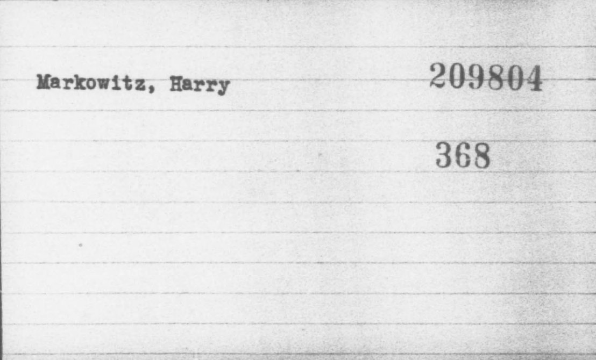
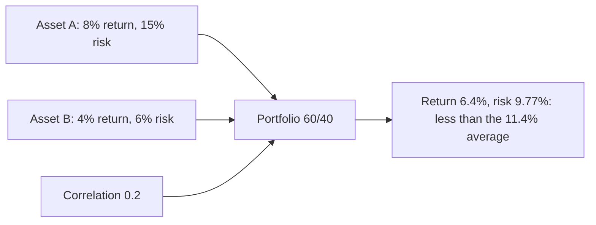

# Portfolio return and risk

**Prerequisites:** [Variance and standard deviation](../01-foundations/09-variance-and-standard-deviation.md), [Correlation and diversification](../01-foundations/11-correlation-and-diversification.md).

*Harry Markowitz, whose 1952 paper 'Portfolio Selection' founded modern portfolio theory. Credit: U.S. District Court for the Southern District of New York. 1814. License: Public domain. Source: [File:Markowitz, Harry - DPLA - cb4e2117a0e34f7b55019f0828b61d23.jpg](https://commons.wikimedia.org/wiki/File:Markowitz,_Harry_-_DPLA_-_cb4e2117a0e34f7b55019f0828b61d23.jpg).*

Investors do not hold single assets; they hold portfolios. The central insight of modern portfolio theory, due to Harry Markowitz in 1952, is that an asset's risk should be judged by how it contributes to the *portfolio*, not by itself. This lesson derives the two basic formulas.

## Portfolio expected return

The expected return of a portfolio is the **weighted average** of its assets' expected returns:

> E(R_p) = w_A E(R_A) + w_B E(R_B), with weights summing to 1

Example: a stock fund A with expected return 8% and volatility 15%, and a bond fund B with expected return 4% and volatility 6%. The correlation between them is 0.2. Hold 60% in A and 40% in B:

E(R_p) = 0.6 × 8% + 0.4 × 4% = **6.4%**.

No magic here: returns just average.

## Portfolio risk is not an average

The standard deviation of a two-asset portfolio is:

> σ_p² = w_A² σ_A² + w_B² σ_B² + 2 w_A w_B ρ_AB σ_A σ_B

The last term involves the correlation ρ. For our example:

- w_A σ_A = 0.6 × 15% = 9%; w_B σ_B = 0.4 × 6% = 2.4%
- σ_p² = (0.09)² + (0.024)² + 2 × 0.6 × 0.4 × 0.2 × 0.15 × 0.06 = 0.0081 + 0.000576 + 0.000864 = 0.00954
- σ_p = **9.77%**

The weighted average of the standalone volatilities would be 0.6 × 15% + 0.4 × 6% = 11.4%. The portfolio's risk, 9.77%, is lower: that gap is the **diversification benefit**. It depends on correlation:

| Correlation ρ | Portfolio volatility (60/40) |
|---|---|
| +1.0 | 11.40% |
| +0.2 | 9.77% |
| −0.5 | 8.07% |

At ρ = +1 there is no benefit (the portfolio risk equals the average); anything less than +1 reduces risk below the average. See [correlation and diversification](../01-foundations/11-correlation-and-diversification.md). Importantly, it is the *co*movement of assets, not each asset's own volatility, that matters, which means that a risky asset can *reduce* overall portfolio risk if it moves differently from the rest.

## Many assets: covariance dominates

For N assets, the portfolio variance is the sum over all pairs of w_i w_j Cov(i, j). The number of pairs, N(N−1), grows far faster than the N own-variance terms, so for a large portfolio, **covariances dominate** and individual variances matter little. In an equally weighted portfolio of N assets with average variance σ² and average covariance c: variance = σ²/N + (1 − 1/N) c. As N rises, the first term vanishes and variance tends to c, the average covariance. This is the formal statement of the split between **idiosyncratic** risk (diversifiable, vanishing as N grows) and **systematic** risk (the common-market part that remains); see [diversification](../01-foundations/11-correlation-and-diversification.md) and [CAPM](03-capm-and-beta.md).

## Matrix view

With many assets it is written compactly as σ_p² = wᵀΣw, where w is the weight vector and Σ the covariance matrix. Estimating Σ for hundreds of assets is hard, since inputs are noisy: errors in estimated returns and covariances can lead to extreme, unstable portfolios, a practical problem noted by many practitioners.

## Why this changed investing

Before Markowitz, advice focused on picking individual securities with good prospects. After him, the question became: what is the best *combination*? His 1952 paper "Portfolio Selection" is the start of modern finance; he shared the 1990 Nobel Memorial Prize in economics with Merton Miller and William Sharpe. The risk measure used, standard deviation, has limits: it treats upside and downside equally, assumes stable relationships and ignores fat tails; during crises, correlations tend to rise toward 1 just when diversification is most needed. Alternatives include downside deviation, value at risk and drawdown, but variance remains the basis of the theory.

## Limitations to remember

- Expected returns, volatilities and correlations are *estimates*; true values change over time.
- Correlations are not constant: in the 2008 crisis many risk assets fell together.
- The formulas describe a single period and ignore taxes, costs and the investor's liabilities.
- A low-volatility portfolio can still be a bad investment if the expected return is low.

## Key ideas

- A portfolio's expected return is the weighted average of its assets' returns.
- A portfolio's risk is lower than the weighted average of the assets' risks unless they are perfectly correlated; with the example, 9.77% versus 11.4%.
- With many assets, covariances dominate; diversification removes idiosyncratic risk but not systematic risk.
- Estimates are uncertain, and correlations rise in crises.

## Where this leads

- Next: [the efficient frontier](02-the-efficient-frontier.md).
- Related: [risk and return](../01-foundations/10-risk-and-return.md), [asset allocation](06-asset-allocation-and-rebalancing.md).
- Glossary: [portfolio](../glossary/portfolio-theory/portfolio.md), [modern portfolio theory](../glossary/portfolio-theory/modern-portfolio-theory.md), [covariance](../glossary/portfolio-theory/covariance.md), [correlation](../glossary/foundations/correlation.md), [diversification](../glossary/foundations/diversification.md), [systematic risk](../glossary/foundations/systematic-risk.md), [idiosyncratic risk](../glossary/foundations/idiosyncratic-risk.md).
