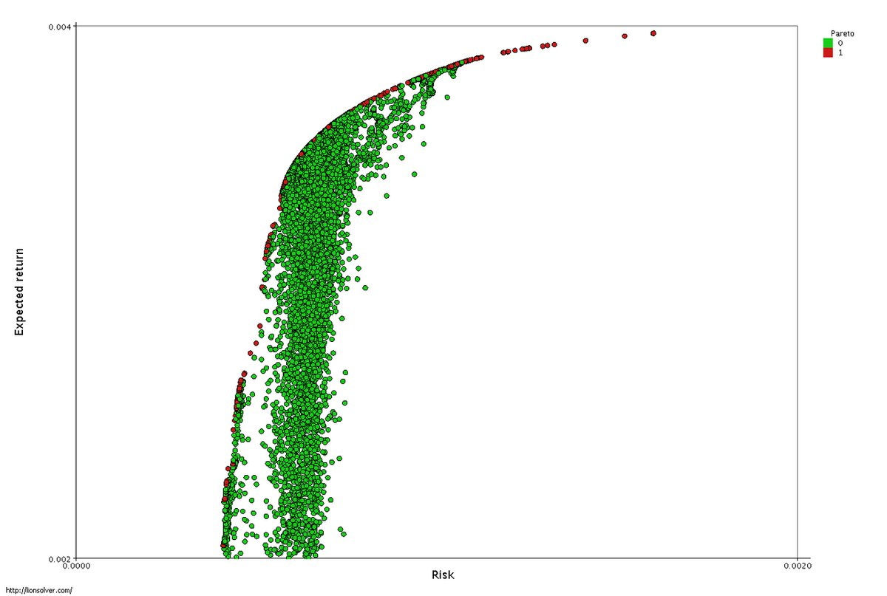
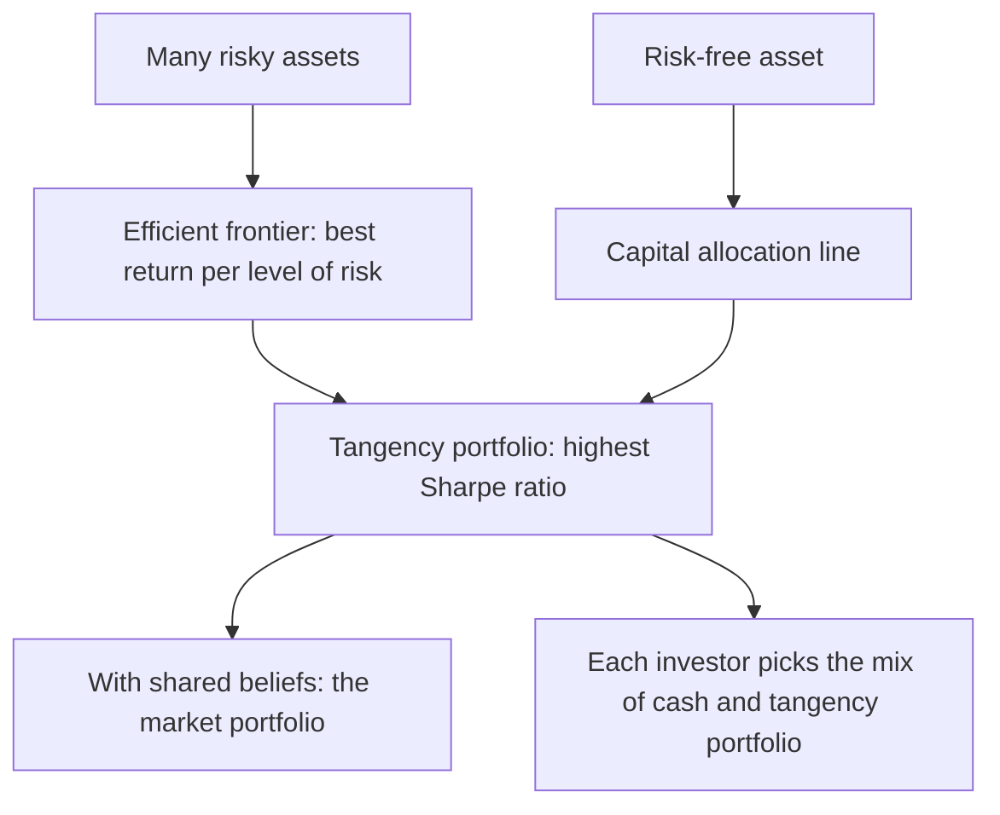

# The efficient frontier

**Prerequisites:** [Portfolio return and risk](01-portfolio-return-and-risk.md).

*An efficient frontier for the Markowitz portfolio selection problem. Credit: Marcuswikipedian. License: [CC BY-SA 3.0](https://creativecommons.org/licenses/by-sa/3.0). Source: [File:Pareto Efficient Frontier for the Markowitz Portfolio selection problem..png](https://commons.wikimedia.org/wiki/File:Pareto_Efficient_Frontier_for_the_Markowitz_Portfolio_selection_problem..png).*

If you can choose any mix of assets, which mixes are sensible? Markowitz's answer: only those on the **efficient frontier**, the set of portfolios that offer the highest expected return for each level of risk, or equivalently the lowest risk for a given return. All others are dominated: something else gives more return for the same risk, or less risk for the same return.

## Two assets: tracing the curve

Using the earlier example, a stock fund (8% return, 15% risk) and a bond fund (4% return, 6% risk) with correlation 0.2, vary the share in stocks:

| Stocks | Expected return | Risk (σ) |
|---|---|---|
| 0% | 4.0% | 6.00% |
| 10% | 4.4% | 5.89% |
| 20% | 4.8% | 6.15% |
| 30% | 5.2% | 6.74% |
| 50% | 6.0% | 8.62% |
| 70% | 6.8% | 11.00% |
| 100% | 8.0% | 15.00% |

Look at the first rows: moving from 0% to 10% stocks *raises* the return and *lowers* the risk, from 6.00% to 5.89%. Adding a bit of a risky asset to a safer one reduced total risk because of the low correlation. The **minimum-variance portfolio** has 8% in stocks and 92% in bonds, with risk about 5.88% and return 4.32%. Portfolios with less in stocks than that are **inefficient**: you could get more return with less risk by holding more stocks. The efficient part of the curve is from the minimum-variance point upward.

Plotted with risk on the horizontal axis and return on the vertical axis, the set forms a curve bulging to the left: the **Markowitz bullet**. With many assets, the feasible set is a region, and the **efficient frontier** is its upper-left boundary.

## Adding a risk-free asset: the capital allocation line

Add a risk-free asset (return 2%) that you can lend to or borrow at. Mix cash with any risky portfolio and the resulting risk and return lie on a straight line. The steepest such line touches the frontier at the **tangency portfolio**, the one with the highest **Sharpe ratio** (excess return per unit of risk): (E(R) − r_f) ÷ σ. In our example, the tangency portfolio holds about 34% stocks and 66% bonds, with return 5.38%, risk 7.10% and Sharpe ratio 0.476, versus 0.333 for bonds only and 0.40 for stocks only (with r_f = 2%).

Then comes **Tobin's separation theorem** (James Tobin, 1958): every investor, whatever their risk tolerance, should hold the *same* risky portfolio (the tangency portfolio), and adjust risk by mixing it with cash or borrowing. A cautious investor holds more cash; an aggressive one borrows to hold more than 100% of the risky portfolio. The risky portfolio does not depend on taste; only the mix with cash does.

## Why the theory leads to the market portfolio

If all investors share the same estimates and hold the tangency portfolio, then in equilibrium that portfolio is simply the **market portfolio**: all risky assets weighted by market value. This is the logic behind [CAPM](03-capm-and-beta.md) and the case for holding a broad market index fund, covered in [index funds](../03-securities/03-funds/03-index-funds.md).

## Practical problems

- **Estimation error:** the optimiser takes expected returns as inputs, and small errors produce large, extreme weights, so "optimal" portfolios can concentrate in a few assets and perform poorly on new data. The tool has been called an "error maximiser."
- **Instability:** results change with small changes in assumptions.
- **Constraints and costs:** real investors face taxes, minimums, short-sale restrictions and trading costs.
- **Single period and one measure of risk:** it ignores changes over time, liabilities and investors' real concerns.

Practitioners respond with **constraints** (no shorting, caps on weights), **shrinkage** of estimates toward a prior, **Black–Litterman** (starting from market equilibrium returns and adding views), **resampling**, and simple rules such as equal weights; a study by DeMiguel, Garlappi and Uppal (2009) found that simple 1/N weighting often does as well as optimisers out of sample. The lesson: the theory is a guide to *thinking* about diversification, not a machine that outputs the right answer.

## Reading the frontier

- Points *below* the frontier are inefficient.
- Points *on* it differ only by risk appetite.
- Moving up the frontier means taking on more risk to get more return, never for free.
- The location of the frontier depends on assumptions about returns and correlations.

## Key ideas

- The efficient frontier is the set of portfolios with the highest return for each level of risk.
- Combining imperfectly correlated assets can raise return and lower risk; portfolios below the minimum-variance point are inefficient.
- With a risk-free asset, all investors hold the same tangency portfolio and vary only the cash mix.
- Estimation error limits practical use; simple diversified portfolios often compete well.

## Where this leads

- Next: [CAPM and beta](03-capm-and-beta.md).
- Related: [the Sharpe ratio and performance measurement](08-measuring-performance.md), [asset allocation](06-asset-allocation-and-rebalancing.md).
- Glossary: [[g:efficient-frontier|efficient frontier]], [[g:sharpe-ratio|Sharpe ratio]], [[g:tangency-portfolio|tangency portfolio]], [[g:capital-allocation-line|capital allocation line]], [[g:market-portfolio|market portfolio]], [[g:minimum-variance-portfolio|minimum-variance portfolio]].
