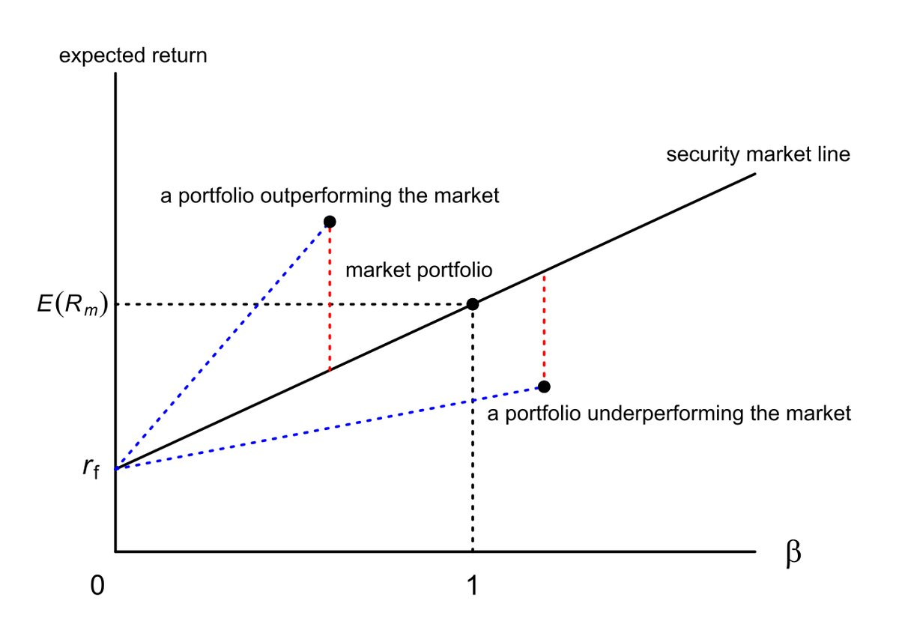
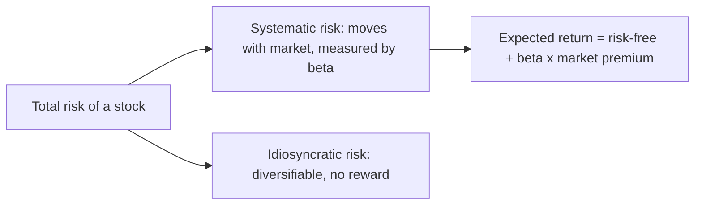

# CAPM and beta

**Prerequisites:** [The efficient frontier](02-the-efficient-frontier.md), [Risk and return](../01-foundations/10-risk-and-return.md).

*The security market line of the Capital Asset Pricing Model. Credit: Munasca. License: [CC BY-SA 4.0](https://creativecommons.org/licenses/by-sa/4.0). Source: [File:Security market line of CAPM.svg](https://commons.wikimedia.org/wiki/File:Security_market_line_of_CAPM.svg).*

If investors are rewarded for taking risk, how much reward goes with how much risk? The **Capital Asset Pricing Model** (CAPM), developed in the 1960s by William Sharpe, John Lintner and Jan Mossin, building on Markowitz and Tobin, gave the first complete answer. Sharpe shared the 1990 Nobel Memorial Prize for it.

## The central idea

Diversification removes idiosyncratic risk, so the market will not pay you for bearing it. You are paid only for **systematic risk**: the part of an asset's risk that moves with the overall market. That exposure is measured by **beta**.

## Beta

> β_i = Cov(R_i, R_m) ÷ Var(R_m)

Beta is the sensitivity of an asset's return to the market's return. By definition, the market has β = 1. A stock with β = 1.5 tends to rise 1.5% when the market rises 1%, and fall 1.5% when it falls 1%. A β of 0.5 means half as sensitive. Utilities and consumer staples often have low betas; technology and cyclical stocks higher ones. Beta is estimated by regressing the stock's returns on the market's over, say, five years of monthly data; it is an estimate and changes over time.

Illustration with five months of returns (market: 10%, −5%, 15%, 2%, 8%; stock: 14%, −8%, 20%, 1%, 10%): the sample covariance divided by the market's sample variance gives a beta of about 1.43: the stock moves more than the market. (Five observations is far too few in practice.)

## The CAPM equation

> E(R_i) = r_f + β_i × [E(R_m) − r_f]

The expected return equals the risk-free rate plus beta times the **market risk premium**, the equity risk premium. The straight line in beta-expected return space is the **security market line** (SML).

Example: risk-free rate 3%, market risk premium 5%.

- β = 1.2 → required return = 3% + 1.2 × 5% = **9%**
- β = 0.6 → 3% + 0.6 × 5% = **6%**
- β = 1.0 → 8%; β = 0 → 3%

A stock with a high standalone volatility but zero beta would earn just the risk-free rate in this model, because its risk is diversifiable. Only the beta matters.

## Using CAPM

1. **Cost of equity:** companies and analysts use the CAPM rate as the cost of equity in [WACC](../02-firms-and-capital/08-capital-structure-and-cost-of-capital.md) and as the discount rate in [DCF valuation](../03-securities/01-stocks/09-discounted-cash-flow-valuation.md).
2. **Performance measurement:** **alpha** is the return above what CAPM predicts. A fund returning 11% with β = 1.2 when CAPM predicts 9% has alpha = +2%; see [measuring performance](08-measuring-performance.md).
3. **Portfolio construction:** a portfolio's beta is the weighted average of its holdings' betas, so beta can be adjusted by shifting between high- and low-beta assets, or by mixing with cash.

## Assumptions and criticism

CAPM assumes investors are rational and mean-variance optimisers, have identical expectations, there is unlimited borrowing and lending at the risk-free rate, no taxes or transaction costs, and a market portfolio containing all assets. These are idealisations. The empirical record is mixed:

- Fama and French (1992) found that beta alone did a poor job explaining the differences in average returns across stocks, while size and book-to-market ratio did better, leading to the three-factor model; see [factor investing](07-factor-investing.md).
- The "low-beta anomaly": low-beta stocks have often earned returns higher than CAPM predicts, flattening the actual security market line.
- **Roll's critique** (1977): the true market portfolio includes everything (real estate, human capital) and is unobservable, so the model cannot be tested exactly.
- The market risk premium is itself hard to estimate: historical averages vary widely by period and country.

Even so, CAPM stays in textbooks and in practice because it is simple and captures a key principle: **risk that can be diversified away is not rewarded**. More elaborate models extend rather than replace it.

## What it means for investors

- Diversify away idiosyncratic risk; the market rewards only systematic risk.
- Expect higher return only from bearing market-wide (or factor) risk, not from holding concentrated bets.
- A high-beta fund is not "better," just riskier; compare returns after adjusting for beta.
- Beta is not the whole of risk: it misses a stock's own tail and liquidity risks.

## Key ideas

- Beta measures an asset's sensitivity to the market; only this systematic risk earns a premium in CAPM.
- Expected return = r_f + β × market risk premium; with a 3% risk-free rate and 5% premium, a beta of 1.2 gives 9%.
- Alpha is return beyond the CAPM prediction.
- CAPM is imperfect empirically, but its principle (no reward for diversifiable risk) is central to finance.

## Where this leads

- Next: [the efficient market hypothesis](04-the-efficient-market-hypothesis.md).
- Related: [capital structure and cost of capital](../02-firms-and-capital/08-capital-structure-and-cost-of-capital.md), [factor investing](07-factor-investing.md).
- Glossary: [[g:capm|CAPM]], [[g:beta|beta]], [[g:alpha|alpha]], [[g:security-market-line|security market line]], [[g:market-risk-premium|market risk premium]], [[g:cost-of-equity|cost of equity]].
