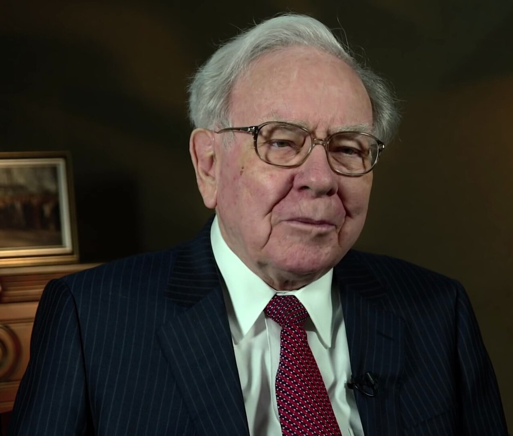
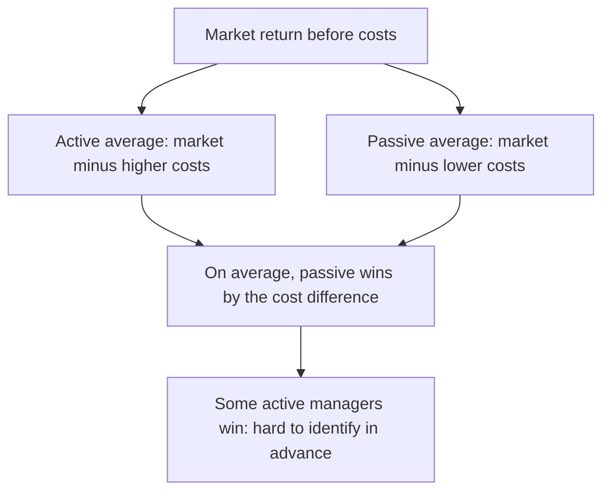

# Active versus passive investing

**Prerequisites:** [The efficient market hypothesis](04-the-efficient-market-hypothesis.md), [Index funds](../03-securities/03-funds/03-index-funds.md).

*Warren Buffett, the best-known long-term active investor, at the 2015 SelectUSA Investment Summit. Credit: USA International Trade Administration. License: Public domain. Source: [File:Warren Buffett at the 2015 SelectUSA Investment Summit.jpg](https://commons.wikimedia.org/wiki/File:Warren_Buffett_at_the_2015_SelectUSA_Investment_Summit.jpg).*

**Active investing** tries to beat a benchmark by picking securities or timing the market. **Passive investing** accepts the market's return by holding a broad index at low cost. The debate between them is one of the most practical in finance.

## The arithmetic of costs

William Sharpe's 1991 argument, outlined in [index funds](../03-securities/03-funds/03-index-funds.md), says: before costs, the average active dollar earns the same as the average passive dollar (both together are the market), so after costs active must earn less on average. This is true even if some managers are highly skilled, because their gains come at the expense of other active investors.

Example: the market returns 7% before costs. Passive funds charge 0.2%, so earn 6.8%. Active funds charge 1.5% and trade more, say 1.8% in total costs, so *on average* earn 5.2%. Over 30 years on 100,000: passive grows to 100,000 × 1.068^30 = about 720,000; active to 100,000 × 1.052^30 = about 458,000. Some active managers will beat the passive result, but you cannot know ahead of time which.

## The evidence

- **SPIVA scorecards** (S&P Dow Jones Indices) compare actively managed funds with their benchmark indices. Across categories and countries, over periods of ten to twenty years, a large majority of funds fail to beat the benchmark after fees; funds that do well in one period rarely repeat. They also correct for **survivorship bias**: poor performers are closed or merged away, which flatters the funds that remain.
- **Carhart (1997)** found little evidence of persistent skill among mutual fund managers; past top performers did not reliably remain on top, and what persistence there was came mainly from costs.
- **Fama and French (2010)** estimated that few fund managers earn enough to cover their costs: before costs, some seem skilled, but after costs, the average underperforms.
- **A famous bet:** in 2008, Warren Buffett wagered 1 million dollars that an S&P 500 index fund would beat a selection of hedge funds, chosen by Protégé Partners, over ten years. By the end of 2017, the index fund had gained roughly 126% against about 36% (after fees) for the hedge funds' selection; the other side conceded. The figures are as reported by Buffett.

## The case for active management

1. **Markets need active investors** for prices to reflect information (the Grossman–Stiglitz point); passive investors depend on them.
2. **Some managers do beat the market,** and some less efficient areas (small caps, emerging markets, private markets) may offer more room, although evidence is mixed, and persistence is weak.
3. **Customisation:** an investor's needs, such as ethical constraints, tax-loss harvesting or an outside concentrated holding, may call for deviations from the index.
4. **Downside management:** some managers aim to limit losses in crashes, trading some upside.
5. **Advice is not just selection:** a planner may add value through planning, behaviour and tax advice, even if fund choice does not.

## The case for passive

- Low cost, which is the single most reliable predictor of net returns.
- **Diversification** and broad market exposure.
- **Simplicity and tax efficiency:** low turnover means fewer taxable events.
- **Discipline:** avoids the behavioural traps of constantly switching funds.
- **Predictability of outcome:** you know you will get close to the market return.

## Middle paths and wrinkles

- **Core and satellite:** hold most assets passively and a small satellite of active or concentrated bets.
- **Factor or "smart beta" funds:** rule-based tilts; see [factor investing](07-factor-investing.md).
- **Selecting the right *indices*:** passive does not mean no decisions; the investor still chooses asset allocation, fees and rebalancing; see [asset allocation and rebalancing](06-asset-allocation-and-rebalancing.md).
- **Concerns about passive's size:** index funds now hold a large share of market assets. Critics worry about concentration of voting power, the impact on price discovery and the "free-rider" problem. Defenders point out that active trading still sets most prices daily.

## Decision rules for individuals

1. If you cannot say why you expect a particular manager to beat the market *after* fees, assume it will not.
2. Compare funds on cost, tax and diversification first.
3. Judge any active fund against an appropriate benchmark over many years, net of fees.
4. Avoid trading on the hunch that you can time the market: studies suggest investors who do tend to underperform the funds they own.

## Key ideas

- Before costs, active and passive investors together earn the market return; after costs, the average active investor must lag.
- SPIVA and academic studies find that most active funds underperform over long periods, with little persistence.
- Active management has arguments (price discovery, specific needs), but identifying winners ahead of time is the challenge.
- Costs, diversification and discipline favour a low-cost passive core for most individuals.

## Where this leads

- Next: [asset allocation and rebalancing](06-asset-allocation-and-rebalancing.md).
- Related: [fees and the cost of investing](../03-securities/03-funds/04-fees-and-the-cost-of-investing.md), [building a simple portfolio](../09-personal-investing-canada/07-building-a-simple-portfolio.md).
- Glossary: [active management](../glossary/portfolio-theory/active-management.md), [passive investing](../glossary/portfolio-theory/passive-investing.md), [SPIVA](../glossary/portfolio-theory/spiva.md), [survivorship bias](../glossary/portfolio-theory/survivorship-bias.md), [core-satellite](../glossary/portfolio-theory/core-satellite.md), [persistence](../glossary/portfolio-theory/persistence.md).
