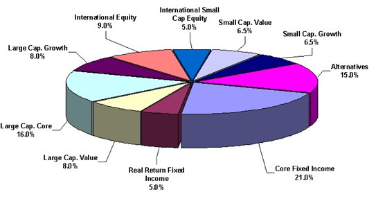
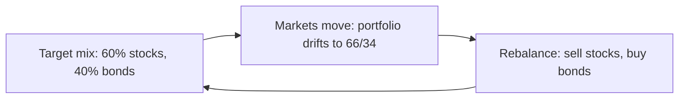

# Asset allocation and rebalancing

**Prerequisites:** [The efficient frontier](02-the-efficient-frontier.md), [Risk and return](../01-foundations/10-risk-and-return.md).

*An asset allocation shown as slices of a portfolio. Credit: Credit as given on Wikimedia Commons. License: Public domain. Source: [File:Asset allocation.png](https://commons.wikimedia.org/wiki/File:Asset_allocation.png).*

**Asset allocation** is the split of a portfolio among broad asset classes: stocks, bonds, cash, real estate and others. Research suggests it is the main driver of how much risk you take and, over time, of how your portfolio behaves. Deciding the mix and then keeping to it, via **rebalancing**, is the core of practical portfolio management.

## Why allocation matters

A classic 1986 study by Gary Brinson, Randolph Hood and Gilbert Beebower found that the *variation over time* of a typical pension fund's returns was explained mostly (over 90%) by its policy asset mix, not by security selection or market timing. This is often misquoted as "allocation explains 90% of returns"; the finding is about the *time-series variation* of returns of a given fund relative to its peers' policy mix, and says little about whether any one allocation is best. The practical takeaway still holds: **how much you hold in stocks versus bonds matters far more to your outcome than which individual securities you pick.**

## The main drivers of the choice

1. **Risk tolerance (emotional capacity):** how you will really feel and act when your portfolio falls by 30%. Many people overestimate it before a crash.
2. **Risk capacity (financial ability):** how much loss you can absorb without changing your plans, depending on income stability, savings and obligations.
3. **Time horizon:** money needed in two years should not be in stocks; money needed in thirty years can ride out downturns, since stocks have historically recovered, though no recovery is guaranteed or has a fixed timetable.
4. **Goals and liabilities:** retirement spending, a down payment, children's education.
5. **Human capital:** a young worker with stable income has a "bond-like" asset in future wages; a commission salesperson in a cyclical industry has a risky one.
6. **Taxes and accounts:** where to hold what; see [registered and non-registered accounts](../09-personal-investing-canada/02-registered-and-non-registered-accounts.md).

Common rules of thumb: "100 minus age in stocks" (or 110 or 120) and **target-date funds**, which reduce equity share as the target year nears. They are guidelines, not laws; the plan must fit the person. A **glide path** describes how the allocation changes over time.

## Example allocations

| Profile | Stocks | Bonds / cash |
|---|---|---|
| Conservative | 30% | 70% |
| Balanced | 60% | 40% |
| Growth | 80% | 20% |
| Aggressive | 100% | 0% |

The earlier lessons show that such mixes sit along an efficient frontier: more stocks mean higher expected return and higher risk, never for free. In Canada, single-ticker "all-in-one" asset allocation ETFs hold a fixed mix (for instance 80% equity / 20% bonds) and rebalance automatically; see [building a simple portfolio](../09-personal-investing-canada/07-building-a-simple-portfolio.md). An investor should also hold a diversification across **geographies**: Canada is only a small share of global equity markets (roughly three percent by market value), so a portfolio of Canadian stocks alone is a heavily concentrated bet; this "home bias" is common.

## Rebalancing

Over time, different assets grow at different rates, and the portfolio drifts away from its target. Suppose you start with 100,000 as 60,000 stocks and 40,000 bonds (60/40). In one strong year stocks gain 30% and bonds 2%:

- Stocks: 60,000 × 1.30 = 78,000
- Bonds: 40,000 × 1.02 = 40,800
- Total 118,800, now 65.7% stocks and 34.3% bonds.

The portfolio has become riskier than planned. **Rebalancing** returns it to 60/40: target stocks 71,280 and bonds 47,520, so sell 6,720 of stocks and buy 6,720 of bonds. It forces you to **sell what has risen and buy what has lagged**, the opposite of the instinct to chase performance. Ways to rebalance:

- **Calendar:** once a year, or quarterly.
- **Threshold (tolerance bands):** when an asset class drifts more than, say, 5 percentage points from its target.
- **With new money:** direct contributions to the underweight asset, avoiding taxable sales.
- **With withdrawals:** draw from the overweight asset.

Costs and taxes matter: selling in a taxable account can trigger capital gains; use registered accounts, new contributions or tax-aware rebalancing to limit this. Over-frequent rebalancing adds costs.

## Does rebalancing increase returns?

It chiefly controls **risk**; it does not guarantee higher returns. In trending markets, a rebalancer may do worse than one who lets winners run; in choppy, mean-reverting markets, rebalancing can add a small "rebalancing bonus". The sound argument is about risk management: it keeps the risk you take in line with the plan you chose. Studies suggest that annual or threshold-based rebalancing captures most of the benefit, and the exact frequency matters little.

## Strategic and tactical

**Strategic allocation** is the long-term policy mix. **Tactical allocation** makes short-term deviations based on market views. Evidence for success of tactical timing is weak; see [the efficient market hypothesis](04-the-efficient-market-hypothesis.md). Most individuals do best with a clear strategic policy, written down, and a rule for rebalancing.

## Behavioural point

In a crash, the temptation is to sell stocks and wait for calm, locking in losses and missing the rebound. A written allocation and rebalancing rule helps; see [prospect theory and loss aversion](../07-behavioural-finance/02-prospect-theory-and-loss-aversion.md).

## Key ideas

- Asset allocation, the split among stocks, bonds and other classes, is the main determinant of a portfolio's risk.
- Choose it by risk tolerance, capacity, horizon, goals and human capital; rules of thumb are only starting points.
- Rebalancing returns the portfolio to target and forces selling high and buying low; it is mainly a risk-control tool.
- Use new contributions, thresholds or registered accounts to keep costs and taxes low.

## Where this leads

- Next: [factor investing](07-factor-investing.md).
- Related: [building a simple portfolio](../09-personal-investing-canada/07-building-a-simple-portfolio.md), [foundations before investing](../09-personal-investing-canada/01-foundations-before-investing.md).
- Glossary: [asset allocation](../glossary/portfolio-theory/asset-allocation.md), [rebalancing](../glossary/portfolio-theory/rebalancing.md), [risk tolerance](../glossary/portfolio-theory/risk-tolerance.md), [glide path](../glossary/portfolio-theory/glide-path.md), [home bias](../glossary/portfolio-theory/home-bias.md), [human capital](../glossary/portfolio-theory/human-capital.md).
