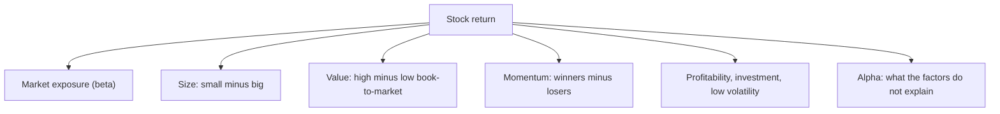

# Factor investing

**Prerequisites:** [CAPM and beta](03-capm-and-beta.md), [The efficient market hypothesis](04-the-efficient-market-hypothesis.md).

*Sunlight scattered into a spectrum by a glass crystal acting as a prism: factor models likewise split a return into component sources. Credit: Pittigrilli. License: [CC BY-SA 4.0](https://creativecommons.org/licenses/by-sa/4.0). Source: [File:Light spectrum on a wall caused by sunlight going through prism and then handmade glass.jpg](https://commons.wikimedia.org/wiki/File:Light_spectrum_on_a_wall_caused_by_sunlight_going_through_prism_and_then_handmade_glass.jpg).*

If CAPM were the whole story, beta alone would explain differences in average returns across stocks. It does not. **Factor investing** builds portfolios around characteristics, called **factors**, that have historically explained returns beyond market exposure.

## From one factor to several

In 1992, Eugene Fama and Kenneth French showed that, in US data, two characteristics, firm **size** (market capitalisation) and **value** (high book-to-market ratio, or cheapness), explained average returns better than beta. In 1993 they proposed the **three-factor model**:

> R_i − r_f = α + β_m (R_m − r_f) + β_s SMB + β_v HML + ε

- **MKT:** the market's excess return.
- **SMB** ("small minus big"): return of small-cap stocks minus large-cap stocks.
- **HML** ("high minus low"): return of high book-to-market (value) stocks minus low (growth) stocks.

Later additions:

- **Momentum (UMD or WML):** stocks that did well over the past 3 to 12 months tended to continue to outperform the losers over the next few months (Jegadeesh and Titman, 1993); added by Mark Carhart in 1997 to make a four-factor model.
- **Profitability and investment:** Fama and French's five-factor model (2015) added the tendency of profitable firms, and of firms investing conservatively, to earn higher returns.
- **Low volatility / low beta:** less risky stocks have delivered returns that are not much lower, and sometimes higher, than riskier ones.
- **Quality, carry and others** in various asset classes.

## A worked example

Suppose the monthly factor premia, annualised, are: market 5%, SMB 2%, HML 3% over a risk-free rate of 3%. A fund with loadings β_m = 1.1, β_s = 0.4 and β_v = 0.3 has an expected return of:

3% + 1.1 × 5% + 0.4 × 2% + 0.3 × 3% = 3 + 5.5 + 0.8 + 0.9 = **10.2%**.

If the fund actually returned 10.2%, its alpha would be zero: it earned exactly the compensation for its factor exposures. This is the key insight: some of what was once called "manager skill" (alpha) is really factor exposure that investors can obtain cheaply through rules-based funds. Regressing a manager's returns on the factors shows how much is factor exposure and how much is truly alpha, if any.

## Why might factor premia exist?

Two broad families of explanations:

1. **Risk-based:** the premium compensates investors for bearing risk not captured by beta. Value firms may be distressed or inflexible and do badly in bad times; small firms are less liquid and more fragile.
2. **Behavioural:** the premium reflects mistakes: investors extrapolate recent trends (leading to momentum), overpay for exciting "glamour" stocks, or are overconfident; see [behavioural finance](../07-behavioural-finance/README.md). Limits to arbitrage allow the mispricing to persist.

Neither explanation has won; the answer probably includes both, and differs by factor.

## Factor funds: "smart beta"

Index providers and fund companies offer ETFs tilted to value, small size, momentum, quality, low volatility or dividends, often charging more than plain index funds. Some are multi-factor. They are neither "active" nor purely "passive": they follow rules, but make bets compared with the market portfolio.

## Cautions

- **Premia are not guaranteed.** Value stocks lagged growth stocks for much of the 2010s in the US, a long drought. Factors can be out of favour for a decade.
- **Data mining:** with hundreds of tested characteristics, some will look good by chance. Academics speak of a "factor zoo"; robust factors should work across time, countries, asset classes and have an economic rationale. Premia often decline after publication, as investors compete for them.
- **Costs and turnover:** trading to maintain tilts costs money; capacity is limited.
- **Behavioural difficulty:** sticking with an underperforming factor requires conviction and a long horizon, which often fails exactly when needed.
- **Definitions vary:** different "value" funds may hold quite different stocks.

## What this means for investors

A broad market index fund remains a sound core. Factor tilts, if used, should be a modest, low-cost, long-horizon addition, supported by understanding why they might work and tolerance for years of underperformance; the evidence suggests no free lunch, just different risks. As a check, ask: is the extra expected return plausible, does it exist across markets and times, can I hold it through bad stretches, and what does it cost?

## Key ideas

- Beyond market beta, factors such as size, value, momentum, profitability and low volatility have explained differences in average returns.
- The Fama–French three-factor model (1993) and its extensions let you separate factor exposure from true alpha.
- Premia may be rewards for risk, behavioural mispricing, or both; they are not guaranteed and can vanish for years.
- Use factors cautiously, with low cost and long horizons; beware of data-mined results.

## Where this leads

- Next: [measuring performance](08-measuring-performance.md).
- Related: [active versus passive investing](05-active-versus-passive-investing.md), [other valuation ratios](../03-securities/01-stocks/07-other-valuation-ratios.md).
- Glossary: [[g:factor|factor]], [[g:fama-french|Fama–French model]], [[g:value-investing|value investing]], [[g:size-premium|size premium]], [[g:momentum|momentum]], [[g:smart-beta|smart beta]], [[g:low-volatility|low volatility]].
