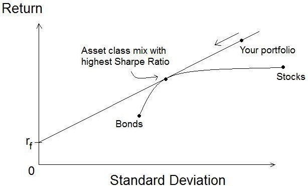
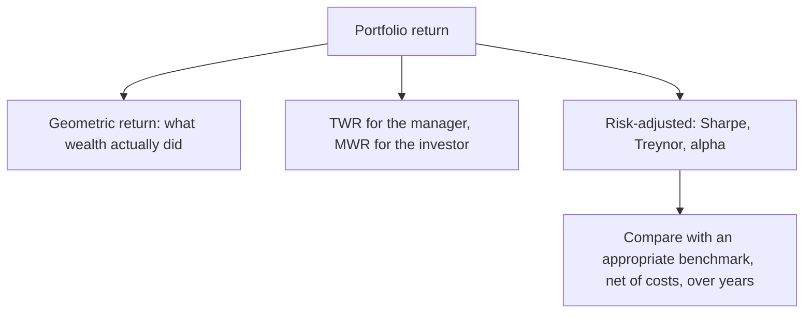

# Measuring performance

**Prerequisites:** [Portfolio return and risk](01-portfolio-return-and-risk.md), [CAPM and beta](03-capm-and-beta.md).

*A graph illustrating the Sharpe ratio, a measure of risk-adjusted performance. Credit: ShuBraque. License: [CC BY-SA 3.0](https://creativecommons.org/licenses/by-sa/3.0). Source: [File:Sharpe ratio graph.jpg](https://commons.wikimedia.org/wiki/File:Sharpe_ratio_graph.jpg).*

How do you know whether your portfolio is doing well? Raw returns can mislead: a high return may mean a high risk, a recent contribution can distort the number, and the right comparison is not zero but a fair benchmark. This lesson covers the main measures.

## Return measures

### Arithmetic versus geometric averages

If a portfolio gains 20% in year one and loses 10% in year two, the **arithmetic average** is (20% − 10%) ÷ 2 = 5%. But 100 becomes 120 and then 108, a total gain of 8%, and the **geometric (compound) annual return** is √(1.20 × 0.90) − 1 = **3.92%**. The geometric mean is what your wealth actually did; arithmetic means overstate it when returns are volatile. The gap grows with volatility ("volatility drag"). Another asymmetry: a 30% loss needs a 43% gain to recover; a 50% loss needs 100%.

### Time-weighted versus money-weighted

Flows of money in and out complicate measurement. Two methods answer different questions:

- **Time-weighted return (TWR)** ignores the timing of deposits and withdrawals and links the returns of each sub-period. It measures the *manager's* performance, which is why funds report it.
- **Money-weighted return (MWR)**, the internal rate of return on all cash flows (see [NPV and IRR](../01-foundations/05-present-value-and-discounting.md)), measures the *investor's* experience, including the timing of their contributions.

Example: you invest 1,000. In year one it gains 20% to 1,200. You then add 1,000, making 2,200. In year two it loses 10%, ending at 1,980.

- TWR: 1.20 × 0.90 − 1 = 8% total, or 3.92% a year.
- MWR: solve −1,000 − 1,000/(1+r) + 1,980/(1+r)² = 0, giving r ≈ **−0.67%** a year.

The fund's holdings earned 3.9% a year, but you earned a slight loss, because the large contribution came just before the decline. The difference is due to timing. Investors as a group often have lower money-weighted returns than the funds they hold, because they add money after good years; see [behavioural finance](../07-behavioural-finance/README.md).

## Risk-adjusted measures

- **Sharpe ratio** (William Sharpe, 1966): (R_p − r_f) ÷ σ_p, excess return per unit of total risk. Example: a fund returns 9% with 12% volatility, risk-free rate 3%: Sharpe = 6 ÷ 12 = 0.50. A market index returns 8% with 15% volatility: (8 − 3) ÷ 15 = 0.33. The fund looks better after adjusting for risk. The ratio assumes that volatility is the right measure of risk and that returns are roughly normal; it can be gamed by strategies that sell insurance (steady gains with rare large losses).
- **Treynor ratio:** (R_p − r_f) ÷ β_p, excess return per unit of systematic risk; suitable for a fund held as part of a diversified portfolio.
- **Jensen's alpha:** R_p − [r_f + β_p (R_m − r_f)]; the return above CAPM's prediction; see [CAPM and beta](03-capm-and-beta.md).
- **Sortino ratio:** like Sharpe but divides by downside deviation only.
- **Information ratio:** active return relative to a benchmark divided by **tracking error**, the volatility of that difference.
- **Maximum drawdown:** the largest peak-to-trough decline; arguably the number investors feel most. Recovery from a 50% drawdown requires a 100% gain.

## Benchmarks

A **benchmark** is the yardstick a portfolio is judged against. A good benchmark is:

1. **Appropriate:** matches the portfolio's asset classes, region, style and currency (a Canadian bond fund against a Canadian bond index, not the S&P 500).
2. **Investable:** you could actually hold it.
3. **Measurable and transparent** and specified in advance.
4. **Total-return based:** includes dividends; see [market indices](../04-markets/06-market-indices.md).

For a diversified personal portfolio, a sensible benchmark is a blend of index funds in your target mix, such as 60% global equity and 40% bonds. Compare *net of all costs* and *over a full market cycle* (several years): comparing a year to a year is mostly noise.

## Attribution

**Performance attribution** breaks a result into sources: asset allocation, security selection, and factor exposure. A portfolio that beat its benchmark by 2% might have done so by overweighting a sector that boomed (allocation), by picking better stocks within sectors (selection), or by taking on a style factor like value or small size. Factor regressions help check whether apparent skill is factor exposure; see [factor investing](07-factor-investing.md).

## Pitfalls

- **Short horizons:** a year or two says almost nothing about skill. Luck dominates.
- **Survivorship bias:** only surviving funds are visible; see [active versus passive investing](05-active-versus-passive-investing.md).
- **Cherry-picked periods:** marketing materials pick favourable start and end dates.
- **Ignoring fees, taxes and inflation:** use real, after-tax, after-cost returns where possible; see [inflation and real returns](../01-foundations/07-inflation-and-real-returns.md).
- **Comparing unlike risk:** a 12% return from a high-risk portfolio is not better than 8% from a low-risk one.
- **Looking at your own return only:** compare your result to what you would have gotten with a simple index mix.

## Key ideas

- Use geometric (compound) returns rather than arithmetic averages; time-weighted returns judge the manager, money-weighted returns capture the investor's own timing.
- Risk-adjusted measures such as Sharpe ratio, Treynor ratio and alpha compare return per unit of risk.
- A fair benchmark must be appropriate, investable and measured net of costs over a long period.
- Beware of short horizons, survivorship bias and cherry-picked periods.

## Where this leads

- Next: [behavioural finance](../07-behavioural-finance/01-from-rational-to-behavioural.md), on why investors, and measurement of ourselves, go wrong.
- Related: [asset allocation and rebalancing](06-asset-allocation-and-rebalancing.md), [fees](../03-securities/03-funds/04-fees-and-the-cost-of-investing.md).
- Glossary: [time-weighted return](../glossary/portfolio-theory/time-weighted-return.md), [money-weighted return](../glossary/portfolio-theory/money-weighted-return.md), [geometric mean](../glossary/portfolio-theory/geometric-mean.md), [Sharpe ratio](../glossary/portfolio-theory/sharpe-ratio.md), [alpha](../glossary/portfolio-theory/alpha.md), [maximum drawdown](../glossary/portfolio-theory/maximum-drawdown.md), [benchmark](../glossary/portfolio-theory/benchmark.md), [tracking error](../glossary/funds/tracking-error.md).
