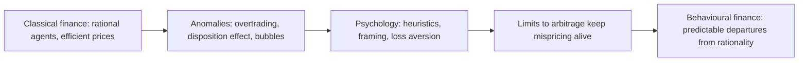

# From rational to behavioural

**Prerequisites:** [The efficient market hypothesis](../06-portfolio-theory/04-the-efficient-market-hypothesis.md), [Probability and expected value](../01-foundations/08-probability-and-expected-value.md).

*Herbert Simon, who introduced the idea of bounded rationality. Credit: Rochester Institute of Technology. License: Public domain. Source: [File:Herbert Simon, RIT NandE Vol13Num11 1981 Mar19 Complete.jpg](https://commons.wikimedia.org/wiki/File:Herbert_Simon,_RIT_NandE_Vol13Num11_1981_Mar19_Complete.jpg).*

Classical finance assumes people are **rational**: they have stable preferences, update beliefs correctly using probability, and maximise **expected utility**. **Behavioural finance** asks what happens when that is only roughly true. It combines psychology with economics to explain systematic patterns in how people, and therefore prices, behave.

## The rational benchmark

The standard model, developed in the mid-20th century (von Neumann and Morgenstern, Savage), says investors evaluate gambles by the expected utility of final wealth, treat all equal-sized outcomes equally regardless of how they are described, are consistent over time, and are at most random in their errors, so errors cancel. If a few irrational traders exist, rational **arbitrageurs** trade against them and drive prices back, so prices remain efficient. See [the efficient market hypothesis](../06-portfolio-theory/04-the-efficient-market-hypothesis.md).

## The challenge

In the 1970s Daniel Kahneman and Amos Tversky, two psychologists, published experiments showing predictable departures from the rational model. Their 1974 paper "Judgment under Uncertainty: Heuristics and Biases" and their 1979 paper on [prospect theory](02-prospect-theory-and-loss-aversion.md) are the foundations. Kahneman received the 2002 Nobel Memorial Prize in economics (Tversky had died in 1996). Richard Thaler's work on mental accounting and the "endowment effect" earned the 2017 Nobel Prize; Robert Shiller shared the 2013 prize partly for work on market over-reactions. Their key claims:

1. People rely on **heuristics**, mental shortcuts that are quick and usually good enough but produce systematic errors in some situations.
2. Preferences depend on **reference points and framing**, not just final wealth.
3. Errors are **systematic**, not random: many people err in the same direction at the same time, so they do not cancel out.

## Two kinds of thinking

Kahneman's book *Thinking, Fast and Slow* (2011) describes **System 1** (fast, automatic, intuitive) and **System 2** (slow, effortful, deliberate). Most financial mistakes arise when System 1 answers a question that needs System 2, especially under stress, time pressure or emotional arousal, as in a market crash.

## The three pillars of behavioural finance

1. **Heuristics and biases** in belief formation: overconfidence, representativeness, availability, anchoring; see [overconfidence and other biases](03-overconfidence-and-other-biases.md).
2. **Prospect theory and framing** in preferences: losses loom larger than gains; reference points matter; see [prospect theory](02-prospect-theory-and-loss-aversion.md) and [mental accounting, anchoring and framing](05-mental-accounting-anchoring-and-framing.md).
3. **Limits to arbitrage:** even if some traders are irrational, rational traders cannot always correct prices, because arbitrage is risky and costly. Prices can stay wrong long enough to bankrupt the arbitrageur (see Shleifer and Vishny, 1997, and the long-lived dot-com bubble in [the dot-com bubble](../08-history/10-the-dot-com-bubble.md)).

## Evidence in markets

- **Excessive trading:** Brad Barber and Terrance Odean (2000), studying thousands of US brokerage accounts, found that households that traded most earned notably less than those that traded least, mainly through costs and poor timing.
- **The disposition effect:** investors sell winners too early and hold losers too long (Shefrin and Statman, 1985; Odean, 1998).
- **Bubbles and manias:** repeated across centuries; see [herding, bubbles and manias](04-herding-bubbles-and-manias.md).
- **Home bias:** investors hold too much of their own country's stock market.
- **Under-diversification** and **chasing performance:** money flows to funds after strong returns, which then often fall.

## Rationality is not abandoned

Behavioural finance does not say people are stupid or markets are random. Its message is more precise: deviations from rationality are **predictable**, and some may affect prices. Proponents and critics, including Fama, argue about whether the anomalies reflect true mispricing or compensation for risk, and the "joint hypothesis problem" makes tests difficult. A reasonable synthesis, such as Andrew Lo's *adaptive markets hypothesis*, sees markets as mostly efficient but with periods when behaviour matters, depending on conditions and competition.

## What this means for investors

The practical value of behavioural finance is mostly **defensive**: you can learn your own predictable mistakes and build rules to avoid them. Examples:

- Write an **investment policy statement** setting your allocation and rules in advance, when calm.
- **Automate** contributions, so fear and greed do not interfere. Brigitte Madrian and Dennis Shea (2001) found that automatically enrolling new employees in a retirement plan raised participation from about 37% to about 86%, a demonstration that defaults powerfully shape behaviour; Thaler and Cass Sunstein's *Nudge* (2008) built on this.
- **Reduce how often you look:** frequent checking exposes you to more losses, which hurt more than gains please.
- **Use checklists** and cooling-off periods before big decisions.
- **Rebalance by rule,** not by feeling; see [asset allocation and rebalancing](../06-portfolio-theory/06-asset-allocation-and-rebalancing.md).

The cost of poor behaviour compounds: an investor earning 5% instead of 7% for 30 years ends with a portfolio about 43% smaller (1.05³⁰ ÷ 1.07³⁰ = 0.57).

## A philosophical note

Self-knowledge, restraint and good habits are ancient themes: see [philosophy: ethics](../../../philosophy/concepts/ethics/README.md), in particular [the mean](../../../philosophy/concepts/ethics/the-mean.md), the idea that virtue lies between extremes. Whether Greek or Stoic or Confucian practice maps neatly onto investing is a stretch, but the discipline of acting by reasoned rules, not momentary impulses, is a shared theme.

## Key ideas

- Classical finance assumes rational agents and efficient prices; behavioural finance documents systematic departures.
- Its three pillars are heuristics and biases, prospect theory and framing, and limits to arbitrage.
- Evidence includes excessive trading, the disposition effect, bubbles and home bias.
- The practical lesson is defensive: know your biases and build rules and defaults to counter them.

## Where this leads

- Next: [prospect theory and loss aversion](02-prospect-theory-and-loss-aversion.md).
- Related: [measuring performance](../06-portfolio-theory/08-measuring-performance.md), [the history of manias](../08-history/README.md).
- Glossary: [[g:behavioral-finance|behavioural finance]], [[g:heuristic|heuristic]], [[g:expected-utility|expected utility]], [[g:limits-to-arbitrage|limits to arbitrage]], [[g:nudge|nudge]], [[g:disposition-effect|disposition effect]], [[g:home-bias|home bias]].
