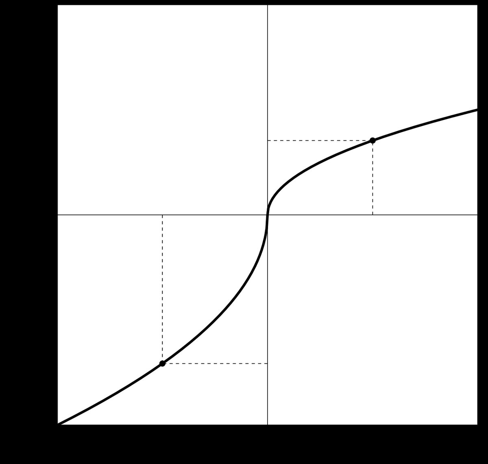
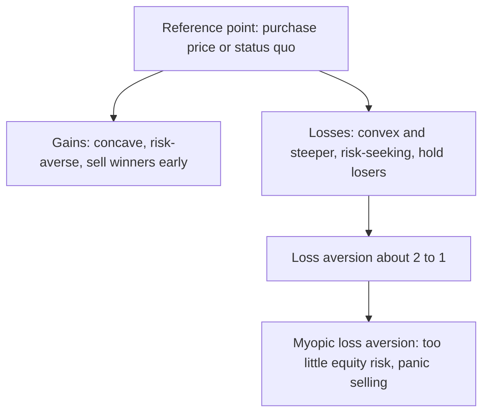

# Prospect theory and loss aversion

**Prerequisites:** [From rational to behavioural](01-from-rational-to-behavioural.md).

*The S-shaped value function of prospect theory: steeper for losses than for gains, and flatter far from the reference point. Credit: Halunkilein. License: [CC0](http://creativecommons.org/publicdomain/zero/1.0/deed.en). Source: [File:Prospect Theory Value Function.svg](https://commons.wikimedia.org/wiki/File:Prospect_Theory_Value_Function.svg).*

Why does losing 100 feel worse than gaining 100 feels good? **Prospect theory**, published by Daniel Kahneman and Amos Tversky in *Econometrica* in 1979, is a descriptive model of how people actually choose among risky options. It remains one of the most cited papers in economics.

## Four features

1. **Reference dependence.** People evaluate outcomes as **gains and losses relative to a reference point** (often the status quo or the purchase price), not as final wealth. A stock bought at 50 now at 45 feels like a loss of 5, even if the "right" question is what it will be worth next.
2. **Loss aversion.** Losses loom larger than equivalent gains. Experiments suggest a loss hurts roughly twice as much as an equal gain pleases; Tversky and Kahneman's 1992 estimate was a coefficient of about 2.25.
3. **Diminishing sensitivity.** The difference between gaining 0 and 100 feels larger than between 1,000 and 1,100, and likewise for losses. The value function is **concave for gains** (risk-averse) and **convex for losses** (risk-seeking), steeper for losses than gains: an S-shape with a kink at the reference point.
4. **Probability weighting.** People overweight small probabilities (hence lottery tickets and insurance) and underweight moderate to high ones, and treat certainty as special.

## Worked example

Use a simple value function v(x) = x^0.88 for gains and v(x) = −2.25 × (−x)^0.88 for losses (values close to Tversky and Kahneman's estimates).

**Mixed gamble:** a 50% chance to win 150 and 50% chance to lose 100. Expected value is +25, so a rational risk-neutral person would accept. Prospect value = 0.5 × v(150) + 0.5 × v(−100) = 0.5 × 82.2 + 0.5 × (−129.5) = −23.6 (using v(150) ≈ 82.2; v(−100) = −2.25 × 57.5 = −129.5): negative, so rejected. The winning amount must be about **251** before a 50–50 bet against losing 100 becomes acceptable: about 2.5 to 1. Many people refuse such bets.

**Gains versus losses:** consider gains first. Option A: a sure gain of 120. Option B: a 50% chance of 250 and 50% of nothing (expected value 125). Using the value function, A is worth 120^0.88 ≈ 67.6, B is worth 0.5 × 250^0.88 ≈ 64.4. So most people take the sure thing: risk-averse in gains.

Now losses. Option C: a sure loss of 120. Option D: a 50% chance of losing 250 and 50% of losing nothing (expected value −125). C is worth −2.25 × 67.6 = −152.0, D is worth 0.5 × (−2.25) × 250^0.88 = −145.0. So D is preferred: most people **gamble to avoid a sure loss**, even though D's expected loss is worse. This reversal, risk-averse for gains and risk-seeking for losses, is a signature of the theory.

## Consequences in investing

- **Disposition effect:** investors prefer to sell winners (locking in a gain with certainty) and hold losers (hoping to avoid realising a loss). It is a pattern documented by Shefrin and Statman (1985) and Odean (1998). It is costly in taxable accounts: selling a winner triggers tax. (Example: in Canada with a 50% inclusion rate and a 40% marginal tax rate, a 3,000 gain costs 3,000 × 0.5 × 0.4 = 600 in tax; selling a loser realises a capital loss of, say, 2,000, which can offset gains and saves up to 400.) Also, the purchase price is irrelevant to the future; what matters is the prospect going forward.
- **Holding on to losers** until "break-even", then selling: the break-even effect.
- **Too little risk-taking and "myopic loss aversion":** Shlomo Benartzi and Richard Thaler (1995) argued that investors who check their portfolios often see more losses, feel them more strongly, and so take less equity risk than they should given long horizons; the equity premium may be partly due to this.
- **The equity premium puzzle:** Mehra and Prescott (1985) showed that the historical equity premium was larger than standard models could explain with plausible risk aversion; loss aversion is one proposed explanation.
- **Panic selling in a crash:** the pain of loss peaks when the portfolio is down; selling "stops the pain" but locks it in.
- **The endowment effect:** people value what they own more than what they could acquire; sellers ask for more than buyers will pay (Kahneman, Knetsch and Thaler, 1990, in mug experiments).
- **Risk-seeking after losses:** traders who are down may double up to "get even," a classic path to ruin.

## Recovering from losses

The asymmetry has a mathematical counterpart: a 40% loss needs a gain of 67% to recover; 20% needs 25%. Investors perceive losses as heavy partly because arithmetic really does make them heavy.

## What to do

1. **Pre-commit:** choose an asset allocation that you can hold through a 30–40% decline, and write the rules down.
2. **Ask the forward-looking question:** "Would I buy this today at this price?" If not, the purchase price is a sunk cost.
3. **Look at the whole portfolio,** not each holding.
4. **Check less often:** annual checks reduce the sight of short-term losses.
5. **Use tax-loss harvesting** where appropriate, selling a loser deliberately for the tax benefit while observing the superficial loss rules in Canada (no repurchase of identical property within 30 days before or after).

## Key ideas

- Prospect theory describes choice via gains and losses relative to a reference point, with diminishing sensitivity and probability weighting.
- Loss aversion: a loss hurts about twice as much as an equal gain pleases; people are risk-averse over gains and risk-seeking over losses.
- Consequences include the disposition effect, myopic loss aversion and panic selling.
- Counter with pre-commitment, forward-looking questions and less frequent checking.

## Where this leads

- Next: [overconfidence and other biases](03-overconfidence-and-other-biases.md).
- Related: [asset allocation and rebalancing](../06-portfolio-theory/06-asset-allocation-and-rebalancing.md), [taxes on investments](../09-personal-investing-canada/06-taxes-on-investments.md).
- Glossary: [prospect theory](../glossary/behavioural-finance/prospect-theory.md), [loss aversion](../glossary/behavioural-finance/loss-aversion.md), [reference point](../glossary/behavioural-finance/reference-point.md), [disposition effect](../glossary/behavioural-finance/disposition-effect.md), [endowment effect](../glossary/behavioural-finance/endowment-effect.md), [myopic loss aversion](../glossary/behavioural-finance/myopic-loss-aversion.md), [equity premium puzzle](../glossary/behavioural-finance/equity-premium-puzzle.md).
