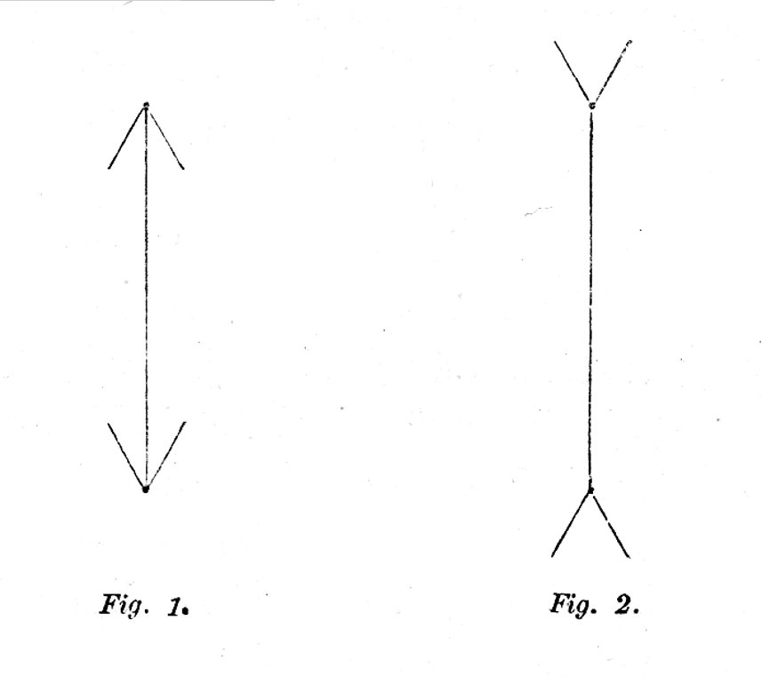
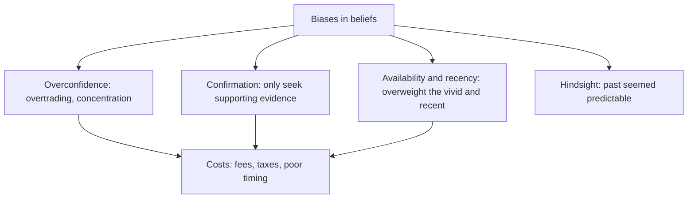

# Overconfidence and other biases

**Prerequisites:** [From rational to behavioural](01-from-rational-to-behavioural.md).

*The Müller-Lyer illusion: two equal lines look unequal, and knowing so does not remove the effect. Credit: Franz Carl Müller-Lyer, Franz Brentano. License: Public domain. Source: [File:Müller-Lyer illusion - Franz Bretano - 1892.png](https://commons.wikimedia.org/wiki/File:Müller-Lyer_illusion_-_Franz_Bretano_-_1892.png).*

Prospect theory describes how we value outcomes. This lesson covers how we form *beliefs*: the shortcuts and errors that shape our forecasts, our reading of evidence and our trading. Each bias has a plain cost for investors.

## Overconfidence

People systematically overestimate their knowledge, skill and the precision of their forecasts. Famous results: in a 1981 study, Ola Svenson found that about 93% of the US drivers surveyed rated themselves above the median driver, which is impossible. In **calibration** tests, people give "90% confidence" ranges that contain the true value only about half the time or even less. In finance, overconfidence appears as:

- **Excessive trading:** thinking one can pick the right moment or stock. Brad Barber and Terrance Odean (2000, 2001) found that households trading most earned markedly lower returns than those trading least, after costs, and that men traded more than women and earned less because of it ("Boys will be boys", 2001).
- **Under-diversification:** concentrating in familiar stocks, often one's employer.
- **Too-narrow forecasts** and overly tight risk estimates.
- **Fund-manager overconfidence:** stock picking in the face of the evidence in [active versus passive](../06-portfolio-theory/05-active-versus-passive-investing.md).

Cost illustration: if overtrading costs 1% a year in fees and bad timing, over 30 years at 7% gross, 100,000 grows to 761,000 instead of the 574,000 you get at 6%: a loss of about 187,000, a quarter of the final wealth. (Check: 1.07³⁰ = 7.61; 1.06³⁰ = 5.74.)

Remedy: keep a **decision journal** (write predictions and reasons, then compare with results); consider the **base rate** (how often do investors like me beat the market?); and seek disconfirming views.

## Confirmation bias

We seek, notice and remember evidence that supports what we already believe, and discount evidence that does not. An investor who owns a stock reads positive news eagerly, dismisses negative reports. Remedy: deliberately argue the opposite case; ask "what would convince me I'm wrong?" before buying.

## Representativeness and the gambler's fallacy

People judge probabilities by how closely something resembles a stereotype, ignoring base rates. A company that had three great quarters is deemed a "great company" and expected to continue, though the sequence may be luck. Its mirror image is the **gambler's fallacy**: after several heads, believing tails is "due". Markets show both: investors extrapolate trends (buying winners at high prices) and expect reversal where none is due. Remedy: ask what the base rate is.

## Availability and recency

We estimate how likely something is by how easily examples come to mind. After a vivid crash, we overestimate the chance of another; in a long boom, we underestimate risk. **Recency bias** gives too much weight to the latest data: in 2007 the previous years' rising house prices and low volatility made risk feel small. Remedy: look at long histories (a century, not a year), including other countries' crises; see [history](../08-history/README.md).

## Hindsight bias and outcome bias

After the fact, events seem to have been predictable ("I knew it all along"), which breeds overconfidence about future predictions; and we judge a decision by its outcome rather than by the quality of the reasoning at the time. A good decision can have a bad outcome (and the reverse). Remedy: record your reasoning at decision time.

## Herding, regret and sunk costs

- **Herding:** copying others; see [herding, bubbles and manias](04-herding-bubbles-and-manias.md).
- **Regret aversion:** avoiding action because of the anticipated pain of being wrong; it keeps investors in cash after a crash ("I will buy when it's safe"), or in the herd because failing with the crowd is less painful than failing alone.
- **Sunk-cost fallacy:** letting past, unrecoverable investments (time, money) affect future decisions: "I've lost so much, I can't sell now."

## Familiarity and home bias

Investors prefer the familiar: their home country, their employer's stock, companies whose names they know. Canadians hold far more Canadian equity than Canada's share of world markets (about three percent) would justify. The cost is lost diversification. The risk is especially severe for **employer stock**: if your company fails, you lose your job and your savings together (as Enron employees found in 2001). Remedy: use global diversified funds and limit any single stock.

## Narrative and the lure of stories

Investors like stories ("the next big thing"), which are persuasive and memorable, more than statistics. Robert Shiller, in *Narrative Economics* (2019), argues popular stories help drive economic events. Be suspicious when an investment idea has a great story and no clear valuation; see [DCF valuation](../03-securities/01-stocks/09-discounted-cash-flow-valuation.md).

## Debiasing: what works?

Awareness alone helps little, since biases operate automatically. More effective:

1. **Rules and precommitment:** a written investment policy and rebalancing rule.
2. **Automation:** automatic contributions and default diversified funds.
3. **Checklists** before trades, and a mandatory waiting period for impulsive ideas.
4. **Outside view:** ask how similar cases have turned out, before considering your own.
5. **Reduce triggers:** limit exposure to news and constant price quotes.
6. **Seek independent challenge** from a trusted adviser, partner or friend.

## Key ideas

- Overconfidence, confirmation bias, representativeness, availability and hindsight shape beliefs in predictable ways.
- Costs show up as overtrading, concentration, home bias, chasing trends and poor timing.
- Awareness is not enough; rules, automation, checklists and outside views work better.
- Keep a decision journal to calibrate your confidence.

## Where this leads

- Next: [herding, bubbles and manias](04-herding-bubbles-and-manias.md).
- Related: [fees and the cost of investing](../03-securities/03-funds/04-fees-and-the-cost-of-investing.md), [scams and common mistakes](../09-personal-investing-canada/09-scams-and-common-mistakes.md).
- Glossary: [overconfidence](../glossary/behavioural-finance/overconfidence.md), [confirmation bias](../glossary/behavioural-finance/confirmation-bias.md), [gambler's fallacy](../glossary/behavioural-finance/gambler-fallacy.md), [recency bias](../glossary/behavioural-finance/recency-bias.md), [hindsight bias](../glossary/behavioural-finance/hindsight-bias.md), [sunk-cost fallacy](../glossary/behavioural-finance/sunk-cost-fallacy.md), [regret aversion](../glossary/behavioural-finance/regret-aversion.md), [base rate](../glossary/behavioural-finance/base-rate.md).
