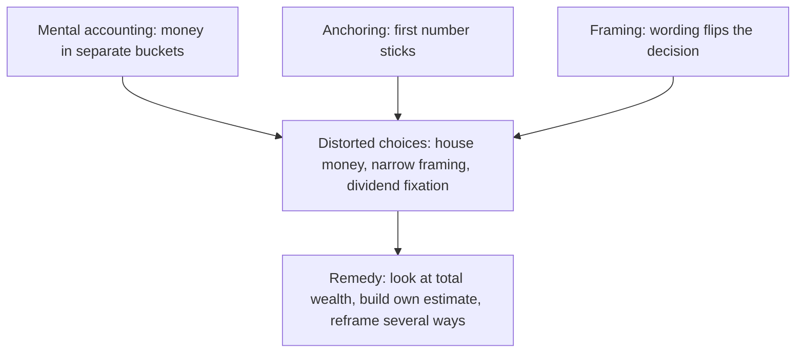

# Mental accounting, anchoring and framing

**Prerequisites:** [Prospect theory and loss aversion](02-prospect-theory-and-loss-aversion.md).

*Richard Thaler, who developed the idea of mental accounting. Credit: Bengt Nyman from Vaxholm, Sweden. License: [CC BY 2.0](https://creativecommons.org/licenses/by/2.0). Source: [File:Richard H. Thaler EM1B8851 (24027005667).jpg](https://commons.wikimedia.org/wiki/File:Richard_H._Thaler_EM1B8851_(24027005667).jpg).*

Money is fungible: a dollar is a dollar. Yet people treat it differently depending on where it came from, what they are comparing it with and how a choice is described. This lesson covers three related patterns that shape budgeting, investing and spending.

## Mental accounting

Richard Thaler, who won the 2017 Nobel Memorial Prize for this work, described **mental accounting**: people sort money into mental "accounts" (rent, holiday, savings, "play money") and treat each separately, ignoring that the total is what matters.

Examples:

- **The house-money effect:** after a gain, people take more risk with "the casino's money" (Thaler and Johnson, 1990). A stock that has doubled is treated as free money, though it is worth the same as cash you could spend.
- **Dividends versus capital gains:** many investors prefer to "live off the dividends" and never touch principal. But a company paying out 3% of its value in dividends reduces its price by the dividend; an investor who needs cash could instead sell 3% of the shares. In a world without taxes and costs, these are equivalent; see [dividends](../03-securities/01-stocks/03-dividends.md). Behaviourally, the preference for dividends can lead people to hold dividend stocks in a concentrated way or to ignore total return.
- **Keeping a savings account at 1% while carrying credit-card debt at 20%:** the mental "emergency fund" account seems separate from "debt," although paying down the debt gives a guaranteed 20% return; see [simple and compound interest](../01-foundations/03-simple-and-compound-interest.md). (Keeping some emergency savings still makes sense; but a mismatch of this size deserves attention.)
- **Windfalls:** a tax refund or bonus is spent more freely than regular income.
- **Narrow framing:** judging each investment on its own rather than as part of the portfolio. A volatile stock may reduce overall risk through diversification, but it will be judged by its own ups and downs.
- **Sunk costs:** treating money already spent as relevant to future choices; see [overconfidence and other biases](03-overconfidence-and-other-biases.md).

Mental accounting can sometimes help: separate accounts for bills, savings and long-term goals can enforce discipline. The error comes when the boundaries distort choices.

## Anchoring

**Anchoring** is the tendency to rely too heavily on an initial number, even when it is irrelevant. In a famous 1974 experiment, Tversky and Kahneman spun a wheel of fortune rigged to land on 10 or 65, and then asked people what percentage of African countries are in the United Nations. The median estimate was about 25% for those who saw 10 and 45% for those who saw 65. An obviously random number moved the answers.

In investing, anchors include:

- **Purchase price:** "I'll sell when it gets back to what I paid."
- **52-week highs and lows,** and round numbers such as a Dow level of 30,000 or a price of 100.
- **Analyst targets, past valuations** and past prices ("it was 80 last year, so 50 is a bargain").
- **Initial offer prices** in negotiations (property, salaries).
- **A first forecast,** which later forecasts adjust from insufficiently.

An investor who bought at 80, now sees 50, and concludes it is "cheap", might be wrong: the stock may have been overpriced at 80 and still be overpriced at 50. The right question is about future cash flows and the price today. Remedy: construct your own estimate of value *before* seeing prices and targets; consider several unrelated reference points.

## Framing

**Framing** means that logically equivalent descriptions of a choice lead to different decisions. Tversky and Kahneman's 1981 "Asian disease" problem: 600 people are expected to die of a disease. In one version, Program A saves 200 people for sure and Program B has a 1/3 chance of saving all 600 and 2/3 of saving none. A large majority chooses A. In the other version, Program C means 400 people die for sure and Program D has a 1/3 chance that nobody dies and 2/3 that all 600 die. Now a majority chooses D. The two versions are identical in outcomes ("save 200" = "400 die") but "gain" and "loss" wording flips the answer, consistent with [prospect theory](02-prospect-theory-and-loss-aversion.md).

Financial examples:

- **"90% fat-free" versus "10% fat":** or "a fund that has returned 8% a year" versus "one that has failed to beat inflation by more than 1%".
- **Gain/loss framing of fees:** "1% a year" sounds small; "about a quarter of the final nest egg" does not; see [fees and the cost of investing](../03-securities/03-funds/04-fees-and-the-cost-of-investing.md).
- **Relative versus absolute:** "up 50% from the low" versus "still 30% below the high".
- **Frequency of reporting:** a daily price chart emphasises noise; annual returns show a trend.
- **Defaults as framing:** an option presented as the default is chosen far more often, such as automatic enrolment in retirement plans.

Remedy: **reframe** the decision in several ways (in dollars and percentages, as gains and as losses, as an annual and a 30-year number) and see if the answer changes.

## Putting them together

An investor holds a stock bought at 60 that has fallen to 45. Mental accounting puts it in a "loss" account; anchoring fixes on 60 as the "real" value; framing as a "loss to be recovered" encourages risk-seeking to get back to even. A clear-headed question: "If I had cash equal to today's value, would I buy this stock?" Nudging the framing to the future can break the spell.

## Key ideas

- Mental accounting treats equal money differently depending on source and label, causing narrow framing, house-money risk-taking and dividend fixation.
- Anchoring lets irrelevant numbers, like the purchase price, pull our estimates.
- Framing means equivalent descriptions in terms of gains or losses change decisions.
- Counter them by viewing total wealth, forming independent valuations and reframing choices.

## Where this leads

- Next: [history](../08-history/01-lending-and-banking-before-stock-markets.md), the long record of manias, crashes and institutions.
- Related: [dividends](../03-securities/01-stocks/03-dividends.md), [foundations before investing](../09-personal-investing-canada/01-foundations-before-investing.md).
- Glossary: [[g:mental-accounting|mental accounting]], [[g:anchoring|anchoring]], [[g:framing|framing]], [[g:house-money-effect|house-money effect]], [[g:narrow-framing|narrow framing]], [[g:fungibility|fungibility]], [[g:default-effect|default effect]].
