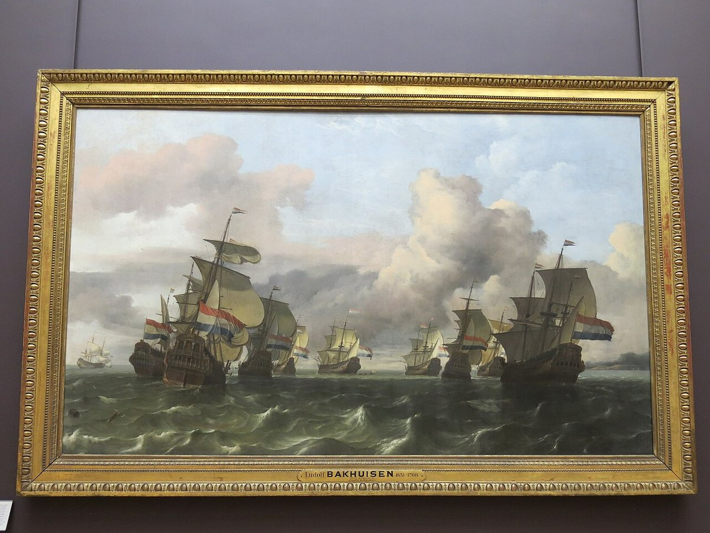
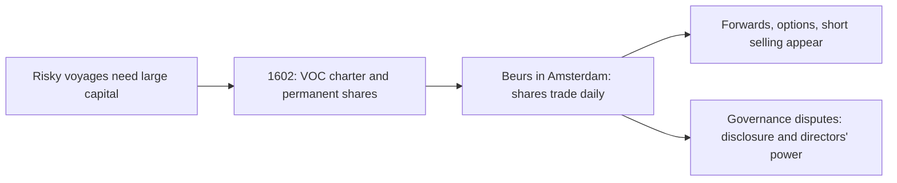

# The Dutch East India Company and the first stock exchange

**Prerequisites:** [Lending and banking before stock markets](01-lending-and-banking-before-stock-markets.md), [What is a share](../03-securities/01-stocks/01-what-is-a-share.md).

*The Return of the Fleet of the Dutch East India Company, Louvre. Credit: Tangopaso. License: Public domain. Source: [File:The Return of the Fleet of the Dutch East India Company (Louvre, INV 987).jpg](https://commons.wikimedia.org/wiki/File:The_Return_of_the_Fleet_of_the_Dutch_East_India_Company_(Louvre,_INV_987).jpg).*

In 1602, the Dutch Republic chartered a company that created in practice what had only existed in rough form before: permanent, tradable shares in a large enterprise, bought and sold on a market. This is often treated as the beginning of the modern stock market.

## Why a company was needed

Voyages to the East Indies were risky and costly: ships could take two years and many were lost to storms, disease, pirates or war. A single merchant could not afford the capital or the loss. Earlier voyages were funded by temporary partnerships, dissolved after each voyage. Competition among Dutch trading companies also pushed prices up in Asia and down in Europe. The Dutch government encouraged merging them.

## The charter of 1602

On 20 March 1602 the States General granted the **Vereenigde Oostindische Compagnie** (VOC, United East India Company) a **21-year monopoly** on Dutch trade east of the Cape of Good Hope and west of the Strait of Magellan, along with powers to make treaties, wage war and found colonies. Roughly 6.4 million guilders was raised from a wide range of subscribers, from rich merchants to ordinary Dutch people: a large sum for the era. Capital was divided into shares, and, crucially, was **permanent**: unlike earlier ventures, investors could not demand their money back. They could, however, sell their shares to someone else, which created the need for a market. See [what is a security](../02-firms-and-capital/07-what-is-a-security.md) and [limited liability and the corporation](../02-firms-and-capital/02-limited-liability-and-the-corporation.md).

Four features anticipated the modern corporation: tradable shares, permanent capital, limited liability for ordinary shareholders (partly: passive investors were not personally liable for the company's debts), and a board of directors (the "Heeren XVII") separate from the shareholders. Shareholders also complained of the opacity of the accounts and of directors' power, an early corporate-governance dispute; Isaac Le Maire, a former VOC investor, published complaints in 1609.

## The Amsterdam market

Shares were traded in Amsterdam, at first on the street and by the Nieuwe Brug, and from 1611 in a purpose-built **Beurs** (exchange) designed by Hendrick de Keyser. Traders used contracts that look modern: **forward** deals, **options** and **short selling**. In 1609 Le Maire's syndicate sold VOC shares short in what is sometimes called the first bear raid, and the authorities issued a ban on short selling (a rule repeatedly broken and renewed). See [short selling and margin](../04-markets/08-short-selling-and-margin.md) and [forwards and futures](../03-securities/04-derivatives/02-forwards-and-futures.md).

In 1688 the Amsterdam trader Joseph de la Vega, writing in Spanish, published *Confusión de Confusiones*, a dialogue describing how the market actually worked, with speculation, rumours, bulls and bears. It is among the earliest books on stock trading.

## Returns and dividends

The VOC paid dividends, sometimes in kind (in spices) in its early years and later in cash. According to common summaries of its record, it paid an average annual dividend of around 18% of the original share capital over nearly two centuries, though the history is more mixed: dividends were irregular and sometimes paid out of borrowed money. Illustration (hypothetical face value): a share of 500 guilders paying 18% a year gives 90 guilders a year. The value to a buyer depended on the price they paid: the same 90 on a share bought at 1,000 yields 9%. See [dividends](../03-securities/01-stocks/03-dividends.md) and [price and yield](../03-securities/02-bonds/03-yield-to-maturity.md).

## Decline

By the 18th century the VOC faced competition, corruption, war and heavy costs of maintaining its fortresses and colonies. In 1799 it was dissolved, with large debts; the Dutch state took over its possessions. Its legacy is double: a model of corporate finance and a symbol of the violence of colonial trade. The VOC was deeply involved in the spice monopoly, enslaved labour and conquest in Asia, and today's discussions of its history recognise this.

## What it taught finance

1. **Permanent capital plus a secondary market** lets long-term projects be funded by short-term investors: liquidity transformation, see [what an exchange does](../04-markets/01-what-an-exchange-does.md).
2. **Speculation emerges with trading,** including options and shorting, and so does regulation.
3. **Governance problems begin at once:** disclosure and the treatment of minority holders.
4. **Competing venues and instruments** (trading in the Amsterdam Beurs and later London's coffee houses) shaped Europe's financial geography.

## Key ideas

- The VOC (1602) combined tradable shares, permanent capital and a board separate from owners.
- Permanent capital created the need for a secondary market; the Amsterdam Beurs traded shares, options and forwards, and short selling began early.
- The VOC's record of dividends was strong but uneven, and its ending shows the limits of monopoly, debt and colonial costs.
- The same themes, liquidity, speculation and governance, recur in every later market.

## Where this leads

- Next: [tulip mania](03-tulip-mania.md).
- Related: [what is a company](../02-firms-and-capital/01-what-is-a-company.md), [the Mississippi and South Sea bubbles](04-the-mississippi-and-south-sea-bubbles.md).
- Glossary: [joint-stock company](../glossary/history/joint-stock-company.md), [VOC](../glossary/history/voc.md), [charter](../glossary/history/charter.md), [bear raid](../glossary/history/bear-raid.md), [permanent capital](../glossary/history/permanent-capital.md), [Beurs](../glossary/history/beurs.md).
