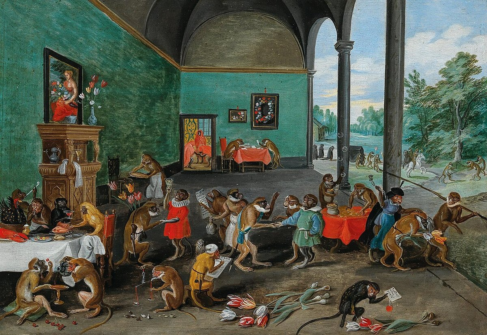

# Tulip mania

**Prerequisites:** [The Dutch East India Company and the first stock exchange](02-the-dutch-east-india-company-and-the-first-stock-exchange.md), [Herding, bubbles and manias](../07-behavioural-finance/04-herding-bubbles-and-manias.md).

*Allegory of Tulip Mania, Jan Brueghel the Younger, c. 1640, satirising the speculators as monkeys. Credit: Jan Brueghel the Younger. License: Public domain. Source: [File:Allegory of Tulip Mania by Jan Brueghel II.jpg](https://commons.wikimedia.org/wiki/File:Allegory_of_Tulip_Mania_by_Jan_Brueghel_II.jpg).*

Tulip mania in the Dutch Republic in the 1630s is the most famous bubble in history. It is often used as shorthand for collective madness. It is also a case where the popular story, shaped by 19th-century writers, is more dramatic than the evidence.

## Background

Tulips came to Western Europe from the Ottoman Empire in the late 16th century and became fashionable luxury goods in the wealthy Dutch Republic of the Golden Age. Some bulbs produced flowers with striking "broken" colour patterns, caused (as scientists later learned) by a virus, which also weakened the plant. Such bulbs were rare and could not be reliably produced, making them prized. The Dutch economy was booming, with sustained trade profits and an active market culture, as seen in [the first stock exchange](02-the-dutch-east-india-company-and-the-first-stock-exchange.md).

## The market

Bulbs can be moved only when dormant (summer to early autumn), but flowers are seen in spring. So much trading took place in the winter, in taverns, through **futures-like contracts** for bulbs still in the ground (called *windhandel*, "wind trade"), settled later. Buyers paid little or nothing upfront, and contracts were traded from hand to hand. This looked like leveraged speculation.

Reported prices rose steeply in the winter of 1636 to 1637. Accounts mention a rare bulb, *Semper Augustus*, with prices of several thousand guilders, and some records mention contracts of around 10,000 guilders for a single bulb, at a time when a skilled craftsman might earn about 300 guilders a year. If so, that bulb was worth some 33 years of a craftsman's wages (10,000 ÷ 300). Treat these figures as reported rather than certain: the sources are fragmentary, and some come from pamphlets with a moral agenda.

## The crash

In early February 1637, buyers at a bulb auction in Haarlem failed to appear at the expected prices, and the market stalled. Prices of contracts collapsed, and some traders could not or would not pay. After the collapse, courts and the authorities were reluctant to enforce the contracts, and settlements at a small fraction of the original prices were negotiated; in practice most traders paid little.

## Was it a bubble?

The traditional account was fixed by Charles Mackay's 1841 book *Extraordinary Popular Delusions and the Madness of Crowds*, which described a nation gripped by madness, ruined merchants and wide devastation. Modern historians push back:

- **Anne Goldgar** (*Tulipmania*, 2007), after examining archival records, found few examples of people ruined by tulip contracts, and concluded the economic damage was limited; the bubble was mainly among a small group of traders.
- **Peter Garber** (1989 and 2000) argued that the high prices of rare bulbs may have been consistent with ordinary market behaviour for rare, new varieties, similar to what happens with new, rare flower varieties, with the rise and fall partly explained by the plant's reproduction cycle and fundamentals; he pointed to the later high prices of hyacinths. Others disagree and see speculative dynamics.
- The record is incomplete and partly polemical: many pamphlets were written by moralisers, and that skews what survives.

A cautious summary: there was a **real episode of speculative price inflation and collapse** in specialised tulip contracts in 1636 to 1637, **much smaller in economic effect** than legend suggests, and its causes remain debated.

## Why it still matters

- **A cautionary tale for later markets,** quoted in every boom, but be careful with the evidence: the *story* can mislead as well as warn.
- **Leverage and forward contracts:** trading with little cash and deferred settlement amplifies price moves; see [forwards and futures](../03-securities/04-derivatives/02-forwards-and-futures.md) and [short selling and margin](../04-markets/08-short-selling-and-margin.md).
- **Valuation:** an asset with no cash flows whose price depends on the next buyer's willingness to pay can fall rapidly; see [cryptoassets](../03-securities/05-alternatives/04-cryptoassets.md) for a modern discussion, and [herding, bubbles and manias](../07-behavioural-finance/04-herding-bubbles-and-manias.md).
- **Rare and collectible assets:** art, wine and collectibles share the same dynamics.

## A numeric reminder

If a bulb bought at 1,000 later trades at 100, the loss is 90%, and to recover, the price must rise tenfold (900%). A contract at 10,000 for something that later trades at 100 is a 99% loss: no financial instrument can protect against paying far above what an asset can later fetch.

## Key ideas

- Tulip prices rose rapidly in 1636 to 1637 in a market for futures-like contracts, then collapsed in February 1637.
- Reported prices were extreme (a single bulb at around 10,000 guilders, some 33 years of a craftsman's pay), but the evidence is patchy.
- Modern historians, including Goldgar and Garber, argue the damage was limited and the episode partly fundamentals-driven, while the legend comes from Mackay and moralising pamphlets.
- The lesson stands, with caution: leverage, deferred settlement and assets valued only by resale invite sharp collapses.

## Where this leads

- Next: [the Mississippi and South Sea bubbles](04-the-mississippi-and-south-sea-bubbles.md).
- Related: [herding, bubbles and manias](../07-behavioural-finance/04-herding-bubbles-and-manias.md), [forwards and futures](../03-securities/04-derivatives/02-forwards-and-futures.md).
- Glossary: [[g:tulip-mania|tulip mania]], [[g:windhandel|windhandel]], [[g:speculative-bubble|speculative bubble]], [[g:futures-contract|futures contract]], [[g:fundamental-value|fundamental value]], [[g:leverage|leverage]].
