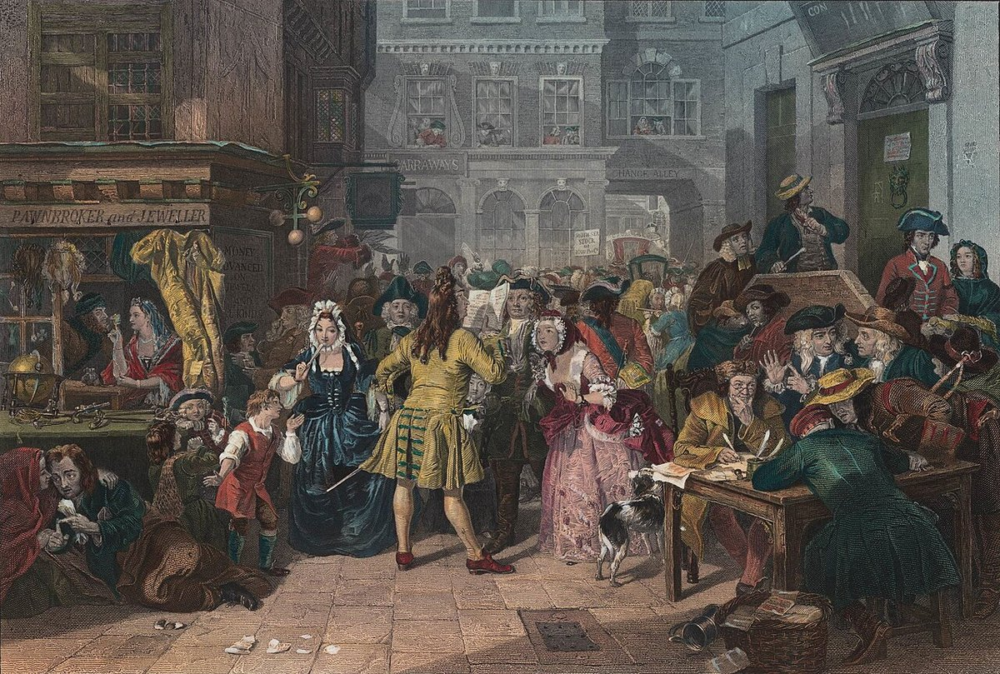
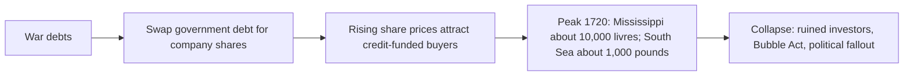

# The Mississippi and South Sea bubbles

**Prerequisites:** [Tulip mania](03-tulip-mania.md), [Government bonds](../03-securities/02-bonds/07-government-bonds.md).

*A satirical image of the South Sea Bubble, 1720. Credit: Edward Matthew Ward. License: Public domain. Source: [File:South Sea Bubble.jpg](https://commons.wikimedia.org/wiki/File:South_Sea_Bubble.jpg).*

In 1719 and 1720, two great speculative booms swept France and Britain almost simultaneously. Both were tied to government debt and to companies promising riches from overseas trade, and both ended in collapse. Their legacies included new regulations, a lasting suspicion of joint-stock companies in Britain, and a template for the later story of bubbles.

## The financial background

After years of war, both the French and British governments carried heavy debts. The idea in both countries was to convert government debt into shares in a trading company, which would lighten the debt burden, rewarding the company with monopoly rights. Investors would swap bonds for shares, and rising share prices would make the exchange attractive. A scheme like this works if the share price keeps rising, and so contains the seed of a bubble.

## The Mississippi Company (France)

The Scottish financier **John Law** persuaded the Duke of Orléans, regent of France, to let him found a bank, the **Banque Générale** (1716), which issued paper money, and then, in 1717, the **Compagnie d'Occident** (the "Mississippi Company"), which received a monopoly of trade with French Louisiana and was later merged into the **Company of the Indies**, with monopolies on trade with the East Indies and China. Law's company took over the collection of taxes and the management of the royal debt, and in 1720 he became Controller-General of Finances, running both the bank and the state finances.

Law financed share purchases with loans from his own bank, essentially creating money to buy shares. Share prices rose from about 500 livres to nearly 10,000 livres by January 1720, a twentyfold increase. As confidence wavered, holders of shares began selling for gold and silver, and the bank had to issue more paper money to keep prices up, causing **inflation**. In 1720 the government tried to deflate the paper and devalue shares, reduce the price, and impose a fixed ratio between paper and coin, which caused panic. Law's system collapsed by the end of 1720, and he fled France in December. The sudden rise and fall wiped out many investors but also paid down the government's debts, since much of the debt had been exchanged and cancelled, and left the French with a lasting distrust of paper money and banks, delaying the development of French banking.

## The South Sea Company (Britain)

The **South Sea Company**, founded in 1711, was given a monopoly on British trade with Spanish South America, although trade turned out to be small and limited by war. Its real business was **government debt**: in 1720 it proposed to take over a large part of the national debt by exchanging government bonds for company shares. The government accepted, partly because the company's bid exceeded those of competitors, and because of the prospect of lower interest costs.

Shares rose rapidly: from about £128 in January 1720 to about £1,000 in the summer. Bribes and loans to politicians and an easy credit system allowed investors to buy on instalments (a form of leverage). A flood of other companies, some outrageous, also listed, such as one "for carrying on an undertaking of great advantage, but nobody to know what it is". The government responded in June 1720 with the **Bubble Act**, which required a royal charter for joint-stock companies; it is often seen as protecting the South Sea Company from rivals' competition for investors' money as much as protecting the public. By autumn the price fell below £200, collapsing to near £150 by December, and many investors, including members of the aristocracy and the political class, were ruined. The scandal brought down ministers; **Robert Walpole** managed the political fallout and became the dominant figure of the next two decades.

## Numbers

An investor who bought at £128 and sold at £1,000 earned +681%: (1,000 ÷ 128) − 1. One who bought near the top at £1,000 and held while it fell to £150 lost 85%. To get back from £150 to £1,000 would require a 567% gain. Famous victims reportedly included Isaac Newton, who is said to have made a profit, sold, re-entered near the top and lost a considerable sum; the details are uncertain.

## Aftermath

- In Britain, the **Bubble Act** (repealed in 1825) restricted the creation of joint-stock companies for a century, delaying the wider use of the corporate form until the nineteenth century: see [limited liability and the corporation](../02-firms-and-capital/02-limited-liability-and-the-corporation.md). Britain also strengthened its public debt system, and the Bank of England emerged as the main manager of the national debt.
- In France, Law's failure led to distrust of banks and paper money; France experienced difficulties in developing public credit that some historians link to the later fiscal crisis of the monarchy.
- Economists have debated whether these were irrational bubbles. **Peter Garber** argued that Law's system had rational elements; others, following Kindleberger, treat it as a classic mania. The history shows the dangers of **money creation to finance asset purchases**, **debt-for-equity swaps** that rely on rising prices, and **political entanglement**.

## Lessons

1. **Stories sell:** monopolies on far-off trade made implausible profits seem sensible.
2. **Credit fuels bubbles:** loans to buy shares, instalment purchases and central money creation.
3. **Insiders and politicians** profit; conflicts of interest are central; see [insider trading, disclosure and fraud](../05-regulation/05-insider-trading-disclosure-and-fraud.md).
4. **Regulation follows disaster,** though not always wisely: see [why markets are regulated](../05-regulation/01-why-markets-are-regulated.md).
5. **Sophisticated people were fooled;** see [herding, bubbles and manias](../07-behavioural-finance/04-herding-bubbles-and-manias.md).

## Key ideas

- Law's Mississippi Company in France and the South Sea Company in Britain turned government debt into shares in monopoly trading companies, and both bubbles burst in 1720.
- Credit and money creation financed the share purchases; collapses followed rapidly.
- Britain's Bubble Act restricted joint-stock companies for a century; France turned against paper money and banks.
- The episodes show recurring features: attractive stories, leverage, political conflicts of interest and eventual regulation.

## Where this leads

- Next: [the Buttonwood Agreement and the NYSE](05-the-buttonwood-agreement-and-the-nyse.md).
- Related: [limited liability and the corporation](../02-firms-and-capital/02-limited-liability-and-the-corporation.md), [central banks](../05-regulation/06-central-banks-and-monetary-policy.md).
- Glossary: [[g:john-law|John Law]], [[g:south-sea-bubble|South Sea bubble]], [[g:bubble-act|Bubble Act]], [[g:debt-for-equity-swap|debt-for-equity swap]], [[g:fiat-money|fiat money]], [[g:national-debt|national debt]].
