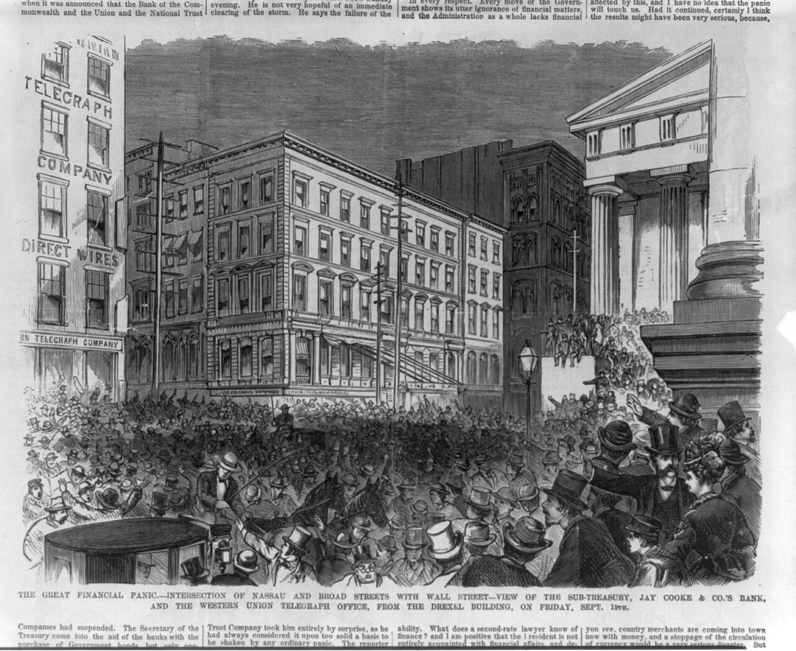

# The Buttonwood Agreement and the NYSE

**Prerequisites:** [The Mississippi and South Sea bubbles](04-the-mississippi-and-south-sea-bubbles.md), [What an exchange does](../04-markets/01-what-an-exchange-does.md).

*The intersection of Nassau, Broad and Wall Streets during the Panic of 1873, with the Sub-Treasury and Jay Cooke & Co.'s bank. Credit: Miscellaneous Items in High Demand, PPOC, Library of Congress. License: Public domain. Source: [File:The Great Financial Panic - Intersection of Nassau and Broad Streets with Wall Street - View of the sub-treasury ... on Friday Sept. 19th LCCN2005676065.jpg](https://commons.wikimedia.org/wiki/File:The_Great_Financial_Panic_-_Intersection_of_Nassau_and_Broad_Streets_with_Wall_Street_-_View_of_the_sub-treasury_..._on_Friday_Sept._19th_LCCN2005676065.jpg).*

The New York Stock Exchange (NYSE) began under a tree, or so the story goes. Its history through the 19th century is also a history of American capitalism: government debt, canals and railways, panics and the long search for a lender of last resort.

## The Buttonwood Agreement (1792)

After the American Revolution, the new federal government assumed state war debts under Treasury Secretary **Alexander Hamilton**, creating a large market in government securities, along with shares in the first banks. Brokers traded informally at street corners in New York, some under a buttonwood (sycamore) tree on Wall Street. In early 1792, a speculative boom in bank and government securities, driven by William Duer and others, collapsed in the **Panic of 1792**, and Hamilton stepped in with Treasury purchases to calm the market.

On **17 May 1792**, 24 brokers signed the **Buttonwood Agreement**, promising to trade only with each other, at fixed commissions, and to give each other preference. It created a closed club with a cartel-like structure, and kept out auctioneers who did not follow the rules. In 1817 they organised formally as the **New York Stock & Exchange Board**, later the New York Stock Exchange. Initially listings were government bonds and a few bank and insurance shares.

## Railways, the telegraph and a national market

In the 19th century, canals and especially **railways** were the first great demand for mass capital. Railway companies sold stocks and bonds to investors in the US and Europe, particularly British investors. Technology changed the market: the **telegraph** allowed prices to flow between cities, and the **stock ticker** (Edward Calahan, 1867) gave brokers a continuous feed of quotes; by the late century, the NYSE was the central US market, although regional exchanges persisted. **Charles Dow** published his first stock average in 1896, which became the Dow Jones Industrial Average; see [market indices](../04-markets/06-market-indices.md).

The late 19th century also saw **speculators and "robber barons"**, such as Jay Gould and Jim Fisk's attempt in 1869 to corner the gold market (the "Black Friday" of 24 September 1869), manipulation, stock watering (issuing shares with no corresponding assets) and little disclosure. The NYSE introduced some listing standards and reporting, but federal securities law came only in the 1930s; see [the SEC and US securities law](../05-regulation/02-the-sec-and-us-securities-law.md).

## Panics

Without a central bank in the US between 1836 (when the Second Bank's charter expired) and 1913, banking crises recurred. Each involved **bank runs**: depositors withdrawing money simultaneously, which causes even healthy banks to fail since they hold only a fraction of deposits in reserve (see [credit and banking](../01-foundations/02-credit-and-banking.md)). Example: a bank with 100 in deposits holds 10 in cash reserves. If depositors worth 15 demand their money, the bank cannot pay without selling loans quickly at a loss: runs can be self-fulfilling.

- **Panic of 1837:** after a land boom and a change in federal policies; banks suspended payments; a long depression followed.
- **Panic of 1857:** the failure of an insurance company, railway overinvestment; one of the first global crises, affecting Britain and Europe via the telegraph and transatlantic trade.
- **Panic of 1873:** the collapse of banker **Jay Cooke & Company**, which had financed railways; the NYSE closed for ten days; a depression lasted several years.
- **Panic of 1893:** railroad failures and a gold drain; depression.
- **Panic of 1907:** a failed attempt to corner the stock of United Copper triggered runs on trust companies, notably the **Knickerbocker Trust**; the NYSE fell sharply, and the financier **J. P. Morgan** organised private bankers to supply liquidity, famously locking bankers in his library until they agreed on a rescue. The episode convinced policymakers that the US needed a central bank, leading to the **Federal Reserve Act of 1913**; see [central banks and monetary policy](../05-regulation/06-central-banks-and-monetary-policy.md).

## The gold standard

During much of this era currencies were tied to gold. The classical gold standard imposed discipline, since a country with a trade deficit lost gold and had to tighten credit, but it also transmitted crises and made recessions deeper, as central banks raised rates to protect reserves and could not freely supply liquidity. See [commodities and gold](../03-securities/05-alternatives/02-commodities-and-gold.md) and [Bretton Woods and the postwar order](08-bretton-woods-and-the-postwar-order.md).

## Patterns

1. **New technology drives booms:** canals, railways, telegraph, then electricity and autos.
2. **Credit and leverage rise, then break.**
3. **Crises prompted institutional change:** the Federal Reserve after 1907; securities law after 1929.
4. **Private solutions bear limits:** J. P. Morgan acted as a private lender of last resort, but dependence on one man was not durable.
5. **Information and trust:** disclosure improved slowly, mostly after scandals.

## Key ideas

- The Buttonwood Agreement (1792) began the organisation that became the NYSE, after the first US government debt market and the Panic of 1792.
- Railways and the telegraph created national securities markets in the 19th century; disclosure and regulation lagged behind.
- Recurring panics and bank runs exposed the lack of a lender of last resort; the Panic of 1907 led to the Federal Reserve in 1913.
- The gold standard imposed discipline but also transmitted crises.

## Where this leads

- Next: [Canadian markets history](06-canadian-markets-history.md).
- Related: [the crash of 1929](07-the-crash-of-1929-and-the-great-depression.md), [central banks](../05-regulation/06-central-banks-and-monetary-policy.md).
- Glossary: [[g:buttonwood-agreement|Buttonwood Agreement]], [[g:nyse|NYSE]], [[g:bank-run|bank run]], [[g:panic|financial panic]], [[g:gold-standard|gold standard]], [[g:stock-ticker|stock ticker]], [[g:robber-barons|robber barons]].
