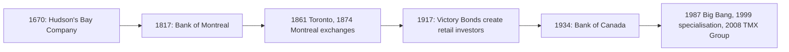

# Canadian markets history

**Prerequisites:** [The Buttonwood Agreement and the NYSE](05-the-buttonwood-agreement-and-the-nyse.md), [Securities regulation in Canada](../05-regulation/03-securities-regulation-in-canada.md).

*The former Montreal Stock Exchange building in Old Montreal (inscribed 1874), now the Théâtre Centaur. Credit: Jeangagnon. License: [CC BY-SA 3.0](https://creativecommons.org/licenses/by-sa/3.0). Source: [File:Montreal Stock Exchange 12.jpg](https://commons.wikimedia.org/wiki/File:Montreal_Stock_Exchange_12.jpg).*

Canadian financial history is shaped by geography, natural resources, a conservative banking tradition and the shadow of the United States and the United Kingdom. Several themes recur: chartered companies, railways, resource booms, a few strong national banks and a regulatory system split among provinces.

## The first corporations: furs and charters

The **Hudson's Bay Company**, chartered in 1670 by King Charles II, was a joint-stock enterprise with a monopoly over the fur trade in Rupert's Land, a vast territory draining into Hudson Bay. Its shares traded in London, and the company lasted for more than three centuries as one of the oldest in the world (its retail business sought creditor protection in 2025). The rival North West Company of Montreal merged with it in 1821. The model, a charter, a monopoly, and distant shareholders, mirrors the [VOC](02-the-dutch-east-india-company-and-the-first-stock-exchange.md).

## Banks and branch banking

The **Bank of Montreal** opened in 1817 as Canada's first bank. From early on, Canada developed a system of a small number of **large banks with national branch networks**, chartered by the federal government under the Bank Act (first passed after Confederation in 1871 and revised every few years), unlike the thousands of small, locally-restricted banks in the United States. Branch banking spread risks across regions and made bank failures less common. The system's stability would be tested in 1929 and 2008 and stood relatively well; see below.

## Exchanges

- **Toronto Stock Exchange (TSE):** founded in 1861, at first a small group of brokers.
- **Montreal Stock Exchange:** established in 1874, in what was then the larger financial centre, home of the major banks and Canadian Pacific Railway's head office.
- Over the 20th century, resource financing, especially mining on the Canadian Shield and oil in Alberta, favoured Toronto and Vancouver, the latter becoming a centre of junior mining markets. By the 1970s Toronto's volume exceeded Montreal's, helped by Montreal's political uncertainty. In 1999, Canada's exchanges specialised: Toronto kept senior equities, Montreal took derivatives, Vancouver and Alberta combined as the Canadian Venture Exchange (later the **TSX Venture Exchange**). In 2008 the TSX Group merged with the Montréal Exchange to form **TMX Group**; see [what an exchange does](../04-markets/01-what-an-exchange-does.md).

## Railways, nation-building and war finance

The **Canadian Pacific Railway**, completed in 1885, was financed by a mix of government loans, land grants and private capital, much of it from Britain. Canadian governments borrowed in London until the early 20th century. The First World War brought the first large domestic bond campaigns: the federal government's **Victory Bonds**, begun in 1917, sold debt directly to Canadians, who had previously been unaccustomed to buying bonds, creating a retail investing public. Canada later ran further Victory Loan drives in the Second World War, and, after the war, the **Canada Savings Bonds** programme sold government debt to households until sales ended in 2017.

## The 1930s and the Bank of Canada

The Great Depression hit Canada hard: real output fell by nearly 30% from 1929 to 1933 and unemployment peaked at somewhere between 20% and 30% of the labour force depending on the measure, especially on the Prairies where drought and low wheat prices compounded the crisis. Canadian banks, however, did not fail in the way American banks did. Following the crisis, the **Bank of Canada** was created in 1934 (opening in 1935) as the central bank; see [central banks](../05-regulation/06-central-banks-and-monetary-policy.md) and [the crash of 1929](07-the-crash-of-1929-and-the-great-depression.md).

## Resource booms and frauds

Canada's markets have long been resource-heavy: gold in Northern Ontario and Yukon, nickel and uranium, oil sands, and a flourishing market of **junior mining** stocks, highly speculative and prone to promotion and fraud. The most famous example was **Bre-X** in 1997, a Calgary-based company that claimed a giant gold deposit in Indonesia, and whose collapse prompted tighter technical disclosure rules (NI 43-101); see [insider trading, disclosure and fraud](../05-regulation/05-insider-trading-disclosure-and-fraud.md).

## Deregulation, banks and the "Big Bang"

Until the 1980s, Canadian law kept the "four pillars" of banking, trust, insurance and securities separate. In 1987 (the "Big Bang" in Ontario), banks were allowed to buy securities dealers, and within a few years most large independent brokerages were bank-owned, creating the integrated financial groups seen today; see [brokers and dealers](../04-markets/03-brokers-and-dealers.md).

## The dot-com era: Nortel

At the peak of the technology boom in 2000, **Nortel Networks** accounted for roughly a third of the value of the TSE 300 index. A cap-weighted index fund then held about a third in one company. When Nortel's shares fell more than 90% over the following two years, that single stock alone could take about 30 points off the index (0.33 × 90% ≈ 30%). The episode is a standard example of **concentration risk**, even within an "index fund"; see [index funds](../03-securities/03-funds/03-index-funds.md) and [the dot-com bubble](10-the-dot-com-bubble.md). Nortel filed for bankruptcy protection in 2009.

## 2008 and after

In the global financial crisis, Canada's banks did not fail and did not require recapitalisation by the government, helped by conservative lending, higher capital, limited securitisation and mortgage insurance rules, though the banks received liquidity support, and a 2007 freeze in non-bank **asset-backed commercial paper** needed a restructuring (the Montreal Accord). Canada's housing market has since seen high price growth and household debt, a continuing source of concern for regulators. See [the 2008 financial crisis](11-the-2008-financial-crisis.md).

## Themes

1. **Resources and the commodity cycle** drive the market and the currency.
2. **Concentration:** a small number of banks and resource firms dominate indices, as does the use of a few large pension funds.
3. **Provincial regulation** has long coexisted with national markets.
4. **Stability through concentration:** large branch banks proved more stable but competition is limited.
5. **Pension funds as global investors:** institutions like the Canada Pension Plan Investment Board, set up in 1997, and Ontario Teachers' have become major global investors.

## Key ideas

- Canada's financial history runs from chartered fur companies to a few strong national banks, resource-heavy exchanges and bank-owned dealers.
- Branch banking stabilised the system through 1929 and 2008; the Bank of Canada was founded in 1934.
- Victory Bonds created a retail investing public, and CPP Investment Board and others made Canadian pensions global investors.
- Concentration risk (Nortel at roughly a third of the TSE 300 in 2000) and fraud (Bre-X) are recurring lessons.

## Where this leads

- Next: [the crash of 1929 and the Great Depression](07-the-crash-of-1929-and-the-great-depression.md).
- Related: [securities regulation in Canada](../05-regulation/03-securities-regulation-in-canada.md), [government bonds](../03-securities/02-bonds/07-government-bonds.md).
- Glossary: [Hudson's Bay Company](../glossary/history/hudsons-bay-company.md), [Victory Bonds](../glossary/history/victory-bonds.md), [TMX Group](../glossary/history/tmx-group.md), [junior mining](../glossary/history/junior-mining.md), [Bank Act](../glossary/history/bank-act.md), [concentration risk](../glossary/portfolio-theory/concentration-risk.md), [Canada Savings Bond](../glossary/bonds/canada-savings-bond.md).
