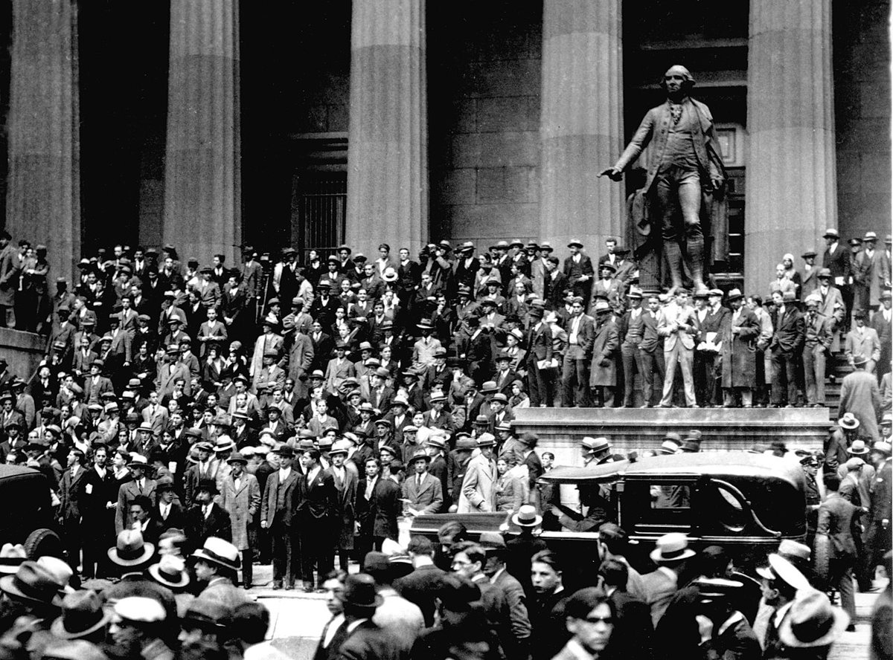
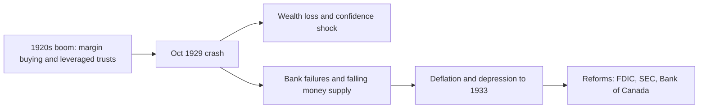

# The crash of 1929 and the Great Depression

**Prerequisites:** [The Buttonwood Agreement and the NYSE](05-the-buttonwood-agreement-and-the-nyse.md), [Short selling and margin](../04-markets/08-short-selling-and-margin.md).

*People gathered on the sub-treasury steps across from the New York Stock Exchange on 'Black Thursday', 24 October 1929. Credit: Associated Press. License: Public domain. Source: [File:Crowds gathering outside New York Stock Exchange (3).jpg](https://commons.wikimedia.org/wiki/File:Crowds_gathering_outside_New_York_Stock_Exchange_(3).jpg).*

The stock market crash of October 1929 is the most famous in history, and the Great Depression that followed shaped economics, regulation and politics for generations. The relationship between the two is subtle: the crash did not alone cause the Depression, but it was part of the story.

## The boom

The 1920s were a decade of rising prosperity in the US: mass production, electrification, the automobile, radio. Stock prices rose strongly, especially from 1927. Millions of ordinary people bought shares, many on **margin**, borrowing from brokers to buy. Example: with a 10% margin requirement, a buyer puts down 1,000 to control 10,000 of stock; a fall of just 10% wipes out the investor's equity, and a margin call forces them to add cash or sell. A market in which many are leveraged is fragile: forced selling feeds falling prices; see [short selling and margin](../04-markets/08-short-selling-and-margin.md). New **investment trusts** pyramided leverage, and sales of securities, including dubious foreign bonds, proceeded with little disclosure.

The **Dow Jones Industrial Average** peaked at **381.17 on 3 September 1929**.

## The crash

Prices began to slide in September and October. On **Thursday 24 October ("Black Thursday")** there was a wave of panic selling; a group of leading bankers pooled funds to buy shares and steady the market, with temporary success. On **Monday 28 October** the Dow fell about 13%, and on **Tuesday 29 October** about 12%, on huge volume, as the ticker ran hours late and investors could not know prices. Margin calls fed the spiral. The market continued to decline, with brief rallies, for almost three years: the Dow reached its low of **41.22 on 8 July 1932**, down about 89% from the peak. A 89% fall needs a gain of about 825% to recover: the Dow regained its 1929 high only in November 1954.

## From crash to Depression

Economic output and employment fell sharply, and the contraction lasted until 1933 in the US. US unemployment reached about 25% in 1933, output fell by roughly a third, prices fell (deflation), and thousands of banks failed (several thousand between 1930 and 1933). In Canada, real output fell by nearly 30% and unemployment peaked at somewhere between 20% and 30%; see [Canadian markets history](06-canadian-markets-history.md). Explanations include:

1. **The stock crash and wealth loss,** reducing consumption and investment, and shaking confidence.
2. **Bank failures and monetary contraction:** Milton Friedman and Anna Schwartz (*A Monetary History of the United States*, 1963) argued the Federal Reserve allowed the money supply to shrink by about a third by failing to act as lender of last resort; Ben Bernanke added the role of credit disruption and bank failures; see [central banks](../05-regulation/06-central-banks-and-monetary-policy.md).
3. **The gold standard,** which transmitted deflation internationally and constrained policy; countries that left gold earlier recovered earlier (Barry Eichengreen).
4. **Debt deflation** (Irving Fisher): falling prices increase the real burden of debts, causing defaults.
5. **Trade policy:** the **Smoot–Hawley Tariff Act (1930)** raised US tariffs, and trading partners retaliated; economists debate how much it deepened the downturn, but most agree it did not help.
6. **Policy errors:** tight money and tax increases in the early 1930s.

## Responses and reforms

- **New Deal measures** under President Franklin Roosevelt from 1933: bank holiday, the **FDIC** for deposit insurance, **Glass–Steagall**, the **Securities Act of 1933** and **Securities Exchange Act of 1934** creating the SEC; see [the SEC and US securities law](../05-regulation/02-the-sec-and-us-securities-law.md).
- **Leaving gold** in 1933 and devaluation of the dollar in 1934 allowed monetary expansion.
- **Canada:** creation of the Bank of Canada in 1934; later social programmes.
- **Keynes's** *General Theory* (1936) argued that governments should use spending to maintain demand, shaping postwar macroeconomic policy.
- Recovery was slow and interrupted (with a renewed downturn in 1937 to 1938); full recovery came with the mobilisation for the Second World War.

## Investor lessons

1. **Leverage magnifies a crash into a collapse,** and margin rules exist for a reason.
2. **Valuations matter:** the P/E of the market was high by historical standards in 1929, and the market lost most of its value; Shiller's CAPE (see [other valuation ratios](../03-securities/01-stocks/07-other-valuation-ratios.md)) shows 1929 as a peak.
3. **Recovery can take decades in nominal terms** (1954 for the Dow); dividends and deflation helped total returns in real terms, and an investor who kept reinvesting dividends recovered earlier than the price index suggests.
4. **Bank runs and deposit insurance:** see [CIRO and investor protection](../05-regulation/04-ciro-and-investor-protection.md).
5. **Policy mistakes can turn a downturn into a depression.**
6. **Diversification and cash flow** (bonds and cash performed better) matter for survival.

## Key ideas

- The Dow peaked at 381.17 on 3 September 1929, fell sharply in October, and bottomed at 41.22 in July 1932, down 89%.
- Margin buying made the market fragile; bank failures, monetary contraction, the gold standard and policy errors turned the crash into a depression.
- Reforms created the SEC, FDIC and in Canada the Bank of Canada; they shaped modern regulation.
- The Dow regained its 1929 level only in 1954; leverage and valuation are the enduring lessons.

## Where this leads

- Next: [Bretton Woods and the postwar order](08-bretton-woods-and-the-postwar-order.md).
- Related: [why markets are regulated](../05-regulation/01-why-markets-are-regulated.md), [the 2008 financial crisis](11-the-2008-financial-crisis.md).
- Glossary: [Black Thursday](../glossary/history/black-thursday.md), [Great Depression](../glossary/history/great-depression.md), [debt deflation](../glossary/history/debt-deflation.md), [deflation](../glossary/history/deflation.md), [FDIC](../glossary/history/fdic.md), [Glass–Steagall](../glossary/history/glass-steagall.md), [Smoot–Hawley](../glossary/history/smoot-hawley.md).
