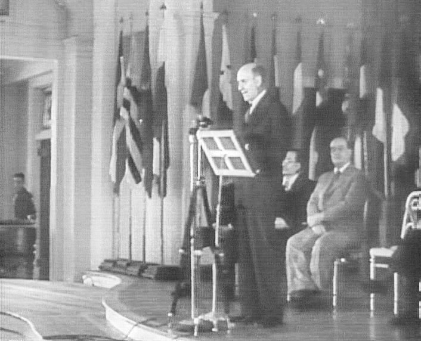
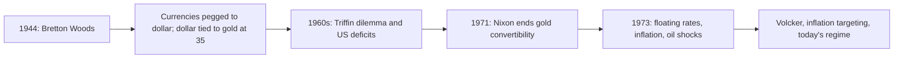

# Bretton Woods and the postwar order

**Prerequisites:** [The crash of 1929 and the Great Depression](07-the-crash-of-1929-and-the-great-depression.md), [Foreign exchange](../03-securities/05-alternatives/03-foreign-exchange.md).

*Henry Morgenthau opening the Bretton Woods conference, July 1944. Credit: National Archives and Records Administration, RG 208 Roll 211 (still). License: Public domain. Source: [File:Morgenthau Bretton Woods opening 1944.jpg](https://commons.wikimedia.org/wiki/File:Morgenthau_Bretton_Woods_opening_1944.jpg).*

The interwar years saw competitive devaluations, tariffs and the collapse of the gold standard. As the Second World War neared its end, the Allies designed a new monetary system to avoid repeating those mistakes. It lasted about a quarter of a century, and its breakdown shaped the floating-rate world of today.

## The conference

In July 1944, delegates from 44 Allied nations met at the Mount Washington Hotel in **Bretton Woods, New Hampshire**. The two main architects were **Harry Dexter White** of the US Treasury and **John Maynard Keynes** of Britain. Keynes proposed an international clearing union with a new reserve unit, the "bancor", and pressure on surplus countries to adjust as well as deficit ones; White's more US-favoured plan, with the dollar at its centre, prevailed because the US was the dominant creditor.

## The system

1. **Fixed but adjustable exchange rates:** each country pegged its currency to the US dollar, within narrow bands (typically 1%); changes in the peg were allowed only in cases of "fundamental disequilibrium".
2. **The dollar linked to gold:** the US promised to convert dollars held by foreign central banks into gold at **35 US dollars per ounce**. The dollar became the world's main reserve currency: "as good as gold".
3. **The International Monetary Fund (IMF)** to lend short-term to countries with balance-of-payments problems, so they would not need to deflate drastically or devalue competitively.
4. **The International Bank for Reconstruction and Development (World Bank)** to finance postwar reconstruction and development.
5. **Capital controls** were allowed, so that governments could pursue domestic full-employment policies while keeping exchange rates fixed.

Trade rules followed: the **General Agreement on Tariffs and Trade (GATT)** in 1947, which became the World Trade Organization in 1995. The postwar decades saw rapid growth, low inflation in the US, and lasting recovery in Europe and Japan; the period is sometimes called the "golden age" of capitalism.

## Cracks: the Triffin dilemma

The Belgian-American economist **Robert Triffin** pointed out in 1960 a built-in contradiction. For the world to have enough dollars for trade and reserves, the US had to run balance-of-payments deficits and send dollars abroad. But as dollar holdings abroad grew relative to US gold reserves, confidence in the dollar's convertibility would fall. Illustration: if foreign central banks hold dollars worth 50 billion and the US holds gold worth 10 billion at the official price, only a fifth of those claims could be redeemed: a run on gold becomes rational for each holder. Throughout the 1960s the strain grew, driven by US spending on the Vietnam War and domestic programmes and inflation; the gold price on the free market in London rose above the official price despite the efforts of a "gold pool" of central banks.

## The Nixon shock and the end of Bretton Woods

On **15 August 1971**, President Richard Nixon announced that the US would no longer convert dollars into gold, as well as a 90-day freeze on wages and prices and a 10% import surcharge. This "Nixon shock" ended gold convertibility. A new set of fixed rates was agreed in the Smithsonian Agreement in December 1971, but it did not last, and by 1973 the major currencies were floating. Gold, officially 35 dollars an ounce, later passed 800 dollars in January 1980, at which point the dollar had lost most of its gold value (35 ÷ 850 is about 4%). Canada had already floated its dollar in 1970; see [foreign exchange](../03-securities/05-alternatives/03-foreign-exchange.md).

## The new world

- **Floating exchange rates and freer capital flows** created a large foreign exchange and derivatives market, in part because firms and investors needed to hedge currency risks; see [forwards and futures](../03-securities/04-derivatives/02-forwards-and-futures.md). Financial futures began in 1972 with the Chicago Mercantile Exchange's currency contracts, and the CBOE opened in 1973.
- **The oil shocks of 1973 and 1979** and **stagflation** (high inflation with weak growth): the postwar economic consensus broke down.
- **The Volcker disinflation:** Paul Volcker, Fed chair from 1979, raised interest rates sharply (the federal funds rate peaking around 20% in 1981) to break inflation; see [central banks and monetary policy](../05-regulation/06-central-banks-and-monetary-policy.md). It caused a deep recession and led to a long decline in inflation and interest rates, and **a 40-year bull market in bonds** from 1981.
- **Inflation targeting** adopted by many central banks from the 1990s (New Zealand 1990, Canada 1991).
- The dollar remained the dominant reserve currency despite losing its link to gold, a status that Barry Eichengreen calls an "exorbitant privilege" (a phrase attributed to French finance minister Valéry Giscard d'Estaing in the 1960s).
- **The IMF and World Bank** survived, shifting to lending to developing countries, with debates over conditions attached to loans.
- **Currency crises** became a recurrent feature: see [1987, LTCM and the 1990s crises](09-1987-ltcm-and-the-1990s-crises.md).

## Lessons

1. **Exchange rate regimes involve trade-offs.** The "impossible trinity" says a country cannot have free capital flows, a fixed exchange rate and independent monetary policy all at once; Bretton Woods gave up free capital flows, and later systems have given up other things.
2. **Fixed pegs fail when the underlying fundamentals diverge.**
3. **Reserve currency status carries benefits and costs.**
4. **Institutions designed after a crisis reflect the previous crisis,** and may not fit new conditions.
5. For investors, currency regimes shape inflation, interest rates, commodity and bond returns across decades.

## Key ideas

- Bretton Woods (1944) created fixed-but-adjustable rates pegged to a gold-convertible dollar, plus the IMF and World Bank.
- The Triffin dilemma, US deficits and inflation undermined confidence; Nixon ended convertibility on 15 August 1971.
- The aftermath brought floating rates, oil shocks, stagflation, the Volcker disinflation and inflation targeting.
- No exchange rate system escapes trade-offs, such as the impossible trinity.

## Where this leads

- Next: [1987, LTCM and the 1990s crises](09-1987-ltcm-and-the-1990s-crises.md).
- Related: [commodities and gold](../03-securities/05-alternatives/02-commodities-and-gold.md), [inflation and real returns](../01-foundations/07-inflation-and-real-returns.md).
- Glossary: [Bretton Woods](../glossary/history/bretton-woods.md), [IMF](../glossary/history/imf.md), [World Bank](../glossary/history/world-bank.md), [Triffin dilemma](../glossary/history/triffin-dilemma.md), [Nixon shock](../glossary/history/nixon-shock.md), [stagflation](../glossary/history/stagflation.md), [impossible trinity](../glossary/history/impossible-trinity.md), [peg](../glossary/history/peg.md).
