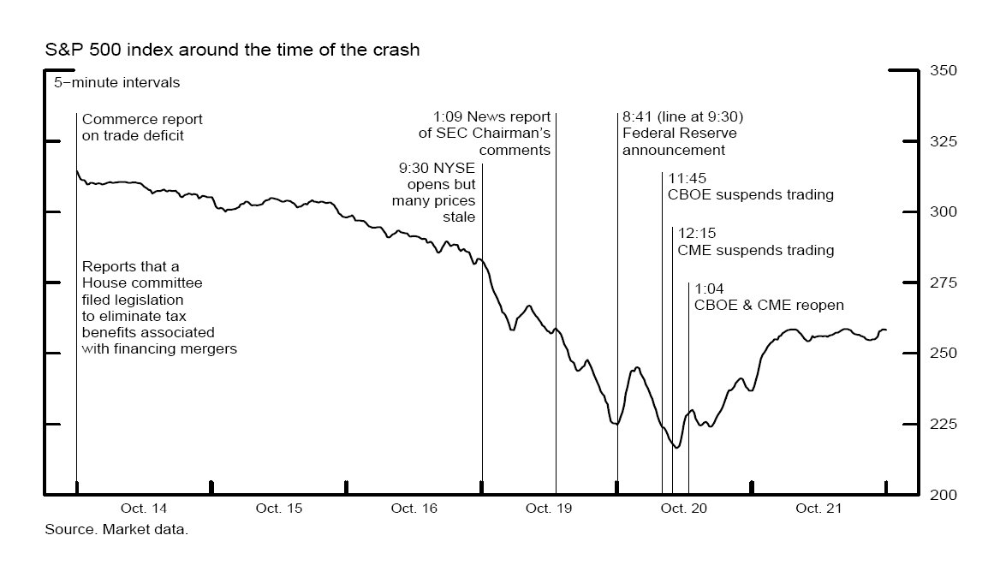
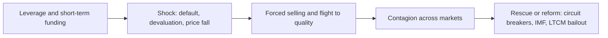

# 1987, LTCM and the 1990s crises

**Prerequisites:** [Bretton Woods and the postwar order](08-bretton-woods-and-the-postwar-order.md), [Swaps and credit derivatives](../03-securities/04-derivatives/06-swaps-and-credit-derivatives.md).

*The S&P 500 index around the time of the October 1987 crash. Credit: Mark Carlson, US Federal Reserve Board of Governors. License: Public domain. Source: [File:S&P 500 index around the time of the crash.png](https://commons.wikimedia.org/wiki/File:S&P_500_index_around_the_time_of_the_crash.png).*

The decades after Bretton Woods brought floating currencies, mobile capital and new instruments. They also brought a series of crises, each with its own cause but common features: leverage, mismatched funding, herd behaviour and fast-moving capital.

## Black Monday, 19 October 1987

After a long bull market, global stock prices fell sharply in mid-October 1987. On **Monday 19 October**, the Dow Jones Industrial Average fell **22.6%** in one day, still the largest one-day percentage fall in its history. Markets fell in every major country: the Toronto market dropped by roughly 11% that day. The cause was not an obvious economic event. Explanations include:

- **Overvaluation** after a large run-up in prices and rising interest rates.
- **Portfolio insurance:** a strategy of selling stock index futures as prices fall to replicate a put option (see [option pricing](../03-securities/04-derivatives/05-option-pricing.md)). When many institutions use the same rule, their selling begins to drive prices down, triggering more selling, a feedback loop.
- **Market structure:** order flows overwhelmed specialists and phone lines; liquidity disappeared; see [bid, ask and market makers](../04-markets/05-bid-ask-and-market-makers.md).
- **Herding and panic:** a classic episode for the behavioural view; see [herding, bubbles and manias](../07-behavioural-finance/04-herding-bubbles-and-manias.md).

The Federal Reserve under its new chair, **Alan Greenspan**, declared readiness to provide liquidity; markets stabilised and did not lead to a recession. The crash led to reforms such as **circuit breakers**, and it demonstrated the use of central banks as backstops. After the crash, out-of-the-money put options began to trade at higher implied volatilities, the "volatility skew"; see [option pricing](../03-securities/04-derivatives/05-option-pricing.md).

## Europe 1992, Mexico 1994 and Asia 1997

- **The ERM crisis, 1992:** the UK and Italy had joined the European Exchange Rate Mechanism, a system of semi-fixed rates, but could not sustain it as German interest rates stayed high after reunification. On **16 September 1992 (Black Wednesday)**, speculators including George Soros sold sterling heavily, and the UK withdrew despite raising interest rates dramatically in one day. Soros is widely reported to have made about a billion dollars. See [foreign exchange](../03-securities/05-alternatives/03-foreign-exchange.md).
- **The Mexican peso crisis (December 1994):** after months of reserve loss and short-term dollar-linked debt, Mexico devalued the peso; the US and IMF organised a large rescue.
- **The Asian financial crisis (from July 1997):** Thailand abandoned the baht's dollar peg on 2 July 1997. Contagion spread to Indonesia, South Korea, Malaysia and others. Common weaknesses: pegged exchange rates, large **short-term foreign-currency borrowing** by banks and firms, weak financial supervision and rapid inflows of capital that reversed suddenly. Currencies and stock markets fell sharply, IMF programmes imposed austerity, and unemployment rose. Lesson: when debts are in foreign currency and funding is short-term, a currency fall becomes a debt crisis. This is the **mismatch** problem; see [credit and banking](../01-foundations/02-credit-and-banking.md).
- **Russia, August 1998:** the government defaulted on domestic debt and devalued the rouble on 17 August 1998.

## Long-Term Capital Management

**Long-Term Capital Management (LTCM)**, a hedge fund founded in 1994 near Greenwich, Connecticut, had as partners Wall Street trader John Meriwether and Nobel laureates **Myron Scholes** and **Robert Merton**, as well as former Fed vice chairman David Mullins. It specialised in **relative-value arbitrage**: finding small price differences between similar securities (for instance, on-the-run and off-the-run Treasury bonds), betting that the gaps would converge, and using **leverage** to turn small gains into large ones. See [hedge funds](../03-securities/03-funds/05-hedge-funds-private-equity-and-closed-end-funds.md).

LTCM had 4 to 5 billion dollars in equity but controlled assets of well over 100 billion dollars (a leverage of about 25 to 1), and enormous derivative positions with large notional amounts. At 25-to-1 leverage, a 4% fall in the value of assets (1 ÷ 25) wipes out all the equity.

After Russia's default in August 1998 there was a **flight to quality**: investors rushed toward the safest and most liquid assets, and spreads that LTCM expected to narrow instead widened. Positions that were supposedly uncorrelated all lost money together, because the same investors (other leveraged funds) held similar trades and had to liquidate. LTCM lost about 4.6 billion dollars in a few months, and by September its creditors worried about a disorderly collapse. The **Federal Reserve Bank of New York** convened the fund's major creditors, and 14 banks and securities firms put about 3.6 billion dollars into the fund in exchange for ownership, in a rescue to avoid a fire sale that could have damaged markets. No public money was put in, but the rescue was controversial because it raised issues of **moral hazard**.

Lessons: models based on historical correlations can fail in a crisis; liquidity can vanish; leverage plus complexity creates fragility; counterparties did not know the full extent of the exposure; see [portfolio return and risk](../06-portfolio-theory/01-portfolio-return-and-risk.md) and [derivatives](../03-securities/04-derivatives/01-what-is-a-derivative.md). Roger Lowenstein's *When Genius Failed* tells the story.

## Patterns in the 1990s

1. **Fixed exchange rates plus open capital** invite speculative attacks (the impossible trinity; see [Bretton Woods](08-bretton-woods-and-the-postwar-order.md)).
2. **Short-term foreign borrowing** creates vulnerability.
3. **Contagion** spreads crises through common creditors and investor behaviour.
4. **Rescues create moral hazard** but not rescuing may allow chaos.
5. **Leverage** is the common thread.

## Aftermath

The Fed and the IMF reconsidered crisis management. Emerging economies built larger foreign-currency reserves, moved to more flexible exchange rates, and reduced foreign-currency debt. The 1990s ended in the boom of technology stocks; see [the dot-com bubble](10-the-dot-com-bubble.md).

## Key ideas

- Black Monday (19 October 1987): the Dow fell 22.6% in a day; portfolio insurance and thin liquidity amplified the fall; the Fed's support helped stabilise it.
- The ERM, Mexican, Asian and Russian crises showed the dangers of pegs, short-term foreign borrowing and sudden capital flight.
- LTCM's 25-to-1 leverage meant a 4% asset fall could wipe out its equity; the New York Fed organised a private-sector rescue in 1998.
- Leverage, liquidity and correlation breakdown recur in every crisis.

## Where this leads

- Next: [the dot-com bubble](10-the-dot-com-bubble.md).
- Related: [short selling and margin](../04-markets/08-short-selling-and-margin.md), [central banks](../05-regulation/06-central-banks-and-monetary-policy.md).
- Glossary: [[g:black-monday|Black Monday]], [[g:portfolio-insurance|portfolio insurance]], [[g:ltcm|LTCM]], [[g:contagion|contagion]], [[g:flight-to-quality|flight to quality]], [[g:currency-crisis|currency crisis]], [[g:relative-value-arbitrage|relative-value arbitrage]].
