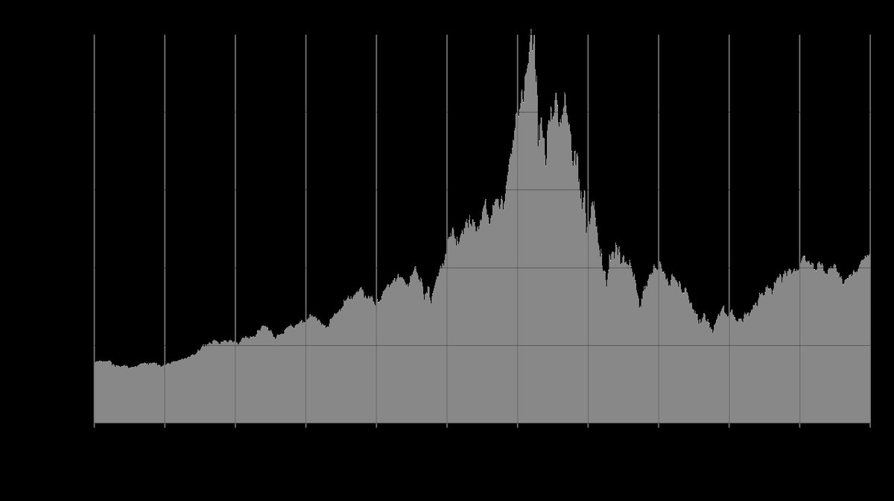

# The dot-com bubble

**Prerequisites:** [1987, LTCM and the 1990s crises](09-1987-ltcm-and-the-1990s-crises.md), [The price-to-earnings ratio](../03-securities/01-stocks/06-the-price-to-earnings-ratio.md).

*The Nasdaq Composite index rising to its March 2000 peak and falling away in the dot-com bubble. Credit: Lalala666 at English Wikipedia. License: Public domain. Source: [File:Nasdaq Composite dot-com bubble.svg](https://commons.wikimedia.org/wiki/File:Nasdaq_Composite_dot-com_bubble.svg).*

In the late 1990s the arrival of the commercial internet seemed to promise a revolution, and share prices of internet and technology companies soared, in many cases far beyond any reasonable estimate of future profits. The bubble burst in 2000. It is the closest modern analogue to the great manias of history, and the best-documented.

## The story

- **Displacement:** The web browser Mosaic (1993) and Netscape (1994) opened the internet to the public. **Netscape's IPO in August 1995** (priced at 28 dollars, closing the first day at about double) was a signal event that set off the boom.
- **Cheap capital and enthusiasm:** venture capital poured in. Investment banks took companies public with little revenue and no profit. In 1999 there were hundreds of technology IPOs, many with enormous first-day gains; see [IPOs and the primary market](../04-markets/02-ipos-and-the-primary-market.md).
- **A new-economy narrative:** claims that the internet had changed the rules; metrics such as "eyeballs", page views and "burn rate" replaced profit. Analysts promoted stocks for banking relationships.
- **Federal Reserve chair Alan Greenspan** warned in December 1996 of "irrational exuberance" in asset markets, but markets kept rising.
- **Peak:** the **Nasdaq Composite** peaked at **5,048.62 on 10 March 2000**, more than five times its level in 1995. Valuations were extreme: the cyclically adjusted P/E (CAPE) of the S&P 500 reached about 44, the highest on record up to then; see [other valuation ratios](../03-securities/01-stocks/07-other-valuation-ratios.md). In January 2000 AOL, an internet company, agreed to buy Time Warner, a much larger traditional company, in an all-stock deal that looked like a triumph of the new economy and soon became a byword for failure.

## The collapse

From March 2000, the market fell: interest rates had risen, some large technology firms disappointed, and venture funding dried up. Many dot-coms ran out of cash within months. **Pets.com**, which went public in February 2000, was liquidated in November 2000. The Nasdaq Composite fell about **78%** from its peak to its low of around **1,114 in October 2002**. Recovery to the 2000 peak took until 2015. A 78% loss needs a 355% gain to recover (1 ÷ 0.22 − 1), which explains why it took so long.

Not all internet companies failed: **Amazon**'s shares fell about 90% yet it survived and became one of the world's largest companies, while others disappeared. This is a typical feature: a real technological revolution *and* a bubble. The business world was reshaped by the internet, but the particular firms and prices of 1999 and 2000 did not justify the valuations.

## Was it irrational?

Believers in efficient markets say that at the time prices might have reflected a plausible if optimistic view of the potential for huge profits, with a few extreme winners. But the breadth of the speculation, IPO first-day gains of hundreds of percent, and valuations with no earnings look more like [herding and a mania](../07-behavioural-finance/04-herding-bubbles-and-manias.md). Limits to arbitrage were illustrated by hedge funds that bet against technology early and lost money long before they were proved right. A famous example was the closure of Julian Robertson's Tiger Management in March 2000 after losing money by refusing to buy technology stocks, near the exact peak.

## Fallout and reform

- **Analyst conflicts:** research analysts had promoted stocks to win investment banking business. In 2003, the "Global Research Analyst Settlement" required major banks to pay about 1.4 billion dollars and separate research from banking.
- **Accounting scandals:** the downturn exposed frauds at **Enron** (2001) and **WorldCom** (2002), leading to the Sarbanes–Oxley Act; see [insider trading, disclosure and fraud](../05-regulation/05-insider-trading-disclosure-and-fraud.md).
- **Telecom overbuilding:** firms had laid vast amounts of fibre capacity that was not needed for years, and bankruptcies followed.
- **Recession and Fed easing:** the economy had a mild recession in 2001, interest rates were cut, and low rates in the following years helped inflate the housing market: see [the 2008 financial crisis](11-the-2008-financial-crisis.md).
- **In Canada:** Nortel and JDS Uniphase collapsed (see [Canadian markets history](06-canadian-markets-history.md)).

## Lessons for investors

1. **A great technology does not mean a great investment at any price:** valuation matters; see [DCF valuation](../03-securities/01-stocks/09-discounted-cash-flow-valuation.md).
2. **Compute what has to go right.** At a P/E of 100, you pay for about a century of today's profits, which requires growth that few firms achieve.
3. **Diversification protects against single-company and single-sector collapse;** concentration in "hot" sectors is the typical error.
4. **After a boom, a bust can be long:** 15 years for the Nasdaq to regain its peak.
5. **Be wary of narratives that explain away valuation.**
6. **Rebalancing** would have sold some of the gains en route; see [asset allocation and rebalancing](../06-portfolio-theory/06-asset-allocation-and-rebalancing.md).

## Key ideas

- The commercial internet triggered a boom: Netscape's 1995 IPO, a flood of IPOs, and a "new economy" story.
- The Nasdaq peaked at 5,048.62 in March 2000 and fell about 78% by October 2002; it took until 2015 to regain the peak.
- The technology was real, many companies were not viable, and valuations assumed unrealistic growth.
- Reforms followed on analyst conflicts and accounting; the lessons are valuation discipline and diversification.

## Where this leads

- Next: [the 2008 financial crisis](11-the-2008-financial-crisis.md).
- Related: [IPOs and the primary market](../04-markets/02-ipos-and-the-primary-market.md), [the price-to-earnings ratio](../03-securities/01-stocks/06-the-price-to-earnings-ratio.md).
- Glossary: [[g:dot-com-bubble|dot-com bubble]], [[g:nasdaq|Nasdaq]], [[g:irrational-exuberance|irrational exuberance]], [[g:venture-capital|venture capital]], [[g:analyst-conflict|analyst conflict of interest]], [[g:cape|CAPE]], [[g:new-economy|new economy]].
