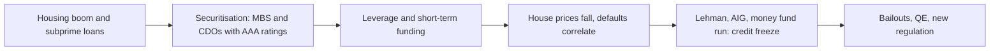

# The 2008 financial crisis

**Prerequisites:** [The dot-com bubble](10-the-dot-com-bubble.md), [Swaps and credit derivatives](../03-securities/04-derivatives/06-swaps-and-credit-derivatives.md), [Credit risk and ratings](../03-securities/02-bonds/06-credit-risk-and-ratings.md).

*The Lehman Brothers sign in Times Square, New York; Lehman failed on 15 September 2008. Credit: David Shankbone. License: [CC BY-SA 3.0](http://creativecommons.org/licenses/by-sa/3.0/). Source: [File:Lehman Brothers Times Square by David Shankbone.jpg](https://commons.wikimedia.org/wiki/File:Lehman_Brothers_Times_Square_by_David_Shankbone.jpg).*

The global financial crisis of 2007 to 2009 was the worst since the Great Depression. It began in US housing credit and spread through the banking system worldwide, showing how complex securities, leverage and interconnection could turn a housing downturn into a global crisis.

## Build-up

1. **Low interest rates and a housing boom.** After the dot-com collapse and 2001 recession, the Fed held rates low, and global savings flowed into US assets. US house prices rose strongly through the early 2000s, peaking around 2006.
2. **Subprime lending.** Lenders gave mortgages to borrowers with weak credit, often with low "teaser" rates, little documentation and loans larger than a home's value, on the assumption that prices would keep rising so borrowers could refinance or sell.
3. **Securitisation.** Lenders sold mortgages to investment banks, which pooled them into **mortgage-backed securities** (MBS) and then repackaged the riskier pieces into **collateralised debt obligations** (CDOs); see [what is a security](../02-firms-and-capital/07-what-is-a-security.md). The original lender no longer bore the loss, weakening incentives to check borrowers.
4. **Credit ratings.** Rating agencies gave many senior tranches AAA ratings, relying on models that assumed that defaults in different regions would not occur together.
5. **Leverage.** Investment banks, hedge funds and shadow banks financed holdings with short-term borrowing, such as overnight **repo**; major banks held leverage of 30 to 1 or more.
6. **Insurance:** AIG sold credit default swaps protecting against losses on such securities.

## Why tranching failed

Illustration with a pool of 100 million of mortgages divided into tranches: an **equity tranche** absorbing the first 5 million of losses, a **mezzanine** tranche of 10 million absorbing the next losses, and a **senior** tranche of 85 million losing only after 15 million of losses have occurred.

| Pool loss | Equity (5m) | Mezzanine (10m) | Senior (85m) |
|---|---|---|---|
| 8m (8%) | wiped out | loses 3m (30%) | untouched |
| 20m (20%) | wiped out | wiped out | loses 5m (5.9%) |

If defaults are independent across regions, a 15% pool loss seems very unlikely, and the senior tranche looks nearly risk-free: AAA. But if house prices fall nationwide, defaults are **correlated**, and the loss can exceed the threshold. The key assumption, low correlation, failed when it mattered; see [correlation and diversification](../01-foundations/11-correlation-and-diversification.md). CDOs of mezzanine tranches amplified the problem.

## The unravelling

- **2007:** US house prices fell and mortgage defaults rose. In August 2007 funds holding mortgage securities were frozen, and interbank lending seized up. In Canada, the market for non-bank **asset-backed commercial paper** froze and was restructured.
- **March 2008:** **Bear Stearns** collapsed and was sold to JPMorgan Chase with Fed support.
- **7 September 2008:** the US government took over the mortgage giants Fannie Mae and Freddie Mac.
- **15 September 2008:** **Lehman Brothers** filed for bankruptcy, the largest in US history, after attempts to find a buyer failed. The next day the US government lent AIG 85 billion dollars, and the **Reserve Primary money market fund** "broke the buck" (its share price fell below 1 dollar), prompting a run on money funds. Credit markets froze globally.
- **October 2008:** the **Troubled Asset Relief Program (TARP)** of 700 billion dollars was authorised; governments across Europe and elsewhere rescued banks; central banks cut rates and began quantitative easing; see [central banks](../05-regulation/06-central-banks-and-monetary-policy.md).

The S&P 500 peaked at about 1,565 in October 2007 and fell to about 677 in March 2009, a decline of about 57%. A 57% fall requires a gain of about 133% to recover (1 ÷ 0.43 − 1); the index regained its 2007 high in March 2013. Unemployment in the US reached 10% in October 2009; many countries entered deep recessions (the "Great Recession").

## Why did it spread?

- **Interconnection:** banks lent to each other and wrote derivatives with each other, so one failure threatened others (counterparty risk).
- **Run on shadow banks:** money market funds, repo and commercial paper, being short-term funding without deposit insurance, saw "runs".
- **Opacity:** no one knew who held the losses, so trust evaporated.
- **Procyclical leverage:** falling asset prices forced sales, which pushed prices lower.
- **Policy gaps:** no orderly way to wind down a giant bank; the "too big to fail" problem, with moral hazard.

## Canada

Canada's banks came through without failures or capital injections, helped by a more conservative lending culture, branch-based funding, higher leverage limits, stricter mortgage rules (mortgage insurance and minimum down payments) and little exposure to subprime securities. This was widely cited internationally, though Canadian banks still used government liquidity facilities; see [Canadian markets history](06-canadian-markets-history.md).

## Responses and reforms

- **Dodd–Frank Act (2010):** new oversight of systemic risk, derivatives clearing, the Volcker Rule limiting proprietary trading by banks, and the Consumer Financial Protection Bureau.
- **Basel III:** higher bank capital and new liquidity rules.
- **Central clearing and reporting of derivatives:** see [clearing and settlement](../04-markets/07-clearing-and-settlement.md).
- **Stress tests** and resolution plans ("living wills") for large banks.
- **Quantitative easing** and ultra-low rates for years, with later debates about their side effects.
- The crisis led to the sovereign debt crisis in Europe (2010 to 2012).

## Lessons

1. **Leverage and short-term funding make systems fragile.**
2. **Complexity hides risk:** if you cannot explain how a product makes money and what can go wrong, be careful.
3. **Correlations rise in a crisis,** and diversification across assets that share a hidden risk fails.
4. **Incentives matter:** originate-to-distribute, ratings paid by issuers, and bonuses rewarding short-term profits.
5. **Liquidity can disappear;** "safe" assets can become unsellable overnight.
6. **Stay invested?** Investors who sold in March 2009 locked in losses; those who kept to a plan recovered, though many experienced years of poor returns; see [prospect theory](../07-behavioural-finance/02-prospect-theory-and-loss-aversion.md).

## Key ideas

- A housing boom, subprime lending, securitisation, high leverage and ratings built a fragile system.
- Tranching worked only if defaults were not correlated; nationwide price falls made them correlated.
- Lehman's failure in September 2008 triggered a global credit freeze; governments and central banks intervened massively.
- Reforms strengthened bank capital, derivatives clearing and oversight; Canada's banks fared relatively well.

## Where this leads

- Next: [the COVID crash and the rate shock](12-covid-crash-and-the-rate-shock.md).
- Related: [swaps and credit derivatives](../03-securities/04-derivatives/06-swaps-and-credit-derivatives.md), [why markets are regulated](../05-regulation/01-why-markets-are-regulated.md).
- Glossary: [subprime mortgage](../glossary/history/subprime.md), [mortgage-backed security](../glossary/history/mbs.md), [tranche](../glossary/history/tranche.md), [repo](../glossary/regulation/repo.md), [too big to fail](../glossary/history/too-big-to-fail.md), [TARP](../glossary/history/tarp.md), [shadow banking](../glossary/history/shadow-banking.md), [Basel III](../glossary/regulation/basel-iii.md).
