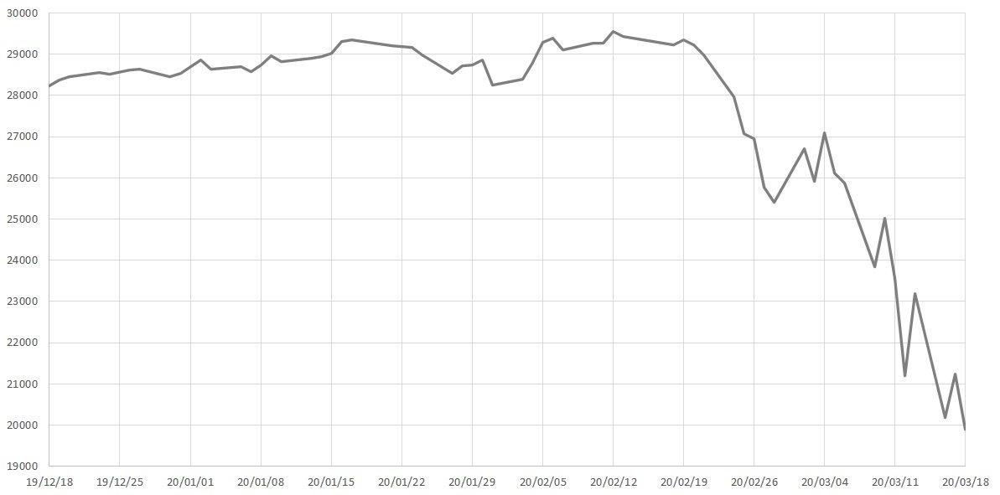

# The COVID crash and the rate shock

**Prerequisites:** [The 2008 financial crisis](11-the-2008-financial-crisis.md), [Central banks and monetary policy](../05-regulation/06-central-banks-and-monetary-policy.md), [Duration and convexity](../03-securities/02-bonds/05-duration-and-convexity.md).

*The Dow Jones Industrial Average during the March 2020 crash. Credit: Renerpho. License: [CC BY-SA 4.0](https://creativecommons.org/licenses/by-sa/4.0). Source: [File:DowJones2020crash.png](https://commons.wikimedia.org/wiki/File:DowJones2020crash.png).*

The most recent chapter of this history is also an unusually clear case study in how fast markets can move and how interest rates drive everything. In three years, investors saw the fastest crash on record, a historic rebound, a speculative surge, and the sharpest rise in rates in four decades.

## The COVID-19 crash (February to March 2020)

As the COVID-19 pandemic spread, governments imposed lockdowns and economies stopped. The S&P 500 reached a record on **19 February 2020** and fell about **34%** to its low on **23 March 2020**, in just 33 days, the fastest fall of that size on record. The S&P/TSX Composite fell about 37% over a similar period, dragged down by energy as oil prices collapsed. The VIX volatility index closed at about 82.7 on 16 March 2020, close to its 2008 peak. Even safe assets were stressed: in March 2020 US Treasury yields swung wildly and the market for government bonds became illiquid as investors sold everything for cash (a "dash for cash").

**Policy response was immediate and large:**

- The Federal Reserve cut rates to near zero on 15 March, restarted quantitative easing, and set up emergency facilities, including for corporate bonds. The **Bank of Canada** cut its policy rate to 0.25% by 27 March and launched asset purchase programmes.
- Governments provided huge fiscal support: income support, wage subsidies and loans.

Markets bottomed on 23 March and rebounded: the S&P 500 reached a new record in August 2020. The speed of the recovery surprised many; people who sold in March locked in losses. A fall of 34% requires a gain of about 52% to recover (1 ÷ 0.66 − 1), which occurred in less than six months. The episode illustrates the difficulty of timing the market: both the drop and the rebound were fast and unpredictable; see [prospect theory](../07-behavioural-finance/02-prospect-theory-and-loss-aversion.md).

## The 2020 to 2021 boom

Low rates, stimulus payments, lockdown-driven trading at home and zero-commission apps produced speculative episodes:

- **Retail trading surge** and options activity; the **meme stock** episode of January 2021 in GameStop, with short squeezes and trading restrictions; see [short selling and margin](../04-markets/08-short-selling-and-margin.md).
- **SPAC boom** and record IPOs; see [IPOs and the primary market](../04-markets/02-ipos-and-the-primary-market.md).
- **Cryptoassets and NFTs** soared, then crashed in 2022; see [cryptoassets](../03-securities/05-alternatives/04-cryptoassets.md).
- Home prices in Canada and the US rose very quickly.

## Inflation and the rate shock (2022 to 2023)

Supply chain disruptions, pent-up demand, large fiscal and monetary stimulus and then the energy price shock after Russia's invasion of Ukraine in February 2022 pushed inflation to levels not seen in about 40 years: roughly 9% in the US and 8% in Canada in mid-2022. Central banks had called the price rises "transitory", then reversed course. The Bank of Canada raised its policy rate from 0.25% in March 2022 to 5% in July 2023, and the Fed raised its range from near zero to 5.25% to 5.5% in the same period: the fastest increases since the early 1980s.

**Effect on markets:**

- **Bonds suffered their worst year in decades in 2022.** Because bond prices fall when yields rise, and long-duration bonds are most sensitive (see [the price-yield relationship](../03-securities/02-bonds/04-the-price-yield-relationship.md)), broad bond indices fell by roughly 11% to 13% in 2022, with long bonds down more. Illustration: a bond fund with a duration of 6.5 years facing a rise in yields of 2.5 percentage points loses about 6.5 × 2.5 = 16%, offset by about 3% of interest income, so about −13%, close to what broad indices experienced.
- **Stocks and bonds fell together:** the S&P 500 dropped about 25% from January to October 2022, so the standard 60/40 portfolio had one of its worst years in decades. This showed that [diversification](../01-foundations/11-correlation-and-diversification.md) between stocks and bonds is not guaranteed: when inflation, not growth, is the main shock, stocks and bonds can both fall as the correlation turns positive.
- **High-growth and unprofitable stocks fell hardest**, as higher discount rates reduce the present value of distant cash flows; see [DCF valuation](../03-securities/01-stocks/09-discounted-cash-flow-valuation.md).
- **Mortgage payments rose** for Canadians renewing fixed-rate mortgages: see [central banks and monetary policy](../05-regulation/06-central-banks-and-monetary-policy.md) for payment arithmetic.
- **Cash and GICs** became attractive again, with rates above 4% to 5%; see [GICs](../03-securities/02-bonds/10-inflation-linked-zero-coupon-and-gics.md).

## Bank stress: March 2023

Banks that had bought long-term bonds when yields were low, financed by uninsured deposits, saw bond values fall as yields rose. **Silicon Valley Bank** (US) suffered a run and failed on 10 March 2023, followed by Signature Bank and later First Republic; in Switzerland, Credit Suisse was rescued by UBS in a government-brokered deal. A textbook lesson in **interest-rate risk and duration mismatch**, bank runs in the age of instant digital withdrawals, and concentrated uninsured deposits. Authorities guaranteed deposits and offered liquidity, and the crisis stayed contained. Canadian banks were not affected in the same way, though the episode was a reminder of the need for supervision; see [CIRO and investor protection](../05-regulation/04-ciro-and-investor-protection.md).

## After the shock

Equities recovered strongly from late 2022, led by large technology companies and enthusiasm about artificial intelligence, again raising concentration concerns in cap-weighted indices; see [index funds](../03-securities/03-funds/03-index-funds.md). Rates peaked in 2023 and central banks began to ease later; current levels change, so check the Bank of Canada and the Fed. This is recent history: interpretations are still developing, and the next few chapters are unwritten.

## Lessons

1. **Crashes can be fast and so can recoveries:** a plan made in calm is worth more than decisions made in panic.
2. **Rates matter to every asset price:** bonds, stocks, houses.
3. **Stocks and bonds can fall together** when inflation is the problem.
4. **Duration risk is real:** safe assets can lose money.
5. **Liquidity can vanish even in safe markets.**
6. **Speculation tends to cluster at low rates and high liquidity:** see [herding, bubbles and manias](../07-behavioural-finance/04-herding-bubbles-and-manias.md).
7. **Fiscal and monetary stimulus on a large scale can have lasting consequences.**

## Key ideas

- The COVID crash took the S&P 500 down about 34% in 33 days (19 February to 23 March 2020); massive policy support produced a rapid rebound.
- Low rates and stimulus fuelled speculation in 2020 to 2021; inflation then reached 8% to 9% in 2022.
- Central banks raised rates at the fastest pace in four decades; bonds had a historically bad year and stocks and bonds fell together.
- Duration mismatch brought down SVB in March 2023. The lessons: rates drive prices, and plan ahead for volatility.

## Where this leads

- Next: [personal investing in Canada](../09-personal-investing-canada/01-foundations-before-investing.md), applying the course.
- Related: [the 2008 financial crisis](11-the-2008-financial-crisis.md), [inflation and real returns](../01-foundations/07-inflation-and-real-returns.md).
- Glossary: [[g:covid-crash|COVID crash]], [[g:meme-stock|meme stock]], [[g:rate-hike|rate hike]], [[g:duration-risk|duration risk]], [[g:vix|VIX]], [[g:quantitative-tightening|quantitative tightening]], [[g:inflation-shock|inflation shock]].
