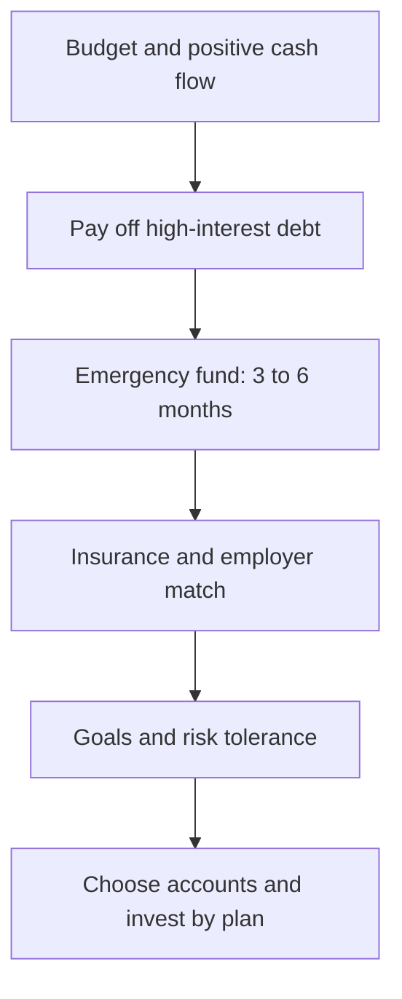

# Foundations before investing

**Prerequisites:** [Foundations](../01-foundations/README.md); [Risk and return](../01-foundations/10-risk-and-return.md).

> **Education, not advice.** This section explains how Canadian accounts and basic investing work. It is not personalised financial, tax or legal advice. Figures are for 2026 and change; confirm them on Canada.ca (CRA) or with a qualified professional before acting.

*A piggy bank, the traditional emblem of saving. Credit: Noah Wulf. License: [CC BY-SA 4.0](https://creativecommons.org/licenses/by-sa/4.0). Source: [File:Model 1925 Kenworth Collectible Piggy Bank front view 2.jpg](https://commons.wikimedia.org/wiki/File:Model_1925_Kenworth_Collectible_Piggy_Bank_front_view_2.jpg).*

Most of the value in personal finance comes from the steps before buying any security: spending less than you earn, avoiding expensive debt, holding a cash cushion and protecting against disasters. The most skilled portfolio cannot compensate for a missing foundation.

## 1. Know your cash flow

Track income and spending for a few months. The key number is your **savings rate**: the share of income you keep. A simple framework is to divide after-tax income between needs, wants and saving, but the right split depends on circumstances. Without a surplus, there is nothing to invest. Automating a transfer on payday ("pay yourself first") turns a good intention into a habit; see [mental accounting](../07-behavioural-finance/05-mental-accounting-anchoring-and-framing.md).

## 2. Eliminate high-interest debt

Paying off debt is an investment with a known, risk-free return equal to the interest rate. Example: 10,000 on a credit card at 19.99% costs 1,999 a year in interest. A balanced portfolio might *expect* 6% to 7% a year, which is 700 on 10,000, and is uncertain. Repaying the card "earns" 19.99% with certainty. So it generally comes first. Lower-rate debt such as a mortgage or low-interest student loan is a genuine trade-off between paying down and investing, depending on the rate and your comfort; see [simple and compound interest](../01-foundations/03-simple-and-compound-interest.md) and [credit and banking](../01-foundations/02-credit-and-banking.md). Watch out for payday loans and store cards with extreme effective rates.

## 3. Build an emergency fund

An **emergency fund** covers unexpected costs and income loss without forcing you to sell investments at a bad time. A common guideline is **three to six months of essential expenses**, more if income is irregular, you are the sole earner or you have dependants. Example: essentials of 3,500 a month imply a fund of 10,500 to 21,000. Keep it safe and accessible: a high-interest savings account, cash ETF or short GIC. Deposits at member institutions are covered by CDIC up to 100,000 per category; see [CIRO and investor protection](../05-regulation/04-ciro-and-investor-protection.md). The emergency fund is the reason you can accept volatility in your investments.

## 4. Insurance and risk management

Protect against catastrophic events that would derail the plan: health and disability coverage (employer plans plus gaps), life insurance if others depend on your income, home or tenant insurance, auto insurance, and liability. Insurance transfers risks you cannot afford to bear. Avoid mixing insurance and investing in complex products unless you understand the costs.

## 5. Take free money first

If your employer offers a **matching contribution** to a group RRSP or pension plan, contributing enough to get the full match is an immediate return (a 50% match is a 50% return on that contribution). Also claim government incentives, for instance the Canada Education Savings Grant for RESPs; see [registered and non-registered accounts](02-registered-and-non-registered-accounts.md).

## 6. Clarify goals and time horizons

Match money to goals by time horizon:

| Horizon | Examples | Typical approach |
|---|---|---|
| Under 3 years | Emergency fund, vehicle, travel | Cash, HISA, short GICs |
| 3 to 10 years | Down payment, education | Mix of stable assets, with equity share limited |
| Over 10 years | Retirement, long-term wealth | Higher equity share, diversified |

Money needed soon should not be exposed to large stock market losses: stocks have fallen 30% or more several times, and recovery can take years; see [the crash of 1929](../08-history/07-the-crash-of-1929-and-the-great-depression.md) and [the 2008 financial crisis](../08-history/11-the-2008-financial-crisis.md). Setting the **asset allocation** is the central choice; see [asset allocation and rebalancing](../06-portfolio-theory/06-asset-allocation-and-rebalancing.md).

## 7. Know your risk tolerance honestly

How would you feel, and what would you do, if a portfolio of 100,000 fell to 65,000? Many people say they would "hold on" and then sell. Risk tolerance includes emotional capacity as well as financial ability; use the lessons in [behavioural finance](../07-behavioural-finance/README.md) as a guide. A portfolio you can stick with beats a theoretically better one you abandon.

## 8. Write it down

A one-page **investment policy statement** lists goals, time horizon, target allocation, which accounts hold what, contribution schedule, rebalancing rule and what you will do in a crash. Writing it when calm helps you act well when scared.

## 9. Learn to value time

Starting early matters because of compounding; see [time value of money](../01-foundations/04-time-value-of-money.md). Saving 500 a month for 25 years at 6% grows to roughly 346,000, of which only 150,000 is contributed; the rest is growth. Waiting ten years to start would greatly reduce the result. Consistency usually matters more than picking the perfect moment.

## 10. Avoid the usual traps

- Treating investing as a way to catch up quickly: high-risk bets are likely to lose.
- Ignoring fees (see [fees and the cost of investing](../03-securities/03-funds/04-fees-and-the-cost-of-investing.md)).
- Following tips from social media and friends; see [scams and common mistakes](09-scams-and-common-mistakes.md).

## Readiness checklist

1. Positive cash flow and a savings rate you can sustain.
2. No high-interest debt.
3. Emergency fund in place.
4. Basic insurance.
5. Employer match captured.
6. Goals and time horizons written down.
7. Allocation chosen that you could live with in a crash.

## Key ideas

- Pay off high-interest debt first: it is a guaranteed return equal to the rate.
- Hold an emergency fund of three to six months' essentials before taking investment risk.
- Capture employer matches, protect against catastrophes, and match money to time horizon.
- Write down goals and rules in an investment policy statement and pick a risk level you can live with.

## Where this leads

- Next: [registered and non-registered accounts](02-registered-and-non-registered-accounts.md).
- Related: [credit and banking](../01-foundations/02-credit-and-banking.md), [asset allocation](../06-portfolio-theory/06-asset-allocation-and-rebalancing.md).
- Glossary: [[g:emergency-fund|emergency fund]], [[g:savings-rate|savings rate]], [[g:employer-match|employer match]], [[g:investment-policy-statement|investment policy statement]], [[g:high-interest-savings-account|high-interest savings account]], [[g:time-horizon|time horizon]].
