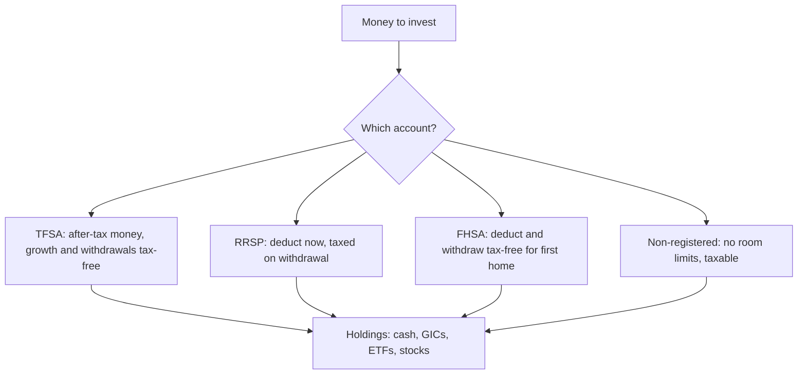

# Registered and non-registered accounts

**Prerequisites:** [Foundations before investing](01-foundations-before-investing.md), [Brokers and dealers](../04-markets/03-brokers-and-dealers.md).

> **Education, not advice.** Figures are for 2026; confirm on Canada.ca (CRA) before acting.

*Parliament Hill in Ottawa, where federal tax law is made. Credit: Óðinn. License: [CC BY-SA 2.5 ca](https://creativecommons.org/licenses/by-sa/2.5/ca/deed.en). Source: [File:Parliament Hill from the Ottawa River.JPG](https://commons.wikimedia.org/wiki/File:Parliament_Hill_from_the_Ottawa_River.JPG).*

In Canada, *where* you hold an investment can matter almost as much as *what* you hold. An **account** is a container held at a bank, broker or insurer; different containers have different tax rules. A **registered account** is registered with the federal government and gets special tax treatment; a **non-registered** (taxable) account does not.

## The main registered accounts

| Account | Purpose | Contributions | Growth | Withdrawals |
|---|---|---|---|---|
| **TFSA** (Tax-Free Savings Account) | General savings | Not deductible | Tax-free | Tax-free |
| **RRSP** (Registered Retirement Savings Plan) | Retirement | Deductible from income | Tax-deferred | Taxable as income |
| **FHSA** (First Home Savings Account) | First home | Deductible | Tax-free | Tax-free if used for a qualifying first home purchase |
| **RESP** (Registered Education Savings Plan) | Education | Not deductible | Tax-deferred | Taxed in the student's hands; grants |
| **RDSP** (Registered Disability Savings Plan) | Disability savings | Not deductible | Tax-deferred | Taxable in part; grants and bonds |

Further types include **LIRAs** and **LIFs** (locked-in plans from pension money), **RRIFs** (retirement income funds into which an RRSP is converted by the end of the year you turn 71), and group plans at work such as DPSPs and pensions.

The headline rules are in the next lessons: [the TFSA](03-the-tfsa.md), [the RRSP](04-the-rrsp.md), [the FHSA](05-the-fhsa.md). For the RESP: the **Canada Education Savings Grant (CESG)** adds 20% on the first 2,500 contributed each year, up to 500 a year, with a lifetime maximum of 7,200 per child (14.4 years of full 500 grants). Contributing 2,500 a year for 18 years puts in 45,000 and can attract the full 7,200 in grants. Low-income families may also qualify for additional grants and the Canada Learning Bond. Confirm current details at Canada.ca.

## An account is not an investment

A frequent confusion: "I put money in my TFSA" does not say what the money is invested in. Each account can hold cash, GICs, stocks, bonds, ETFs and mutual funds. A TFSA "savings account" at a bank may pay very little interest; you could instead hold ETFs inside the same TFSA. The account determines the *tax treatment*; the holdings determine the *return and risk*.

## Non-registered accounts

A **non-registered** (taxable) account has no contribution limit and no tax shelter: interest, dividends and capital gains are taxable in the year they arise or are realised. Advantages: flexibility, no limits on contributions or withdrawals, and capital losses can offset gains. Typically used after registered room is full; see [taxes on investments](06-taxes-on-investments.md).

## Why accounts matter: the same money, different results

Compare two ways of using 1,000 of pre-tax earnings, assuming a 40% marginal tax rate now, 6% annual growth for 10 years (factor 1.79):

- **TFSA:** pay tax now: 600 invested, grows to 600 × 1.79 = 1,075, withdrawn tax-free.
- **RRSP:** invest the full 1,000 (the deduction gives back the tax), grows to 1,791; withdrawn and taxed at 40%: 1,075.
- **RRSP, if the tax rate in retirement is 30%:** 1,791 × 0.7 = 1,254, better than the TFSA.
- **RRSP, if the tax rate in retirement is higher than now:** worse than the TFSA.

With the same tax rate at contribution and withdrawal, the two come out equal. The decision hinges on the marginal tax rate today versus later, and other factors (benefit clawbacks, flexibility, room). Neither is "better" in general. See [the TFSA](03-the-tfsa.md) and [the RRSP](04-the-rrsp.md).

## Which comes first? Common frameworks

These are general ideas, not rules:

1. Capture any employer match.
2. If you are saving for a first home, the FHSA combines a deduction and tax-free withdrawal.
3. Compare the TFSA and RRSP, based on current versus expected future income. Lower earners often favour the TFSA; higher earners at higher brackets often favour the RRSP, though many people use both.
4. RESPs if children's education matters, because of the grant.
5. Non-registered accounts after other room.

## Asset location

**Asset location** means deciding which investments go in which account, to reduce taxes (distinct from asset allocation, which concerns the mix). Typical considerations in Canada:

- Interest-paying investments (bonds, GICs) are fully taxable in a non-registered account, so they often suit a registered account.
- Canadian dividend stocks get the dividend tax credit in a non-registered account but not in an RRSP, where tax treatment is neutral.
- US dividends: an RRSP is exempt from the US 15% withholding tax under the Canada–US treaty, if held directly, whereas a TFSA is not exempt. See [building a simple portfolio](07-building-a-simple-portfolio.md).
- High-growth assets might fit the TFSA since gains are never taxed.
- Keep the plan simple: complexity must be worth the benefit.

## Where to hold the account

Accounts are held at **banks, brokerages (including online discount brokers), robo-advisors, and insurers**. The account can be moved between institutions in a **transfer in kind** that does not trigger tax (use the receiving institution's transfer form, rather than withdrawing and redepositing). Check CIPF or CDIC coverage; see [CIRO and investor protection](../05-regulation/04-ciro-and-investor-protection.md) and [costs, brokers and choosing a platform](08-costs-brokers-and-choosing-a-platform.md).

## Beneficiaries and estates

Registered accounts allow naming a **successor holder** (for a TFSA, a spouse) or **beneficiary**, which can speed up transfers on death. Rules vary by province and account. This is one of the simplest, most overlooked pieces of planning.

## Key ideas

- Registered accounts (TFSA, RRSP, FHSA, RESP, RDSP) shelter investments from tax in different ways; a non-registered account has no shelter or limits.
- The account is a container; what you hold inside determines risk and return.
- TFSA versus RRSP is largely a question of tax rate now versus later: with equal rates, outcomes are identical.
- Asset location can reduce taxes, but keep plans simple.

## Where this leads

- Next: [the TFSA](03-the-tfsa.md), then [the RRSP](04-the-rrsp.md) and [the FHSA](05-the-fhsa.md).
- Related: [taxes on investments](06-taxes-on-investments.md), [building a simple portfolio](07-building-a-simple-portfolio.md).
- Glossary: [[g:registered-account|registered account]], [[g:non-registered-account|non-registered account]], [[g:resp|RESP]], [[g:cesg|CESG]], [[g:rrif|RRIF]], [[g:asset-location|asset location]], [[g:marginal-tax-rate|marginal tax rate]].
