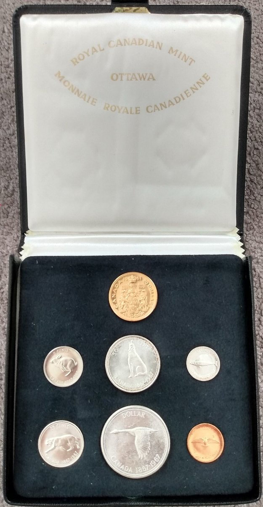
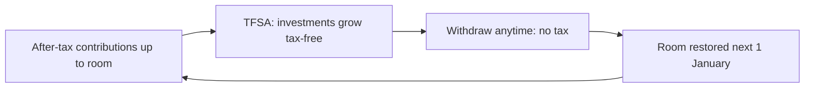

# The TFSA

**Prerequisites:** [Registered and non-registered accounts](02-registered-and-non-registered-accounts.md).

> **Education, not advice.** Figures are for 2026; confirm on Canada.ca (CRA) before acting. Limits change, and so do rules.

*The 1967 Canadian Centennial coin set. Credit: Snd3054. License: [CC0](http://creativecommons.org/publicdomain/zero/1.0/deed.en). Source: [File:1967 Centennial Coin Set.jpg](https://commons.wikimedia.org/wiki/File:1967_Centennial_Coin_Set.jpg).*

The **Tax-Free Savings Account (TFSA)**, introduced in 2009, lets Canadians earn investment income and gains **tax-free**, and withdraw them without tax. Despite the name, it is not only for "savings": it can hold stocks, ETFs, bonds, GICs, mutual funds and more.

## The basics

- **Who:** Canadian residents aged 18 or older with a valid Social Insurance Number. Room starts accumulating the year you turn 18, whether or not you open an account. There is no upper age limit.
- **Contributions:** made with after-tax money; **not deductible**.
- **Growth:** interest, dividends and capital gains are **tax-free**.
- **Withdrawals:** tax-free, and they do **not** count as income for calculating income-tested benefits such as Old Age Security clawback, the Guaranteed Income Supplement, or the Canada Child Benefit.
- **Account types:** you can hold multiple TFSAs across institutions, but the total contribution limit is shared.

## The contribution room

The annual TFSA dollar limit has varied: 5,000 (2009 to 2012), 5,500 (2013, 2014), 10,000 (2015), 5,500 (2016 to 2018), 6,000 (2019 to 2022), 6,500 (2023), and 7,000 (2024, 2025 and, for 2026, 7,000). For someone who was 18 or older and a resident since 2009, the **cumulative room in 2026 is 109,000**, if nothing has been used. (Check: 4 × 5,000 + 2 × 5,500 + 10,000 + 3 × 5,500 + 4 × 6,000 + 6,500 + 3 × 7,000 = 109,000.)

Key rules:

- **Withdrawals are added back** to your room, but only on **1 January of the next year**, not immediately. Withdraw 3,000 in March 2026 and you regain that room in January 2027. Re-contributing in the same year can lead to an overcontribution.
- **Unused room carries forward** indefinitely.
- **Check your room** through CRA My Account; it is the official source. Your broker may not know about contributions made elsewhere.
- **Over-contribution** is taxed at **1% per month** on the excess. Example: 5,000 over the limit for 3 months costs 5,000 × 1% × 3 = 150, and continues until you withdraw it or room opens up.
- **Prohibited and non-qualified investments**, **day trading as a business** and certain transactions between you and your TFSA can cause penalties or taxation of gains. Typical investments (listed stocks, ETFs, GICs, mutual funds) are fine; unusual ones (shares of your own private company, collectibles) need checking.

## What the benefit is worth

Contribute 7,000 a year for 30 years at 6%: total contributed 210,000; value ≈ 553,000, all of it withdrawable tax-free. In a taxable account, interest and dividends would be taxed every year and capital gains when sold; the TFSA removes that drag. The benefit is greatest for assets expected to grow most and for investments generating taxable income. See [simple and compound interest](../01-foundations/03-simple-and-compound-interest.md).

## Strengths

1. **Flexibility:** withdraw anytime, with no tax, and room returns the next year, making the TFSA suitable for emergencies and medium-term goals as well as retirement.
2. **No effect on benefits** and income-tested credits.
3. **No deduction to manage:** simpler than the RRSP.
4. **Useful at any age** and at any income, and valuable in retirement after RRSP withdrawals begin.
5. **Estate planning:** a spouse can be named **successor holder** so the account continues tax-free.

## Limits and cautions

- **No deduction:** you pay tax on the income you contribute, so for high earners the RRSP deduction can be worth more; see [the RRSP](04-the-rrsp.md).
- **Foreign withholding tax:** US dividends in a TFSA face a 15% US withholding tax that is not recoverable, since the treaty exemption applies only to RRSPs and similar plans; dividends from foreign countries also face withholding. See [building a simple portfolio](07-building-a-simple-portfolio.md).
- **Losses cannot be claimed:** capital losses inside a TFSA are not deductible against other gains, and room is lost.
- **A "savings account" TFSA** may pay little interest; check what you hold.
- **Don't treat it like a chequing account:** the timing rules on withdrawals make over-contribution easy.
- **Rules can change:** the government can change limits and rules.

## Using the TFSA

Common uses: an emergency fund (held in cash or GICs), saving for a medium-term goal, long-term investing alongside an RRSP, or the first home before opening an FHSA. Some investors place their highest-expected-growth assets here, since the gains escape tax entirely. Others prioritise based on the asset-location discussion in [registered and non-registered accounts](02-registered-and-non-registered-accounts.md). All of these are choices, not instructions.

## Checklist

1. Check your **room** at CRA My Account.
2. Decide the **purpose** of the money and **time horizon**.
3. Pick **holdings** that match; see [asset allocation](../06-portfolio-theory/06-asset-allocation-and-rebalancing.md).
4. Keep track of withdrawals and **re-contribute only next year**.
5. Name a **successor holder** or beneficiary.
6. Avoid over-contribution.

## Key ideas

- A TFSA shelters growth and withdrawals from tax; contributions are not deductible.
- Cumulative room for someone eligible since 2009 is 109,000 in 2026 (7,000 for the year); withdrawals are added back the next January 1.
- Overcontributions cost 1% a month; check room with CRA.
- Highly flexible; US dividends still suffer a 15% withholding tax inside it.

## Where this leads

- Next: [the RRSP](04-the-rrsp.md).
- Related: [registered and non-registered accounts](02-registered-and-non-registered-accounts.md), [taxes on investments](06-taxes-on-investments.md).
- Glossary: [TFSA](../glossary/personal-investing-canada/tfsa.md), [contribution room](../glossary/personal-investing-canada/contribution-room.md), [over-contribution](../glossary/personal-investing-canada/over-contribution.md), [successor holder](../glossary/personal-investing-canada/successor-holder.md), [withholding tax](../glossary/personal-investing-canada/withholding-tax.md), [CRA](../glossary/personal-investing-canada/cra.md).
