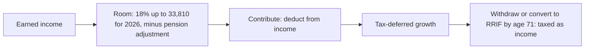

# The RRSP

**Prerequisites:** [Registered and non-registered accounts](02-registered-and-non-registered-accounts.md), [The TFSA](03-the-tfsa.md).

> **Education, not advice.** Figures are for 2026; confirm on Canada.ca (CRA) before acting.

*A retirement residence in Vaughan, Ontario. Credit: Raysonho @ Open Grid Scheduler / Scalable Grid Engine. License: [CC0](http://creativecommons.org/publicdomain/zero/1.0/deed.en). Source: [File:ChartwellValleyVistaRetirementResidenceVaughan.jpg](https://commons.wikimedia.org/wiki/File:ChartwellValleyVistaRetirementResidenceVaughan.jpg).*

The **Registered Retirement Savings Plan (RRSP)**, introduced in 1957, is Canada's main retirement savings account. Contributions are **tax-deductible**, growth is **tax-deferred**, and withdrawals are **taxed as income**. The deal: you get the tax break now and pay later, ideally at a lower rate.

## The basics

- **Contribution room:** 18% of the previous year's **earned income**, up to an annual dollar limit (for 2026, **33,810**; the 2027 limit is 35,390), minus any **pension adjustment** from workplace pension plans, plus unused room carried forward. Your **Notice of Assessment** and CRA My Account show your exact room.
- **Deduction:** contributions can be deducted from taxable income in the year of contribution or carried forward to a future year; contributions made in the first 60 days of a year can be applied to the prior year.
- **Growth:** tax-deferred; no tax on interest, dividends or gains inside.
- **Withdrawals:** added to income and taxed at your marginal rate; the financial institution withholds tax at source on withdrawals (the rate depends on the amount).
- **Conversion:** an RRSP must be converted by **31 December of the year you turn 71**, usually into a **RRIF**, which requires minimum annual withdrawals, or into an annuity, or cashed out.
- **Over-contribution:** a lifetime cushion of **2,000** is allowed without penalty; beyond that the penalty is **1% per month** on the excess.
- **Spousal RRSP:** a higher earner contributes to a plan owned by the lower-earning spouse, shifting future income to the lower bracket, with rules about withdrawals within three years.

## Worked example: why the deduction matters

Earn 1,000 more, with a marginal tax rate of 40%. Contributing 1,000 to an RRSP lowers your tax by 400, so the after-tax cost is 600. In ten years at 6% growth (factor 1.79), the 1,000 becomes 1,791. Withdrawn when your marginal rate is 40%, it leaves 1,075; at 30% it leaves 1,254. The same 600 invested in a TFSA grows to 1,075 tax-free. So:

- If the retirement tax rate equals the current rate, RRSP and TFSA give the same result.
- If the retirement rate is lower, the RRSP wins; if higher, the TFSA wins.
- Investing the tax refund (here 400) is part of the RRSP's advantage; if you spend it, the comparison changes.

Many people have lower incomes in retirement, but pensions, RRIF minimums, Old Age Security clawbacks and other income can push rates higher than expected, so it is not automatic. See [registered and non-registered accounts](02-registered-and-non-registered-accounts.md).

## Special programmes

- **Home Buyers' Plan (HBP):** first-time buyers can withdraw up to **60,000** (raised from 35,000 in 2024) from an RRSP to buy a home, tax-free, and must repay over 15 years. See [the FHSA](05-the-fhsa.md) for an alternative.
- **Lifelong Learning Plan (LLP):** withdraw up to 10,000 a year (20,000 total) for full-time education, repaid over 10 years.
- **Group RRSPs** through employers, often with matching contributions: always capture the match; see [foundations before investing](01-foundations-before-investing.md).

## Things to watch

1. **Withdrawals are costly:** they are taxed, and the contribution room is lost (except for HBP and LLP repayments). An RRSP is not an ordinary emergency fund.
2. **Income-tested benefits:** large RRSP and RRIF withdrawals increase taxable income and can reduce OAS and GIS and other benefits.
3. **Deemed disposition at death:** the value is generally added to the final tax return unless the account passes to a spouse or qualifying dependants, so large balances can trigger a large bill for the estate; name a beneficiary.
4. **Foreign dividends:** a US-listed stock held *directly* in an RRSP avoids the 15% withholding tax under the treaty; a Canadian-listed ETF that holds US stocks does not escape the foreign tax at the fund level in the same way. See [building a simple portfolio](07-building-a-simple-portfolio.md).
5. **Over-contributing** by accident, especially with several accounts and employer plans.
6. **Mismatched tax treatment:** all withdrawals are taxed as income, regardless of whether growth came from capital gains or dividends: the favourable tax treatment of capital gains and dividends in a taxable account is lost inside an RRSP.

## Deciding how much to contribute

The deduction is most valuable in high-income years. Some people contribute to the RRSP but delay claiming the deduction until a year in which their income (and marginal tax rate) is higher; unclaimed deductions can be carried forward indefinitely. Others use the refund to fund a TFSA. Not everyone has to use the RRSP at all if their pension and other savings are sufficient: this depends on income, expected retirement income, home ownership and benefits. A qualified planner can help; the aim of this lesson is to understand the machinery.

## Checklist

1. Look up your **room** (Notice of Assessment or CRA My Account).
2. Decide how the **deduction** fits your marginal tax rate.
3. Choose **holdings** that fit your plan; see [asset allocation](../06-portfolio-theory/06-asset-allocation-and-rebalancing.md).
4. Remember the **60-day** rule and the 31 December deadline for age-71 conversion.
5. Name a **beneficiary** or successor.
6. Keep contributions within the 2,000 cushion.

## Key ideas

- RRSP contributions are deductible, growth is tax-deferred, and withdrawals are taxable; room is 18% of prior-year earned income up to 33,810 (2026).
- With equal tax rates now and later, RRSP and TFSA give the same result; the RRSP wins if the retirement rate is lower.
- The HBP lets first-time buyers withdraw up to 60,000, repaid over 15 years; the LLP is for education.
- The RRSP converts by the year you turn 71, creates tax on death if not passed to a spouse, and withdrawals can affect income-tested benefits.

## Where this leads

- Next: [the FHSA](05-the-fhsa.md).
- Related: [taxes on investments](06-taxes-on-investments.md), [the TFSA](03-the-tfsa.md).
- Glossary: [RRSP](../glossary/personal-investing-canada/rrsp.md), [earned income](../glossary/personal-investing-canada/earned-income.md), [pension adjustment](../glossary/personal-investing-canada/pension-adjustment.md), [Home Buyers' Plan](../glossary/personal-investing-canada/home-buyers-plan.md), [tax deferral](../glossary/personal-investing-canada/tax-deferral.md), [Notice of Assessment](../glossary/personal-investing-canada/notice-of-assessment.md), [spousal RRSP](../glossary/personal-investing-canada/spousal-rrsp.md).
