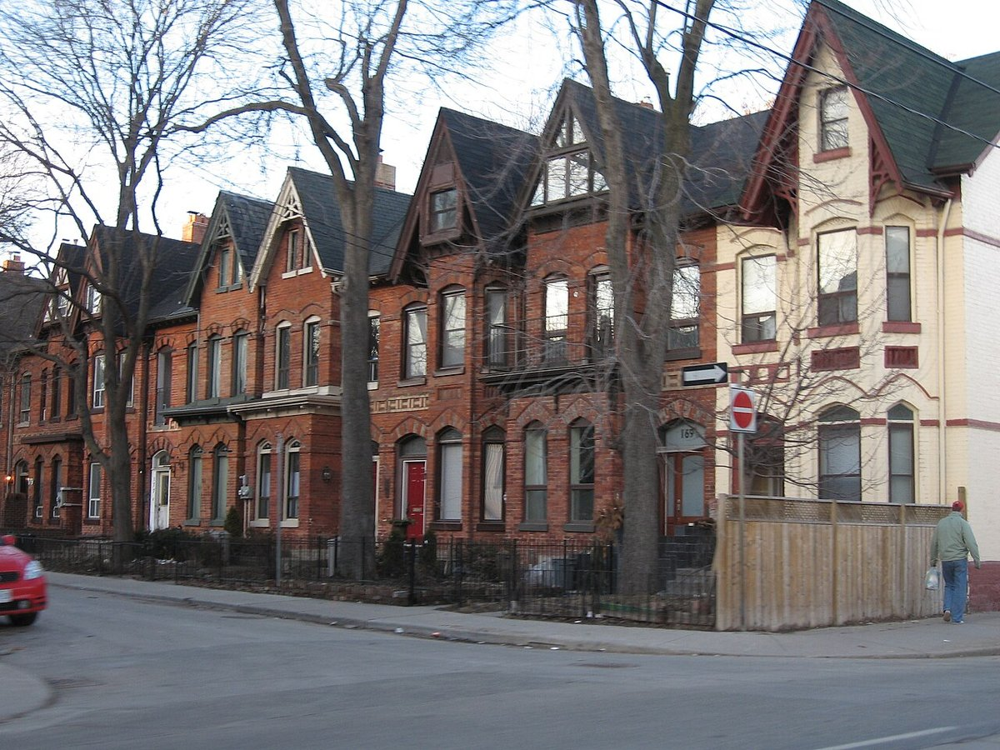
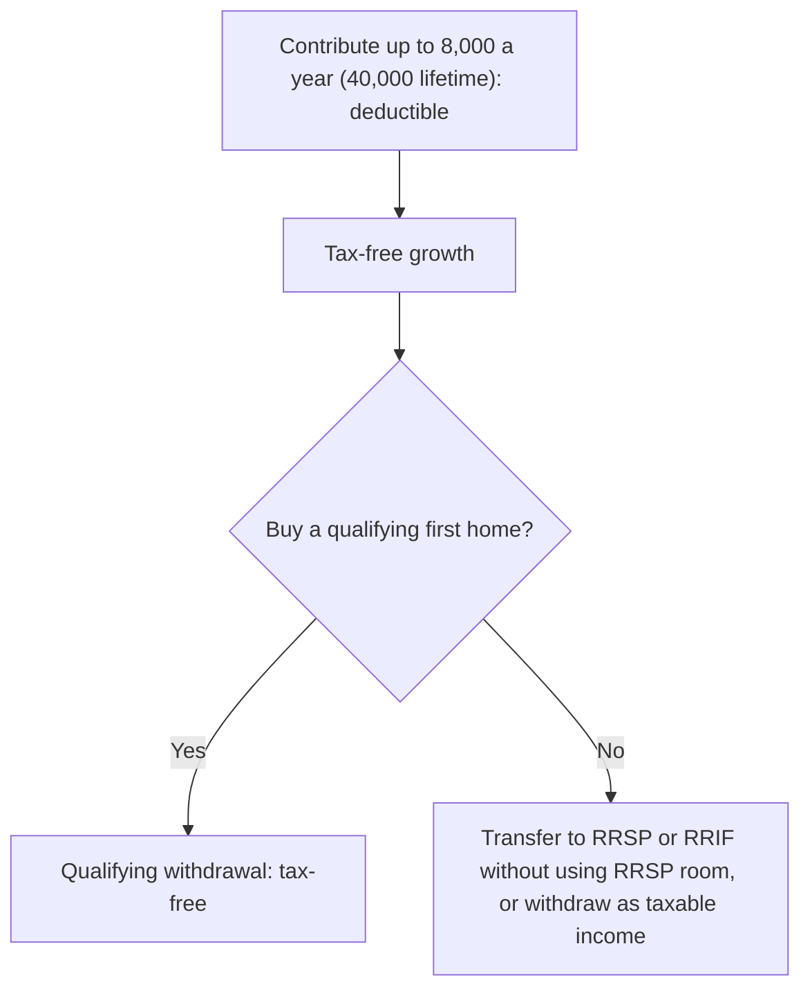

# The FHSA

**Prerequisites:** [The TFSA](03-the-tfsa.md), [The RRSP](04-the-rrsp.md).

> **Education, not advice.** Figures are for 2026; confirm on Canada.ca (CRA) before acting. The FHSA is a recent account, and details have been refined since launch.

*Row houses in Toronto. Credit: Bardiak at English Wikipedia. License: Public domain. Source: [File:Toronto Row Houses.jpg](https://commons.wikimedia.org/wiki/File:Toronto_Row_Houses.jpg).*

The **First Home Savings Account (FHSA)**, available since 1 April 2023, combines features of the RRSP and the TFSA for a single purpose: saving for a first home. Contributions are **deductible**, growth is **tax-free**, and **qualifying withdrawals** to buy a first home are **tax-free**. It is a rare double tax break.

## Eligibility

- Canadian resident, aged **18 or older** (and under 71).
- A **first-time home buyer**: you did not live in a qualifying home that you owned (or that your spouse or partner owned) during the calendar year you open the account or the previous four calendar years. Rules for exact situations differ; check with the CRA.
- The home must be a **qualifying home in Canada**, bought as your principal residence within one year of purchase, with a written agreement to buy or build.

## The numbers

- **Annual contribution limit: 8,000.**
- **Lifetime limit: 40,000** (five years of full contributions).
- **Carry-forward:** unused annual room (up to 8,000) carries forward to the next year, so the maximum contribution in a single year is 16,000 (8,000 plus up to 8,000 carried forward). Room begins to accumulate only after you open the account, unlike the TFSA.
- **Participation period:** the account can stay open for up to **15 years** after you open it, or until the end of the year you turn 71, or the end of the year after your first qualifying withdrawal, whichever comes first.
- **Deduction:** contributions are deductible against income, and unused deductions can be carried forward indefinitely, which means you can choose the year with the highest tax rate to claim them.

Example: contribute 8,000 in a year in which your marginal tax rate is 40%: the deduction reduces tax by 3,200 (8,000 × 0.4). After five years of 8,000 contributions (40,000 total, which hits the lifetime limit), the tax saved would be about 16,000 at the same rate. Growth is tax-free and the qualifying withdrawal is tax-free. Compare 40,000 in a TFSA, which has no deduction, or in an RRSP, where the withdrawal for the Home Buyers' Plan is tax-free but must be repaid within 15 years.

## Using the FHSA to buy a home

A **qualifying withdrawal** lets you take out everything in the account (contributions and growth) tax-free to buy your first home. You must have a written agreement to buy or build, and use the home as your principal residence within a year. The FHSA can be combined with the RRSP **Home Buyers' Plan**: you can use both for the same purchase; see [the RRSP](04-the-rrsp.md).

## If you don't buy a home

You can transfer the FHSA balance to your **RRSP or RRIF** without affecting your RRSP contribution room (and without a tax cost), so the account is not "wasted". You can also withdraw the money as taxable income. The ability to move to the RRSP means that, for many people with a long horizon, the FHSA is a no-regrets account: the contribution is deductible and the funds can be moved to retirement savings if you decide not to buy. (Transfers the other way, from an RRSP into an FHSA, are possible within FHSA limits but do not create a new deduction.) Check the current rules before relying on this.

## How to invest it

The FHSA can hold the same investments as a TFSA or RRSP (stocks, ETFs, GICs, bonds, mutual funds). The right investment depends on the **time horizon**:

- If you plan to buy within 1 to 3 years, volatility is a threat: a stock market fall right before the purchase could derail the plan. Cash, HISA or GICs match the horizon. See [foundations before investing](01-foundations-before-investing.md).
- If you are early in your 15-year window and flexible about timing, you might hold a more growth-oriented mix, shifting toward safer assets as the purchase approaches. This is the logic of a **glide path**; see [asset allocation and rebalancing](../06-portfolio-theory/06-asset-allocation-and-rebalancing.md).

## Comparing home-buying accounts

| Feature | FHSA | RRSP (HBP) | TFSA |
|---|---|---|---|
| Contribution deductible | Yes | Yes | No |
| Growth tax-free | Yes | Tax-deferred | Yes |
| Withdrawal for first home | Tax-free | Tax-free, must repay in 15 years | Tax-free |
| Annual limit | 8,000 (carry-forward up to 8,000) | 18% of income to 33,810 (2026) | 7,000 (2026) |
| Lifetime limit | 40,000 | Not applicable (HBP withdrawal up to 60,000) | Cumulative room |
| Repayment needed | No | Yes | No |

Many first-time buyers use more than one account.

## Things to watch

1. **First-time buyer test:** make sure you qualify, before relying on the deduction.
2. **Opening early matters:** room only accumulates once the account is open. Some people open the account with a small deposit to start the clock, as unused room carries forward only up to 8,000.
3. **Overcontribution:** the penalty is 1% a month on the excess, as with the TFSA and RRSP.
4. **Closing:** after a qualifying withdrawal, the account must be closed by the end of the next year.
5. **Rules and limits may change.**

## Key ideas

- The FHSA gives a deduction on contributions and tax-free growth and tax-free withdrawal for a first home: a double tax break.
- Limits: 8,000 a year, 40,000 lifetime, carry-forward of unused room up to 8,000, open up to 15 years.
- If you do not buy, you can move the balance to an RRSP or RRIF without using RRSP room.
- Match investments to your timeline: near-term purchases need safe assets.

## Where this leads

- Next: [taxes on investments](06-taxes-on-investments.md).
- Related: [the RRSP and Home Buyers' Plan](04-the-rrsp.md), [registered and non-registered accounts](02-registered-and-non-registered-accounts.md).
- Glossary: [FHSA](../glossary/personal-investing-canada/fhsa.md), [qualifying withdrawal](../glossary/personal-investing-canada/qualifying-withdrawal.md), [first-time home buyer](../glossary/personal-investing-canada/first-time-home-buyer.md), [tax deduction](../glossary/personal-investing-canada/tax-deduction.md), [carry-forward](../glossary/personal-investing-canada/carry-forward.md), [glide path](../glossary/portfolio-theory/glide-path.md).
