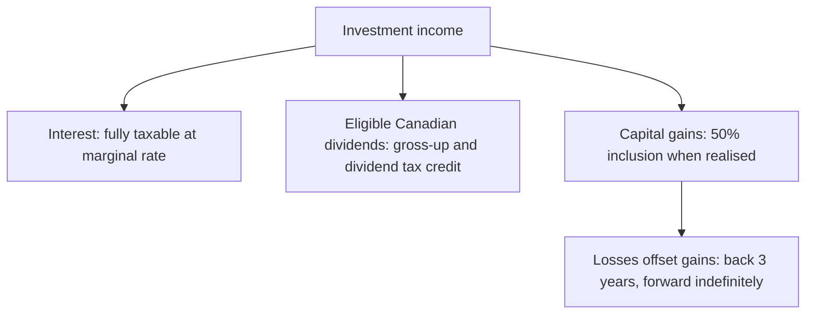

# Taxes on investments

**Prerequisites:** [Registered and non-registered accounts](02-registered-and-non-registered-accounts.md).

> **Education, not advice.** Tax rules and rates change and vary by province. Check the CRA website or a tax professional before acting.

*The Connaught Building in Ottawa, national headquarters of the Canada Revenue Agency. Credit: Jcart1534. License: [CC BY-SA 3.0](https://creativecommons.org/licenses/by-sa/3.0). Source: [File:Connaught Building NW Corner.jpg](https://commons.wikimedia.org/wiki/File:Connaught_Building_NW_Corner.jpg).*

In a non-registered account, what you keep depends on *how* the money is earned. Canada taxes different kinds of investment income differently. Understanding the three main types, interest, dividends and capital gains, helps you choose investments and accounts sensibly.

## The three types of investment income

### 1. Interest

Interest from savings accounts, GICs and bonds is taxed as **ordinary income** at your full marginal rate, in the year it accrues or is received. It is the least tax-efficient kind of income outside a registered account.

### 2. Capital gains

A **capital gain** is the profit from selling an asset for more than its cost. In Canada, the **capital gains inclusion rate is 50%**: half the gain is added to your taxable income. (A proposed increase to two-thirds on gains above a threshold was announced in 2024 and then cancelled in March 2025.) Example: you sell shares for a gain of 10,000. With a 40% marginal tax rate, tax = 10,000 × 50% × 40% = **2,000**, an effective rate of 20%. By contrast, 10,000 of interest at the same marginal rate would cost **4,000**.

Capital gains are taxed only when **realised** (when you sell), so you control the timing: deferral has value. The **lifetime capital gains exemption** for qualified small business shares and farming and fishing property (1.25 million dollars) is a separate concept; your primary residence is generally exempt from capital gains tax under the **principal residence exemption**.

**Capital losses** offset capital gains: you apply them first against gains in the same year, then can carry them **back three years** or **forward indefinitely** against future gains. They cannot be used against other income.

### 3. Dividends

Canadian dividends from taxable Canadian corporations get special treatment to reduce the double taxation of corporate profits: the dividend is **grossed up** (for eligible dividends by 38%) and you claim a **dividend tax credit**. The result is that eligible Canadian dividends are taxed at a lower effective rate than interest, particularly for lower and middle incomes. The exact rate depends on income, province and whether the dividend is "eligible" or "non-eligible". Use a provincial tax calculator (for example, the CRA's or tax-software calculators) for the numbers. Foreign dividends receive no dividend tax credit and are taxed as ordinary income, often with foreign tax withheld at source.

### Ranking in a taxable account (at a given income level)

In rough order from most to least tax-efficient: **capital gains > eligible Canadian dividends > interest and foreign income**. The exact order depends on your bracket. This is one reason interest-heavy assets are often held in registered accounts, a point covered in asset location; see [registered and non-registered accounts](02-registered-and-non-registered-accounts.md).

## Adjusted cost base (ACB)

To compute a gain you need the **adjusted cost base**: what you paid, plus commissions, adjusted for reinvested distributions and return of capital. For identical shares bought at different prices, Canada uses **average cost**. Example: you buy 100 shares at 50 (5,000) and 100 at 60 (6,000): ACB = 11,000 for 200 shares, or 55 per share. Selling 100 shares at 70 gives a gain of (70 − 55) × 100 = 1,500. Your broker tracks ACB, but not always correctly, especially after transfers; keep your own records.

**Return of capital (ROC)** distributions, common in some funds and REITs, are not taxed immediately but reduce your ACB, resulting in a larger gain later.

## Reinvested distributions

Distributions from funds and ETFs are taxable in a non-registered account **even if reinvested** automatically. Reinvesting raises your ACB (so you don't pay tax twice). Not tracking this is a common mistake: see [pooled investing and mutual funds](../03-securities/03-funds/01-pooled-investing-and-mutual-funds.md).

## Tax slips and reporting

Investment income is reported on slips such as the **T5** (interest and dividends), **T3** (trust and fund distributions), and **T5008** (securities sold). Registered account contributions appear on RRSP receipts. Report capital gains on Schedule 3 of the tax return. Slips usually arrive by the end of February.

## Foreign investments

- **Withholding tax:** the US withholds 15% on dividends paid to Canadian residents under the treaty (30% without treaty relief). RRSPs, RRIFs and some other registered plans are exempt on directly held US stocks; TFSAs, FHSAs and RESPs are not. A claim for the foreign tax credit can recover tax paid in a non-registered account.
- **Currency:** gains and costs must be reported in Canadian dollars using the exchange rate on the transaction dates.
- **Foreign property reporting:** if your foreign property (outside registered accounts, and not held at a Canadian broker in a way that excludes it) exceeded **100,000 Canadian dollars** in cost at any time, you must file **form T1135**. Foreign securities held through Canadian brokers still count; check the rules.

## Strategies (education, not advice)

1. **Use registered accounts** (TFSA, RRSP, FHSA) first, as appropriate; see the previous lessons.
2. **Prefer low-turnover funds** (index ETFs) in taxable accounts, as they distribute fewer gains.
3. **Tax-loss harvesting:** selling a losing investment to realise a loss for offsetting gains. The **superficial loss rule** denies the loss if you (or an affiliated person, including a spouse, or your RRSP or TFSA) buy the same or an identical property within **30 days before or after** the sale and still hold it at the end of that period. Buying a similar but not identical fund is a common workaround, with care.
4. **Defer gains:** unrealised gains aren't taxed; holding long-term delays tax.
5. **Match gains and losses** in the same year where sensible.
6. **Donate appreciated securities** to registered charities: gains on publicly-listed securities donated in-kind are generally exempt from capital gains tax and you receive a donation receipt.
7. **Don't let tax drive the whole decision:** selling a good investment only to avoid tax, or holding a bad one, can cost more than the tax; see [prospect theory](../07-behavioural-finance/02-prospect-theory-and-loss-aversion.md) for the disposition effect.

## Tax on inheritance

Canada has no inheritance or estate tax, but at death a person is **deemed to have disposed** of their assets at fair market value, so capital gains (and registered account balances) are taxed on the **final return**, unless assets pass to a spouse on a tax-deferred basis. Probate fees in some provinces also apply.

## Key ideas

- Interest is fully taxable; capital gains are 50% included and only taxed when realised; eligible Canadian dividends get a credit.
- With a 40% marginal rate, 10,000 of interest costs 4,000 tax and 10,000 of capital gains costs 2,000.
- Track adjusted cost base; distributions are taxable even when reinvested; the superficial loss rule applies for 30 days.
- Foreign dividends bring withholding tax; high-value foreign holdings require T1135 reporting.

## Where this leads

- Next: [building a simple portfolio](07-building-a-simple-portfolio.md).
- Related: [registered and non-registered accounts](02-registered-and-non-registered-accounts.md), [dividends](../03-securities/01-stocks/03-dividends.md).
- Glossary: [capital gain](../glossary/personal-investing-canada/capital-gain.md), [inclusion rate](../glossary/personal-investing-canada/inclusion-rate.md), [adjusted cost base](../glossary/personal-investing-canada/adjusted-cost-base.md), [dividend tax credit](../glossary/personal-investing-canada/dividend-tax-credit.md), [superficial loss](../glossary/personal-investing-canada/superficial-loss.md), [T5 slip](../glossary/personal-investing-canada/t5.md), [tax-loss harvesting](../glossary/personal-investing-canada/tax-loss-harvesting.md), [T1135](../glossary/personal-investing-canada/t1135.md).
