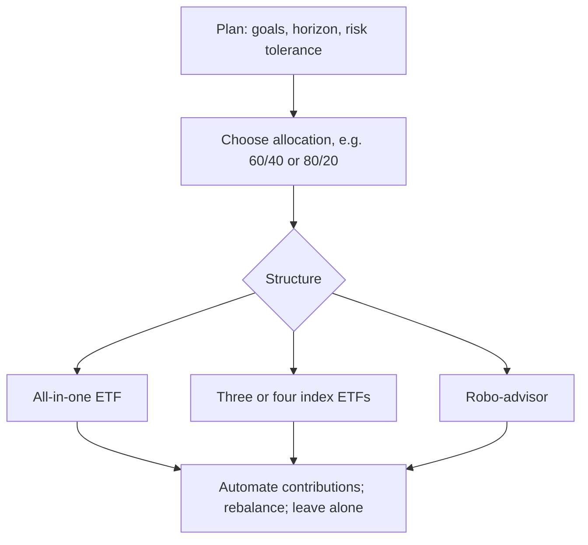

# Building a simple portfolio

**Prerequisites:** [Registered and non-registered accounts](02-registered-and-non-registered-accounts.md), [Asset allocation and rebalancing](../06-portfolio-theory/06-asset-allocation-and-rebalancing.md), [Index funds](../03-securities/03-funds/03-index-funds.md).

> **Education, not advice.** This lesson describes common, simple approaches. It is not a recommendation of any product or allocation. Check current fees and tax rules.

*The 'Lucky Loonie', a Canadian one-dollar coin, on display at the Hockey Hall of Fame, Toronto. Credit: Evan Delshaw. License: [CC BY 2.0](https://creativecommons.org/licenses/by/2.0). Source: [File:Lucky Loonie (20111391984).jpg](https://commons.wikimedia.org/wiki/File:Lucky_Loonie_(20111391984).jpg).*

The theory in this course points toward a modest set of ideas: diversify widely, keep costs low, choose an asset allocation you can hold, and rebalance with discipline. This lesson turns those ideas into concrete structures that fit Canadian accounts. The aim is to understand the options, not to prescribe one.

## Principles recap

1. **Diversify** across thousands of securities and across countries; see [correlation and diversification](../01-foundations/11-correlation-and-diversification.md).
2. **Keep costs low:** the MER and trading costs compound; see [fees and the cost of investing](../03-securities/03-funds/04-fees-and-the-cost-of-investing.md).
3. **Own the market, not forecasts:** the evidence for beating it consistently is thin; see [active versus passive](../06-portfolio-theory/05-active-versus-passive-investing.md).
4. **Match risk to horizon and temperament;** see [foundations before investing](01-foundations-before-investing.md).
5. **Automate and rebalance.**

## Three simple structures

### 1. The all-in-one asset allocation ETF

Several Canadian providers offer a single ETF that holds a global mix of stocks and bonds in a fixed proportion, rebalances automatically and charges one MER. Examples of the *type* (not recommendations) include products with names such as "growth", "balanced" and "all-equity" portfolios, sold by Vanguard, iShares, BMO and others. They typically mix a Canadian, US and international equity ETFs and a bond ETF in set ratios, for example 80% stocks / 20% bonds, or 100% stocks.

*Pros:* extremely simple, automatic rebalancing, broadly diversified, low cost. *Cons:* the mix is fixed, less control over asset location or tax (you hold the foreign stocks wherever the fund sits), and the MER, though low compared with mutual funds, is higher than the weighted cost of building it yourself.

### 2. The three- or four-fund portfolio

Combine broad-market ETFs yourself: Canadian equity, US equity, international (developed and sometimes emerging) equity, and a Canadian bond ETF. A simple version is 70% global equity and 30% bonds, split among the equity funds roughly in line with market weights (although many Canadian investors hold more Canada than its world share of about three percent; "home bias" is a choice).

*Pros:* more control over allocation, costs and tax location; *cons:* more decisions and rebalancing; the risk of tinkering.

### 3. Robo-advisor

An online service that builds and rebalances a portfolio of ETFs based on a questionnaire, for an annual fee on top of ETF costs, usually in the range of 0.25% to 0.7%. *Pros:* low effort, automatic rebalancing and sometimes tax-loss harvesting; *cons:* the added fee (see [costs, brokers and choosing a platform](08-costs-brokers-and-choosing-a-platform.md)).

### What about a simple portfolio of GICs and cash?

For short horizons or very low risk tolerance, cash and GICs have a role: see [GICs](../03-securities/02-bonds/10-inflation-linked-zero-coupon-and-gics.md). Their long-run real returns are lower than stocks, which has a cost of its own: see [inflation and real returns](../01-foundations/07-inflation-and-real-returns.md).

## Sample allocations (illustrative)

| Profile | Equity | Bonds | Typical use |
|---|---|---|---|
| Conservative | 30% | 70% | Short horizon or low risk tolerance |
| Balanced | 60% | 40% | Medium horizon |
| Growth | 80% | 20% | Long horizon, comfortable with large swings |
| All-equity | 100% | 0% | Very long horizon, high tolerance |

Larger equity shares have historically meant higher average returns and larger drops: an 80/20 portfolio can fall 30% or more in a major crash; see [the 2008 financial crisis](../08-history/11-the-2008-financial-crisis.md) and [the COVID crash and the rate shock](../08-history/12-covid-crash-and-the-rate-shock.md), where stocks and bonds fell together in 2022.

## Putting money in over time

- **Regular contributions:** contributing the same amount monthly, sometimes called dollar-cost averaging, reduces the risk of investing everything at a peak and builds discipline. For a lump sum, the evidence is that investing immediately has, on average, done better than spreading it out (because markets rise more often than they fall), but spreading can ease the regret of a poor start; this is a behavioural choice.
- **Example:** 500 a month for 25 years at 6% grows to roughly 346,000 (150,000 contributed). With a total cost of 0.2% higher (5.8%), it is roughly 336,000: a difference of about 10,000 for a 0.2% cost.
- **Rebalance** once a year or when the mix drifts by 5 percentage points, using new contributions first; see [asset allocation and rebalancing](../06-portfolio-theory/06-asset-allocation-and-rebalancing.md).

## Asset location, briefly

The tax treatment of accounts affects *where* to hold each fund (see [registered and non-registered accounts](02-registered-and-non-registered-accounts.md)):

- US-listed equity ETFs in an **RRSP** can avoid the 15% US withholding tax on dividends under the treaty; the same ETF in a TFSA does not.
- A Canadian-listed ETF that holds US stocks bears the withholding tax inside the fund, which cannot be recovered in any account.
- Bond interest is fully taxable in a taxable account and usually sits better in a registered account.
- Canadian dividend stocks held in a taxable account benefit from the dividend tax credit.
- Complexity has costs: a simpler arrangement that you can keep up usually beats an optimal one that you abandon.

## Behaviour: the biggest variable

The best portfolio is one you hold through downturns. A written plan, automatic contributions and limiting how often you look at balances help; see [overconfidence and other biases](../07-behavioural-finance/03-overconfidence-and-other-biases.md). Avoid constantly switching to last year's winners, and treat any "hot tip" with scepticism; see [scams and common mistakes](09-scams-and-common-mistakes.md).

## Checklist

1. Emergency fund and debt done (see [foundations before investing](01-foundations-before-investing.md)).
2. Choose **accounts** and available room.
3. Choose an **allocation** you can hold through a 30% to 40% fall.
4. Pick a **structure** (all-in-one, few funds, or robo-advisor).
5. Set up **automatic contributions**.
6. Compare **total costs** (MER, trading, fees).
7. **Rebalance** by rule; review annually.
8. Write the plan down.

## Key ideas

- A simple, diversified, low-cost portfolio is built from broad index ETFs, an allocation you can hold, and a rebalancing rule.
- Three common structures: an all-in-one asset allocation ETF, a three- or four-fund portfolio, or a robo-advisor.
- Asset location can reduce tax but keep it simple; automatic contributions and discipline matter more than fine-tuning.
- Sticking with the plan through crashes is the biggest determinant of results.

## Where this leads

- Next: [costs, brokers and choosing a platform](08-costs-brokers-and-choosing-a-platform.md).
- Related: [exchange-traded funds](../03-securities/03-funds/02-exchange-traded-funds.md), [measuring performance](../06-portfolio-theory/08-measuring-performance.md).
- Glossary: [[g:all-in-one-etf|all-in-one ETF]], [[g:three-fund-portfolio|three-fund portfolio]], [[g:robo-advisor|robo-advisor]], [[g:dollar-cost-averaging|dollar-cost averaging]], [[g:asset-allocation|asset allocation]], [[g:rebalancing|rebalancing]].
