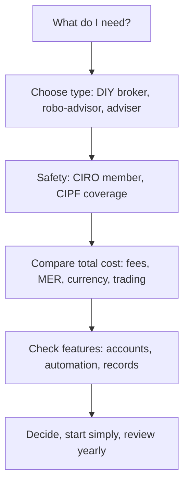

# Costs, brokers and choosing a platform

**Prerequisites:** [Brokers and dealers](../04-markets/03-brokers-and-dealers.md), [Fees and the cost of investing](../03-securities/03-funds/04-fees-and-the-cost-of-investing.md).

> **Education, not advice.** This lesson describes what to compare; it does not recommend any firm. Fees and features change often: check each firm's current fee schedule.

*The Toronto-Dominion Centre, a landmark of Toronto's financial district. Credit: TooMuchFrixion. License: [CC BY-SA 4.0](https://creativecommons.org/licenses/by-sa/4.0). Source: [File:Toronto-Dominion Centre.jpg](https://commons.wikimedia.org/wiki/File:Toronto-Dominion_Centre.jpg).*

Once you have decided what to hold and in which accounts, you need somewhere to hold them. Choosing a platform is partly about convenience and partly about costs, which compound just like returns do.

## Types of platforms

| Type | How it works | Typical cost | Suits |
|---|---|---|---|
| **Bank-owned brokerage** | Self-directed account at a big bank's brokerage arm | Trading commissions, sometimes fees on small accounts | Those who like integration with their bank |
| **Independent online broker** | Self-directed, often lower commissions | Low or zero commissions on ETFs; fees for some services | Cost-conscious DIY investors |
| **Robo-advisor** | Portfolio built and rebalanced for you | About 0.25% to 0.7% a year plus ETF costs | Those who want low effort |
| **Full-service adviser or wealth manager** | Advice, planning, portfolio management | Typically about 1% to 2% of assets | Those who need broader planning or behavioural coaching |
| **Mutual fund dealer / bank branch** | Advice, with funds sold through the branch | Embedded in fund MERs, often 2% or more | Many first-time investors, often at high cost |

In Canada, **order-execution-only** (OEO) accounts have no advice; you make the decisions. See [brokers and dealers](../04-markets/03-brokers-and-dealers.md).

## The costs to compare

1. **Trading commissions:** per-trade fees; several Canadian brokers now offer zero-commission ETF purchases, though not always for sales or for stocks.
2. **Account fees:** annual or quarterly fees for some registered accounts, inactivity fees, minimum balances, fees to transfer out (often 100 to 150 dollars per account); check whether a new broker will reimburse transfer fees.
3. **MER and TER of the funds** you hold, usually the largest long-term cost: see [fees](../03-securities/03-funds/04-fees-and-the-cost-of-investing.md).
4. **Currency conversion:** brokers typically charge a spread of 1% to 2% or more on converting Canadian to US dollars. Example: converting 10,000 Canadian dollars to US dollars at a 1.5% spread costs about 150; converting back later costs another 150, a total of about 300 (3% round trip). Ways to reduce: hold USD in a USD account, use Norbert's Gambit (buying and selling a dual-listed ETF to convert currency, which can cost far less on large sums but requires care with commissions and timing), or buy Canadian-dollar-listed funds that hold foreign assets (whose cost is built into the MER).
5. **Bid-ask spreads:** the hidden cost of trading; see [bid, ask and market makers](../04-markets/05-bid-ask-and-market-makers.md).
6. **Advice and management fees,** and tax costs.
7. **Margin interest and short fees,** if used.

Do the arithmetic for your situation: with 100,000 invested and 12 trades a year, 10 dollars a trade costs 120, 0.12%. A 1% advisory fee costs 1,000 a year. Over decades, a 1% fee compounds into a far larger sum than commissions.

## Safety and regulation

- **CIRO membership and CIPF coverage:** check that the firm is a member of CIRO and that CIPF coverage applies, so client assets are protected if the firm becomes insolvent; see [CIRO and investor protection](../05-regulation/04-ciro-and-investor-protection.md). Look the firm up with the CSA's National Registration Search.
- **Segregation:** client assets should be held separately from the firm's.
- **Cybersecurity:** use strong unique passwords, two-factor authentication, and beware of phishing.
- **Not covered:** CIPF does not cover market losses; and crypto platforms are not covered the same way: see [cryptoassets](../03-securities/05-alternatives/04-cryptoassets.md).

## Features that matter

1. **Account types offered:** TFSA, RRSP, FHSA, RESP, margin, and for couples, spousal RRSP.
2. **Investment choices:** ETFs, stocks, mutual funds, GICs, US-dollar accounts, fractional shares.
3. **Automation:** automatic contributions, dividend reinvestment (DRIP), automatic rebalancing.
4. **Tools and records:** clear statements, tax slips, accurate adjusted cost base tracking; see [taxes on investments](06-taxes-on-investments.md).
5. **Transfers:** in-kind transfers accepted and reimbursed.
6. **Customer service and reliability.**
7. **Interface and temptation:** an app designed to encourage frequent trading may hurt you.

## How "free" trading is paid for

Zero-commission firms still need revenue: interest on client cash, currency conversion, fees on certain products, securities lending and subscriptions; see [brokers and dealers](../04-markets/03-brokers-and-dealers.md). Ask: how does this firm make money from me?

## Switching

Moving accounts is straightforward but needs care:

1. Open the new account of the **same type** (a TFSA to a TFSA).
2. Ask the new firm to initiate a **transfer in kind**, so holdings move without being sold and no tax is triggered.
3. **Do not withdraw** from a registered account to deposit elsewhere, which triggers tax or loses room.
4. Check currency holdings and fees.
5. Keep records of the ACB if you hold taxable assets.

## Choosing: a short framework

1. **What do you need?** Advice, or just execution? A planner for complex situations? Or just a place to buy ETFs?
2. **Compare total costs for your size:** account fees, trading costs, fund costs, currency conversion.
3. **Confirm safety:** CIRO and CIPF.
4. **Check features** you will actually use.
5. **Look for conflicts of interest,** such as proprietary funds with high fees.
6. **Start simple;** you can switch later.

A cheap platform for a self-directed investor can save thousands of dollars over a lifetime, while a good adviser may be worth the fee for planning and behaviour: value depends on what you are buying. If you pay for advice, make sure it is advice (planning, taxes, behaviour), not a sales channel for high-fee products.

## Key ideas

- Platform types range from DIY brokers to robo-advisors to full-service advisers; costs differ widely.
- Compare account fees, trading costs, fund MERs, currency conversion and advice fees; MER and advisory fees usually dominate.
- Check CIRO membership and CIPF coverage, and use an in-kind transfer when switching.
- "Free" trading is funded elsewhere; ask how the firm earns money from you.

## Where this leads

- Next: [scams and common mistakes](09-scams-and-common-mistakes.md).
- Related: [brokers and dealers](../04-markets/03-brokers-and-dealers.md), [building a simple portfolio](07-building-a-simple-portfolio.md).
- Glossary: [order-execution-only](../glossary/markets/order-execution-only.md), [in-kind transfer](../glossary/personal-investing-canada/in-kind-transfer.md), [currency conversion spread](../glossary/alternatives/fx-spread.md), [Norbert's Gambit](../glossary/personal-investing-canada/norberts-gambit.md), [DRIP](../glossary/stocks/drip.md), [robo-advisor](../glossary/personal-investing-canada/robo-advisor.md).
