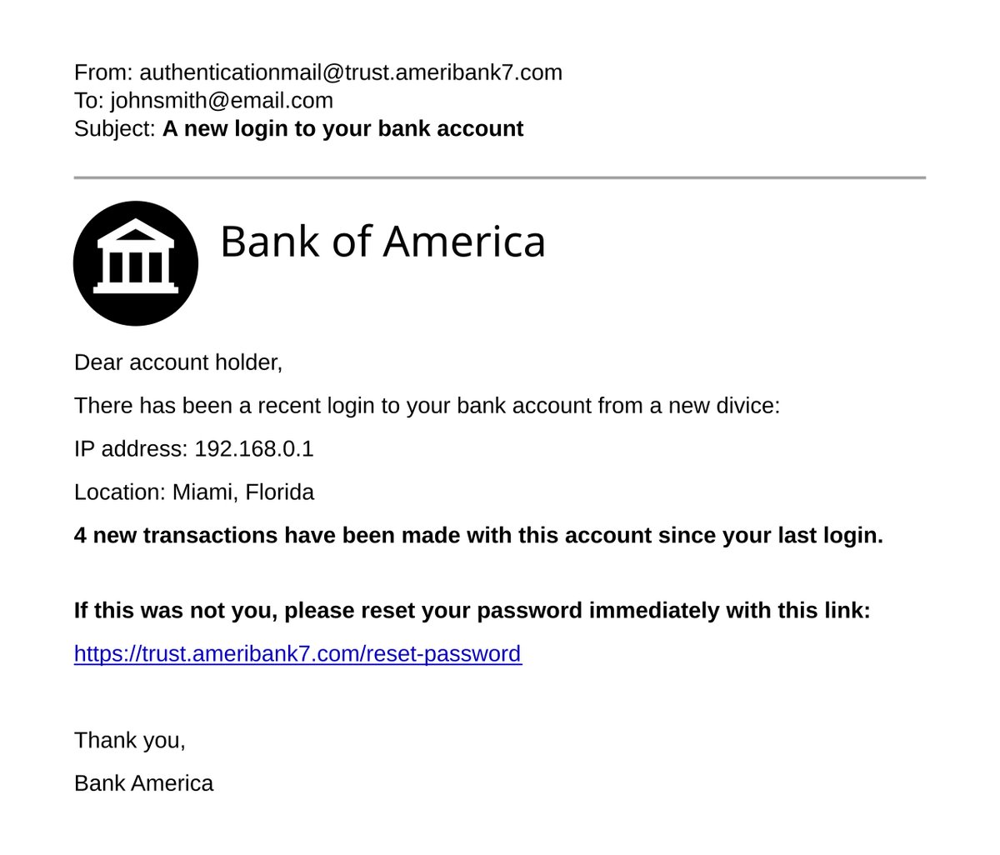
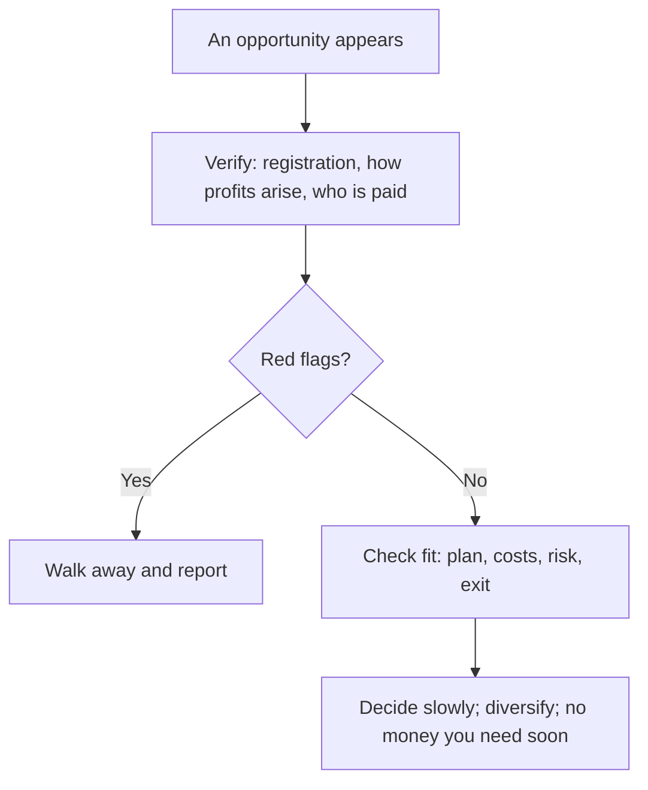

# Scams and common mistakes

**Prerequisites:** [Insider trading, disclosure and fraud](../05-regulation/05-insider-trading-disclosure-and-fraud.md), [Foundations before investing](01-foundations-before-investing.md).

> **Education, not advice.** If you think you have been targeted by fraud, contact your local police, the Canadian Anti-Fraud Centre, and your provincial securities regulator.

*An example of a phishing email imitating a bank. Credit: Original template by User:Isochrone, amended by User:Belbury. License: [CC BY 4.0](https://creativecommons.org/licenses/by/4.0). Source: [File:Example bank phishing email.svg](https://commons.wikimedia.org/wiki/File:Example_bank_phishing_email.svg).*

Most investors lose more money to avoidable mistakes and fees than to market crashes, and a smaller number lose everything to fraud. This final lesson collects the main scams and errors, with warning signs and defences.

## Part 1: Scams

### Common types

- **Ponzi and pyramid schemes:** promise steady, high returns paid from new investors' money; they collapse when recruiting stalls. See [insider trading, disclosure and fraud](../05-regulation/05-insider-trading-disclosure-and-fraud.md).
- **Investment and crypto "pig-butchering" scams:** a stranger builds a relationship online or by text, then steers you to a fake trading platform showing fabricated profits; withdrawal is blocked unless you pay "taxes" or "fees".
- **Fake investment platforms and "trading bots":** professional-looking websites and apps that show growing balances, often promoted with celebrity deepfakes or fake news articles.
- **Pump-and-dump:** coordinated promotion of a thinly traded stock via social media, messaging groups or spam, then selling to followers.
- **Affinity fraud:** exploiting trust within a community, religious group or workplace.
- **Romance, impersonation and "recovery" scams:** fraudsters posing as regulators, bank staff or the police; "recovery" firms that charge fees to get lost money back, usually a second scam.
- **Advance-fee and "guaranteed return" products:** unregistered, exotic or offshore products; high-pressure "limited-time" offers.
- **Phishing and account takeover:** fake emails and texts pretending to be your broker or CRA, to steal your login.
- **Unregistered advisers and "finfluencers":** people giving tailored advice without registration, often paid to promote products.

### Red flags

1. **Guaranteed or unusually high returns,** or returns that are very smooth.
2. **Pressure to act now,** or secrecy.
3. **Unsolicited contact** by phone, text, social media or a dating app.
4. **Unregistered sellers.** Check at the CSA's National Registration Search (aretheyregistered.ca).
5. **Can't explain** how the profits are made.
6. **Difficulty withdrawing** or demands for more money to release funds.
7. **Payment by crypto, gift cards or wire** to individuals.
8. **Complex or "exclusive" strategies.**

Rule of thumb: high return implies high risk; if someone offers high return with no risk, it is a lie. Example arithmetic: an investment claiming 2% a month compounds to (1.02)^12 − 1 ≈ 26.8% a year, with no volatility: a pattern of returns that no legitimate strategy promises with certainty. Madoff's reported returns were similarly smooth.

### Defences

- **Verify registration** of the person and firm; call the regulator using a number you look up yourself.
- **Never** send money to people you only know online.
- **Use only well-known, regulated platforms;** check the URL; use two-factor authentication.
- **Take time:** a real opportunity will survive a night's sleep and a second opinion.
- **Be sceptical of social media tips,** and of paid promotion.
- **Report** suspected fraud quickly: Canadian Anti-Fraud Centre, local police, and your provincial regulator. Recovery is difficult once money has left, particularly with crypto; see [cryptoassets](../03-securities/05-alternatives/04-cryptoassets.md).
- **Know what protects you** and what does not: CIPF and CDIC do not cover fraud losses from scams or market losses; see [CIRO and investor protection](../05-regulation/04-ciro-and-investor-protection.md).

## Part 2: Common mistakes (even without a fraudster)

1. **Paying high fees.** A 2% MER versus 0.2% can cost about 40% of final wealth over 25 years; see [fees and the cost of investing](../03-securities/03-funds/04-fees-and-the-cost-of-investing.md). Ask what you pay for advice and funds, in dollars.
2. **Trying to time the market,** selling in panics and buying in euphoria; see [prospect theory](../07-behavioural-finance/02-prospect-theory-and-loss-aversion.md) and [measuring performance](../06-portfolio-theory/08-measuring-performance.md) on investor returns versus fund returns.
3. **Concentration:** holding mostly your employer's stock, one sector, or one stock someone recommended; see [correlation and diversification](../01-foundations/11-correlation-and-diversification.md) and the Nortel and Enron examples.
4. **Chasing last year's winner** or the hot theme; see [herding, bubbles and manias](../07-behavioural-finance/04-herding-bubbles-and-manias.md).
5. **Ignoring risk tolerance:** holding a portfolio that you will sell in a crash.
6. **Using leverage** (margin, leveraged ETFs) without understanding it; see [short selling and margin](../04-markets/08-short-selling-and-margin.md).
7. **Investing money you need soon** in stocks; see [foundations before investing](01-foundations-before-investing.md).
8. **No emergency fund,** forcing sales at bad times, or withdrawals from an RRSP at a cost.
9. **Over-contributing to registered accounts:** a penalty of 1% a month on the excess. Example: 5,000 over the TFSA limit for 3 months costs 150; check room with CRA; see [the TFSA](03-the-tfsa.md).
10. **Mixing up account and investment:** a TFSA "savings account" earning little; see [registered and non-registered accounts](02-registered-and-non-registered-accounts.md).
11. **Tax mistakes:** forgetting taxable distributions, violating the superficial loss rule, missing T1135 or not tracking ACB; see [taxes on investments](06-taxes-on-investments.md).
12. **Ignoring inflation:** holding too much cash for decades; see [inflation and real returns](../01-foundations/07-inflation-and-real-returns.md).
13. **Neglecting beneficiaries and estate basics.**
14. **Complexity and products you don't understand,** including structured products, annuities with hidden costs, exotic funds. If you cannot explain how it works and how its seller is paid, wait.
15. **Day trading** and speculative trading: studies of retail traders find that most lose money; see [overconfidence and other biases](../07-behavioural-finance/03-overconfidence-and-other-biases.md).
16. **Failing to start,** or stopping contributions after bad years; the cost of waiting is large because of compounding; see [time value of money](../01-foundations/04-time-value-of-money.md).

## A short pre-investment test

Before you commit to any investment, ask:

1. What exactly am I buying, and how does it make money?
2. Who is selling it, are they registered, and how are they paid?
3. What can go wrong and how much could I lose?
4. What are all the costs?
5. How easily can I get my money out?
6. Does it fit my plan, horizon and risk tolerance?
7. Would I be comfortable explaining it to a skeptical friend?

If any answer is unclear, the correct decision is to wait.

## Closing note

A sound approach to investing is not exciting: spend less than you earn, avoid expensive debt, keep an emergency fund, use tax-advantaged accounts, hold diversified low-cost funds in a mix you can live with, rebalance, and avoid being fooled by others or by your own impulses. The rest of this course supplies the reasons behind each step.

## Key ideas

- Common scams: Ponzi schemes, fake platforms and pig-butchering, pump-and-dump, impersonation, unregistered advisers.
- Red flags: guaranteed or smooth high returns, pressure, unsolicited contact, no registration, difficulty withdrawing.
- Most investor losses come from avoidable mistakes: high fees, market timing, concentration, leverage and tax or account errors.
- Verify registration, take time, report fraud quickly, and use a simple pre-investment test.

## Where this leads

- Back to the course map: [Finance README](../README.md) and the [glossary](../glossary/README.md).
- Related: [securities regulation in Canada](../05-regulation/03-securities-regulation-in-canada.md), [behavioural finance](../07-behavioural-finance/README.md).
- Glossary: [[g:ponzi-scheme|Ponzi scheme]], [[g:pig-butchering|pig-butchering scam]], [[g:pump-and-dump|pump and dump]], [[g:phishing|phishing]], [[g:red-flag|red flag]], [[g:caf-centre|Canadian Anti-Fraud Centre]], [[g:finfluencer|finfluencer]].
