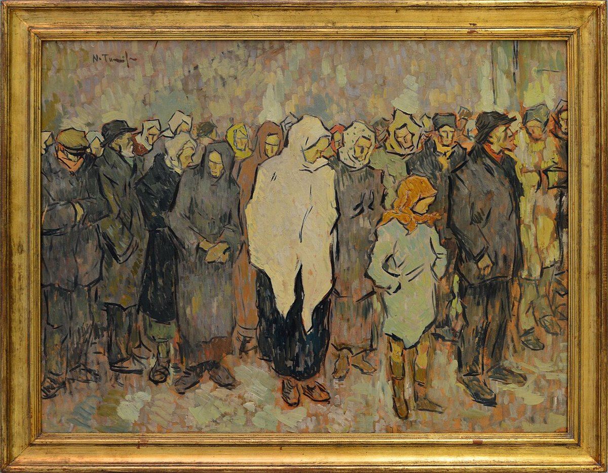
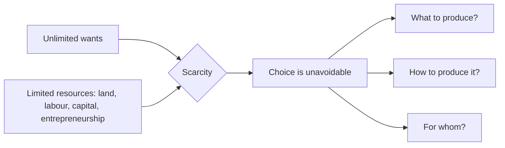

# Scarcity and the economic problem

**Prerequisites:** none. This is the first lesson of the microeconomics course.

*Bread Line by the Romanian painter Nicolae Tonitza: people queuing for a scarce staple. Credit: Joe Mabel. License: Public domain. Source: [File:Nicolae Tonitza - Bread Line - MNAR.jpg](https://commons.wikimedia.org/wiki/File:Nicolae_Tonitza_-_Bread_Line_-_MNAR.jpg).*

Every branch of economics begins with one plain observation: people want more than there is. There are only so many hours in a day, so many hectares of farmland, so many trained nurses, so many litres of fresh water in a reservoir. Human wants, by contrast, show no natural ceiling. Satisfy one and another appears. Economists call this gap **scarcity**, and the study of how people cope with it is what economics is.

## What scarcity is, and what it is not

Scarcity is not the same as rarity or poverty. A good is scarce whenever there is not enough of it to give everyone as much as they would like *at a price of zero*. By that test almost everything is scarce, including things that seem plentiful. Seawater is abundant, but desalinated drinking water delivered to a tap is scarce because it takes energy, pipes and labour to produce. Even a billionaire faces scarcity: they have only 24 hours a day and one life to spend them in.

A few things are genuinely not scarce in ordinary circumstances. Air to breathe at sea level is the textbook example. No one has to give anything up to take another breath, so no one bothers to price or ration it. Economists call such things **free goods**. The interesting cases are the others, the **economic goods**, where getting more of one thing means having less of something else.

## Resources: the inputs to everything

Goods and services are made from **resources**, also called **factors of production**. The classical economists grouped them into three, and modern textbooks often add a fourth:

- **Land**: all natural resources, including soil, minerals, forests, fish stocks and the radio spectrum.
- **Labour**: human time and effort, physical and mental.
- **Capital**: produced means of production, such as tools, machines, buildings and software. (In economics, "capital" means physical capital unless stated otherwise; money is a claim on resources, not a resource itself. See the finance lesson [money and value](../../finance/01-foundations/01-money-and-value.md).)
- **Entrepreneurship**: the organising, risk-taking activity that combines the other three into a product someone wants.

Each of these is limited at any moment. Even capital, which can be built, must be built out of today's land and labour, which then cannot be used for something else.

## The economic problem

Because resources are scarce, every society must answer three questions, whether it does so by markets, tradition, voting or command:

1. **What** to produce, and how much of each thing.
2. **How** to produce it: which combination of resources and techniques.
3. **For whom**: how the output is divided among people.

A family deciding whether to spend savings on a car or on tuition faces the same three questions in miniature. So does a hospital allocating operating-room time, or a country deciding how much of its budget goes to defence.

## Robbins' definition

The most widely quoted definition of the subject comes from the British economist Lionel Robbins, in *An Essay on the Nature and Significance of Economic Science* (1932). He described economics as the science that studies human behaviour as a relationship between ends and scarce means that have alternative uses. Each part matters. *Ends* are the goals people have. *Scarce means* are the resources. *Alternative uses* is the crucial bit: if a resource could be used for only one thing, there would be no choice to make. A plot of land can grow wheat or hold a house; an hour can be spent working or sleeping. That is what makes choice, and therefore economics, necessary.

Not every economist accepts Robbins' framing as complete. Some, following the classical tradition of Adam Smith, prefer to define economics by its subject matter: production, exchange, wealth and how they change over time. Others, in institutional and heterodox traditions, stress power, social provisioning and history. But nearly all agree that scarcity forces choices, and microeconomics is mostly about how those choices are made.

## Micro versus macro

**Microeconomics** studies the choices of individual decision-makers (households, firms, workers, governments acting in particular markets) and how they interact in markets for particular goods. **Macroeconomics** studies the economy as a whole: total output, unemployment, inflation and growth. The two connect, because the whole economy is made of individual choices, but they ask different questions. This course is about the first. The finance course applies the same logic to claims on future money.

## A worked illustration

Suppose a student has 10 free hours this week. Each hour can go to studying for an exam or to a part-time job paying 20 dollars an hour. If she studies all 10 hours, she earns nothing. If she works all 10, she earns 200 dollars but walks into the exam unprepared. Any split, say 6 hours studying and 4 working (80 dollars), is a choice that gives up something. There is no way to have both 10 hours of study and 200 dollars. That is scarcity in its simplest form, and the next lessons will turn it into tools: [trade-offs](02-choice-and-trade-offs.md), [opportunity cost](03-opportunity-cost.md) and the [production possibilities frontier](09-production-possibilities-frontier.md).

## Key ideas

- Scarcity means wants exceed what limited resources can provide at a zero price; almost everything is scarce.
- Resources (factors of production) are land, labour, capital and entrepreneurship.
- Every society must decide what to produce, how, and for whom.
- Robbins defined economics as the study of choices about scarce means with alternative uses; other traditions define it by subject matter.
- Microeconomics studies individual decisions and particular markets; macroeconomics studies the economy as a whole.

## Where this leads

- Next: [choice and trade-offs](02-choice-and-trade-offs.md).
- Related: [the production possibilities frontier](09-production-possibilities-frontier.md), which draws scarcity as a curve.
- Glossary: [[g:scarcity|scarcity]], [[g:factors-of-production|factors of production]], [[g:opportunity-cost|opportunity cost]].
