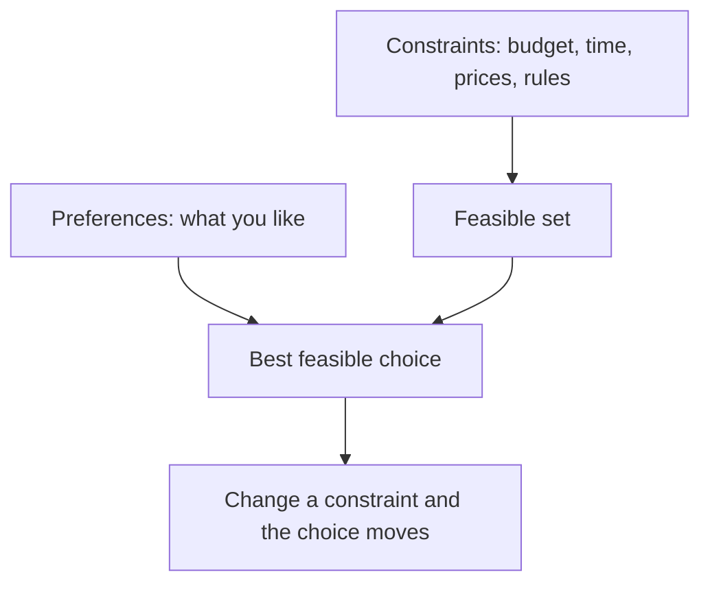

# Choice and trade-offs

**Prerequisites:** [Scarcity and the economic problem](01-scarcity.md).

*Hercules at the Crossroads by Annibale Carracci (c. 1596): the hero must choose between two paths, an old image of an unavoidable choice. Credit: Annibale Carracci. License: Public domain. Source: [File:Annibale Carracci, Hercules at the Crossroads, brighter.jpg](https://commons.wikimedia.org/wiki/File:Annibale_Carracci,_Hercules_at_the_Crossroads,_brighter.jpg).*

Scarcity has a direct consequence: you cannot have everything, so you must choose. Every choice to have more of one thing is a choice to have less of another. Economists call this a **trade-off**, and the habit of seeing trade-offs everywhere is the first skill the subject teaches.

## There is no such thing as a free lunch

The saying "there is no such thing as a free lunch" was popularised by Milton Friedman, who used it as a book title in 1975, though the phrase is older. Nineteenth-century American saloons offered a "free lunch" to customers who bought a drink. The lunch was not free: its cost was built into the price of the beer, and the customer paid for it with time spent in the saloon. The point generalises. Something offered at a zero price still uses resources that could have gone elsewhere, and someone bears that cost.

## Trade-offs at every level

**Individuals.** A worker chooses between leisure and income. A shopper chooses between a nicer jacket and a weekend away. A student chooses between a degree that takes four years and starting work now.

**Firms.** A bakery with one oven chooses between baking bread and baking cakes during the morning rush. A software company chooses which features its engineers build this quarter, knowing every feature delays another.

**Governments.** A provincial budget spent on hospitals is not spent on schools or roads, or must be paid for with higher taxes that reduce what households can buy. A familiar phrase for the national version is "guns versus butter": more military spending means fewer civilian goods.

**Society.** Many of the deepest trade-offs are between broad goals. Rules that make the economy more equal can reduce incentives to work or invest, and rules that encourage efficiency can widen inequality. A cleaner environment usually means higher production costs. Economists argue about how steep these trade-offs are in practice, and about which side of each is more important, but they agree the trade-offs exist. This course returns to the equity-efficiency trade-off in [[efficiency-versus-equity|efficiency versus equity]].

## Rational choice: the economist's working assumption

To predict how people choose, mainstream economics uses a simplifying assumption: decision-makers are **rational**. In this technical sense, rational does not mean wise, selfish or emotionless. It means people have consistent preferences and pick the option they like best among those available to them. If you prefer tea to coffee and coffee to juice, you should prefer tea to juice; and when tea is available at the same price, you should not pick juice.

This assumption is a modelling choice, not a claim that people never err. It works surprisingly well for many market questions, such as how buyers respond on average when the price of gasoline rises. It works less well in some settings, such as decisions far in the future or under heavy uncertainty, and [[the-rationality-assumption|behavioural economics]] later in the course looks at where and how it fails.

## Constraints and choice sets

Every choice happens inside **constraints**. The main ones are:

- **Budget**: how much money you have.
- **Time**: how many hours are available.
- **Prices**: what each option costs.
- **Technology and rules**: what is physically possible and legally allowed.

The options that satisfy all the constraints form the **choice set** or **feasible set**. The decision-maker picks the best point inside it. Much of microeconomics is the careful drawing of feasible sets and the study of how the best choice moves when a constraint changes, for example when a price falls or an income rises.

## A worked example

Maya has 60 dollars for the weekend. Movie tickets cost 15 dollars each and restaurant meals cost 20 dollars. Her feasible combinations that use the full budget include 4 movies and no meals (60), 0 movies and 3 meals (60), and 2 movies plus 1.5 meals, which is impossible because meals come whole. Real feasible options that spend at most 60 include: 4 movies; 2 movies and 1 meal (50); 1 movie and 2 meals (55); 3 meals. If she values variety, she might choose 1 movie and 2 meals and keep 5 dollars. The arithmetic shows the trade-off rate: each extra meal costs her 20/15 = 1.33 movies. That ratio of prices is the market's statement of the trade-off, and it will come back in [the budget constraint](../03-consumer-theory/05-budget-constraint.md).

## Choices at the margin

Real choices are rarely all-or-nothing. Maya is not choosing between "movies" and "meals" in the abstract; she is choosing whether to swap one movie for one meal. Economists call this thinking **at the margin**, and it turns out to be the key that unlocks most of the subject. It gets its own lesson: [marginal thinking](05-marginal-thinking.md).

## Key ideas

- Scarcity forces trade-offs: more of one thing means less of another.
- "No free lunch": goods offered at zero price still use resources.
- Trade-offs arise for individuals, firms, governments and whole societies.
- Economists model choice as rational: consistent preferences, best feasible option.
- Choices are made within constraints of budget, time, prices and rules.

## Where this leads

- Next: [opportunity cost](03-opportunity-cost.md), the precise measure of a trade-off.
- Later: [the budget constraint](../03-consumer-theory/05-budget-constraint.md) and [optimal choice](../03-consumer-theory/06-optimal-choice.md) formalise this lesson.
- Glossary: [[g:trade-off|trade-off]], [[g:rational-choice|rational choice]], [[g:budget-constraint|budget constraint]].
