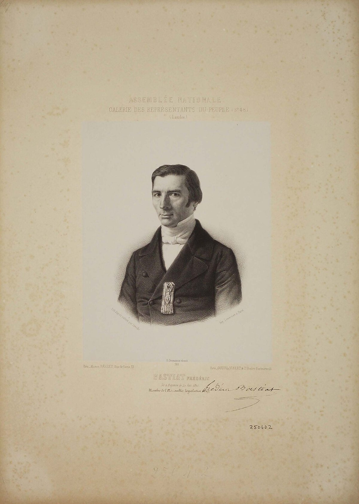
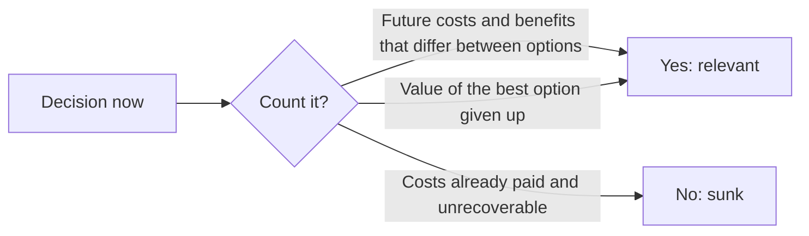

# Opportunity cost

**Prerequisites:** [Choice and trade-offs](02-choice-and-trade-offs.md).

*Frédéric Bastiat (1801–1850), whose essay "What Is Seen and What Is Not Seen" is an early statement of opportunity-cost reasoning. Credit: Émile Desmaisons. Lithograph by Auguste-Hilaire Léveillé. License: Public domain. Source: [File:Frédéric Bastiat galerie des représentants du peuple 1848.jpg](https://commons.wikimedia.org/wiki/File:Frédéric_Bastiat_galerie_des_représentants_du_peuple_1848.jpg).*

If every choice gives something up, the natural question is: how much? Economists answer with **opportunity cost**: the value of the best alternative you give up when you make a choice. It is the most important single idea in microeconomics, and it is often different from the price on the tag.

## The definition, carefully

The opportunity cost of an action is the value of the **next-best** alternative forgone. Not all the alternatives added together, just the best one you did not take. If you spend Saturday afternoon at a baseball game, and your alternatives were working a shift for 120 dollars, studying, or sleeping, the opportunity cost is whichever of those you would otherwise have chosen. If you would have worked, the cost of the game includes the 120 dollars you did not earn, on top of the ticket price.

The idea was named by the Austrian economist Friedrich von Wieser in the 1910s, but its spirit is older. The French writer Frédéric Bastiat's 1850 essay "What Is Seen and What Is Not Seen" argued that good economists look beyond the visible effects of an action to its unseen ones. His parable of the broken window is the classic example: a boy breaks a shop window, the glazier gets work, and onlookers conclude the breakage helped the economy. Bastiat points out what is not seen: the shopkeeper would have spent that money on something else, a new pair of shoes perhaps, and the shoemaker loses the sale. The window repair is not new wealth; it replaces wealth that was destroyed.

## Explicit and implicit costs

Opportunity cost combines two kinds of cost:

- **Explicit costs** involve a payment: tuition, rent, wages, materials.
- **Implicit costs** involve no payment but still represent a forgone alternative: the salary you give up while studying, the rent you could have charged on a building you use yourself, the interest your savings could have earned.

## Worked example: the cost of a university degree

Consider a four-year degree with these yearly numbers (illustrative, not official figures):

| Item | Per year | Four years |
|---|---|---|
| Tuition and fees | 8,000 | 32,000 |
| Books and supplies | 1,000 | 4,000 |
| Room and board | 12,000 | 48,000 |
| Earnings forgone (full-time job instead) | 35,000 | 140,000 |

What is the opportunity cost? Tuition and books are clearly costs of the degree. Room and board is trickier: you would have to eat and live somewhere even without the degree, so only the *extra* cost of living near campus counts. If housing would have cost the same either way, it drops out. The largest item is the one people forget: the 140,000 in earnings you could have had. Counting tuition, books and forgone earnings, the opportunity cost is about 32,000 + 4,000 + 140,000 = 176,000. That does not mean the degree is a bad choice; graduates on average earn more over their lifetimes. It means the right comparison is that lifetime gain against 176,000, not against 36,000 of fees. This is the logic of [[human-capital|human capital]].

## Sunk costs are not opportunity costs

A **sunk cost** is a cost already incurred that cannot be recovered whatever you do next. Because it cannot be changed, it should not affect a forward-looking decision. Suppose you paid 80 dollars for a non-refundable concert ticket, then fall ill on the night. Should you go because you "already paid"? The 80 dollars is gone either way. The only question is whether going, feeling ill, is better than staying home. People often do let sunk costs sway them, a pattern called the sunk-cost fallacy, which the behavioural lessons discuss under [[heuristics-and-biases|heuristics and biases]]. The finance course shows the same trap with investors who refuse to sell a losing stock until it gets "back to what I paid".

## Opportunity cost and price

Market prices often measure opportunity costs well, because the price of a resource reflects what other buyers would pay to use it. If a carpenter's time sells for 50 dollars an hour, then using an hour of that time to build your bookcase costs society 50 dollars of other carpentry. But prices and opportunity costs can diverge. A "free" public park still uses land that could hold housing. A gift card feels like free money but its opportunity cost is whatever else the cash value could have bought. And, as the [[externalities|externalities]] lessons show, when prices leave out costs imposed on third parties, the price of a good understates its true opportunity cost to society.

## Opportunity cost in production

Opportunity cost also applies to what an economy produces. If a farm can grow either 100 tonnes of wheat or 50 tonnes of barley on the same field, then each tonne of barley costs 2 tonnes of wheat. That ratio is what lies behind [comparative advantage](07-comparative-advantage.md) and the shape of the [production possibilities frontier](09-production-possibilities-frontier.md).

## Key ideas

- Opportunity cost is the value of the next-best alternative given up.
- It includes explicit (paid) and implicit (unpaid but forgone) costs.
- Sunk costs cannot be recovered and should not drive forward-looking choices.
- Bastiat's "seen and unseen" is an early statement of opportunity-cost reasoning.
- Prices often, but not always, measure opportunity cost.

## Where this leads

- Next: [incentives](04-incentives.md).
- Applied: [comparative advantage](07-comparative-advantage.md) rests entirely on opportunity cost.
- Related branch: [the time value of money](../../finance/01-foundations/04-time-value-of-money.md) treats forgone interest as an opportunity cost.
- Glossary: [[g:opportunity-cost|opportunity cost]], [[g:sunk-cost|sunk cost]], [[g:implicit-cost|implicit cost]].
